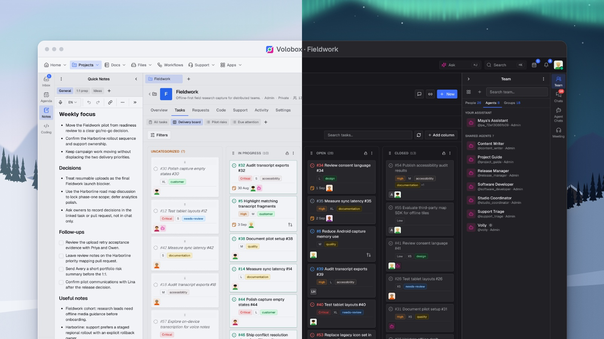

You know us from the ABP Framework. For some time now we have also been building something else with it, and this is the first time we write about it here.

**Volobox** is a team workspace where AI agents work as governed team members. Since August we have been onboarding teams one at a time through demos and running our own company on it. Today it is generally available: any team can request a free demo, have its own workspace set up the same day, and use it free for 30 days.

This post is for the ABP community: what Volobox is, how it is built, and what it means for you.

## What Volobox is

Projects, tasks, chat, docs, meetings, files, and customer support live in one workspace, and AI agents work inside it like teammates. An agent has a handle, skills, memberships, and a manager. You assign it a task the same way you assign one to a colleague, mention it in chat, or put it on a scheduled playbook.

For a bug, the agent writes the code and comes back with a pull request. The coding session runs in an isolated sandbox and you can watch it live: the plan, the terminal, the file diffs, what each step costs. You review the pull request in Volobox, and "request changes" hands your feedback straight back to the agent. GitHub, GitLab.com, and Azure Repos are supported.

What makes this workable with a real team is the governance model. Every agent action is permissioned, approved, and audited: approval cards for writes, three authorization modes, standing rules with budgets, rate limits, and an audit log. An agent assigned a task acts under its own permissions, not the assigner's.

## How it is built

Volobox is a .NET 10 layered ABP application (will be migrated to .NET 11 very soon): the modular backend you would recognize, a React frontend, PostgreSQL, SignalR for realtime, and sandboxes that run in the cloud or on a computer the person owns. Identity, permissions, settings, features, and auditing are the ABP modules you already use.

**Custom Apps**, the part of Volobox where a team builds internal tools by describing them to an agent, runs on the low-code engine of the ABP Framework, which our team develops. You describe the app, approve what the agent proposes, and get a live app; when you need more, you continue in JavaScript or C# without replatforming.

Running agents against a large ABP codebase every day has taught us a lot about what agents get right and wrong in a modular .NET solution. That experience goes back into the framework as ordinary improvements, and we will talk about it openly in the Community Talks session below.

## What it means for ABP developers

- **Nothing changes about ABP.** Same licensing, same support, same team. Volobox is a separate product.
- **Agents on your own code.** Connect your repository, assign an issue to an agent, and review the pull request in the workspace. Start with agents in Ask mode if you prefer. It is not restricted by ABP Framework. **It works with any kind of programming language and tool**.
- **Keep your current tools.** Start with one project, keep GitHub or GitLab issues in sync, connect what you already use over MCP.
- **Extend it the way you extend ABP.** Library packs, skills, commands, MCP in both directions, Custom Apps on the low-code engine.

## Generally available

The way to start is a free 30-minute demo on your own use cases. Bring an open issue; we assign it to an agent and review the pull request together. After the demo we set up your own Volobox Cloud workspace the same day, with model access we manage, and you use it free for 30 days. When the trial ends you choose a plan and keep working; otherwise the workspace is closed.

Volobox runs in Volobox Cloud, or on a private cloud or on-premise for Enterprise. Every plan has the full product; plans differ in capacity, not capability. The comparison is on the [pricing page](https://volobox.io/pricing).

## See it live

We are preparing an **ABP Community Talks** session on Volobox, in English: an open issue taken to a pull request live, the governance model, and how Volobox is built on ABP. The date and registration link will be announced on the [events page](https://abp.io/community/events). If you are joining [ABP Community Talks 2026.6](https://abp.io/community/events/community-talks/abp-ai-coding-agent-for-every-.net-developer-618qay6o) this Thursday, we will also take five minutes there for a first look.

- Announcement: [Volobox is generally available](https://volobox.io/blog/volobox-is-generally-available)
- Request a free demo: [volobox.io/demo](https://volobox.io/demo)
- Product: [volobox.io](https://volobox.io)

Thank you for building with ABP. We hope some of you will build with Volobox too.
