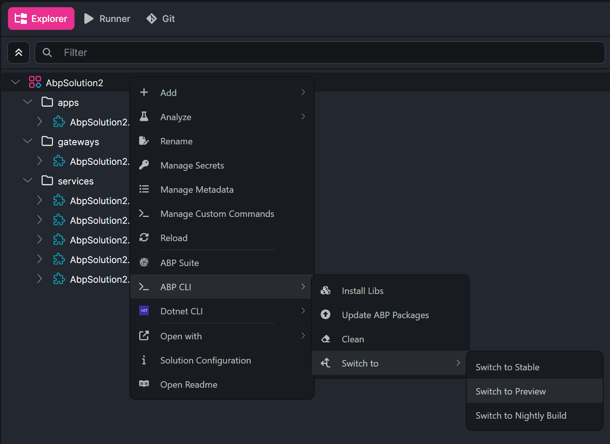
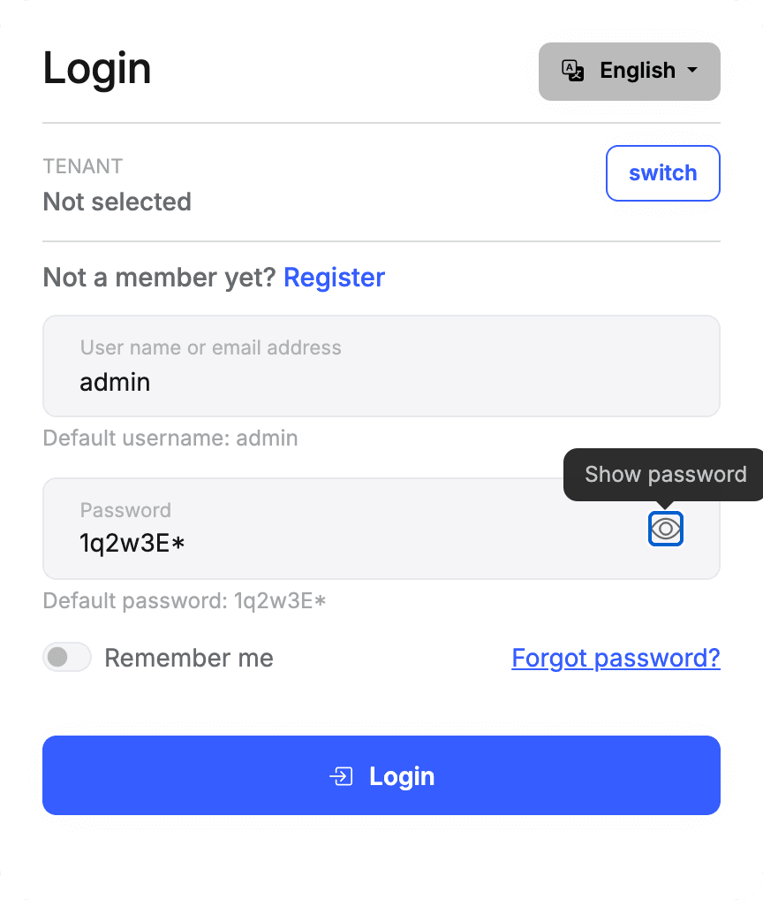

# ABP Platform 11.0 RC Has Been Released

We are happy to release [ABP](https://abp.io) version **11.0 RC** (Release Candidate). This blog post introduces the new features and important changes in this version.

Try this version and provide feedback to help us deliver a more stable ABP v11.0 release. Thanks in advance!

## Get Started with the 11.0 RC

You can check the [Get Started page](https://abp.io/get-started) to see how to get started with ABP. You can either download [ABP Studio](https://abp.io/get-started#abp-studio-tab) (**recommended**, if you prefer a user-friendly GUI application - desktop application) or use the [ABP CLI](https://abp.io/docs/latest/cli).

By default, ABP Studio uses stable versions to create solutions. Therefore, if you want to create a solution with a preview version, first you need to create a solution and then switch your solution to the preview version from the ABP Studio UI:



## Migration Guide

This version has breaking changes that can affect an existing solution. Read the [ABP Version 11.0 Migration Guide](https://abp.io/docs/11.0/release-info/migration-guides/abp-11-0) before upgrading from v10.x. It covers the move to .NET 11, the MySQL and Oracle EF Core providers, the removed Polly reference, the Docs module PDF and Elasticsearch clients, the MVC UI library replacements, batch permission updates, C# client proxy generation, and the Blogging module's image library.

## What's New with ABP v11.0?

In this section, I will introduce some major features released in this version.
Here is a brief list of titles explained in the next sections:

- Upgraded to .NET 11
- Query Projection for Read-Only Application Services
- FluentValidation Rules in the API Definition
- MVC UI Library Replacements
- Docs Module PDF and Full-Text Search
- C# Client Proxies
- Commercial Module Updates
- Dependency Updates
- Other Improvements and Enhancements

### Upgraded to .NET 11

ABP v11.0 targets .NET 11. Move your solution to .NET 11 if you want to use this version. ABP 11.0.0-rc.1 references the .NET 11 RC 3 packages (`11.0.0-rc.3`). .NET 11, a Standard Term Support release, was released on November 10, 2026, and we are moving ABP to the stable .NET 11 SDK and packages for the next RC. See the [known issues](#known-issues) below if you use the .NET 11 SDK 11.0.100 with ABP 11.0.0-rc.1.

The Blazor startup templates use the new `BasePath` component. ABP preserves the .NET 10 rounding behavior when `float` or `double` extra-property values are read as `decimal`.

The MySQL and Oracle EF Core provider versions referenced by ABP 11.0.0-rc.1 are not compatible with EF Core 11 RC 3. This includes Pomelo 9.0.0. Keep your existing working ABP and database provider versions before upgrading; see the migration guide for details. SQL Server and SQLite use the EF Core 11 RC 3 packages. The PostgreSQL integration uses `Npgsql.EntityFrameworkCore.PostgreSQL` 11.0.0-rc.1.1 together with EF Core 11 RC 3.

> See the [migration guide](https://abp.io/docs/11.0/release-info/migration-guides/abp-11-0) and [#26147](https://github.com/abpframework/abp/pull/26147).

### Query Projection for Read-Only Application Services

`GetAsync` and `GetListAsync` on the read-only application services load the entity and then map it to the DTO. You can now project that query to the DTO, so the database returns only the columns the DTO needs.

Implement `IQueryProjector<TEntity, TDto>`. ABP registers it by convention. Nothing changes when no projector is registered.

```csharp
public class BookProjector : IQueryProjector<Book, BookDto>
{
    public IQueryable<BookDto> ProjectTo(IQueryable<Book> source)
    {
        return source.Select(book => new BookDto
        {
            Id = book.Id,
            Name = book.Name
        });
    }
}
```

For example, with SQLite, `GetListAsync` runs the following query without a projector:

```sql
SELECT "b"."Id", "b"."ConcurrencyStamp", "b"."Description", "b"."ExtraProperties", "b"."Name", "b"."Price", "b"."PublishDate", "b"."Type"
FROM "Books" AS "b"
ORDER BY "b"."Id" DESC
LIMIT @p1 OFFSET @p
```

With the `BookProjector` above, it selects only the DTO columns:

```sql
SELECT "b"."Id", "b"."Name"
FROM "Books" AS "b"
ORDER BY "b"."Id" DESC
LIMIT @p1 OFFSET @p
```

Filters, sorting, and paging still run on the entity query before the projection. A projection has to return one row per entity. Override `CreateGetOutputDtoQueryOrNullAsync` or `CreateGetListOutputDtoQueryOrNullAsync` when the projection has to join another aggregate. Override `GetOutputDtoQueryProjector` or `GetListOutputDtoQueryProjector` and return `null` to keep the in-memory mapping for one application service.

> See the [application services](https://abp.io/docs/11.0/framework/architecture/domain-driven-design/application-services) document and [#26016](https://github.com/abpframework/abp/pull/26016).

### FluentValidation Rules in the API Definition

The API definition is built from data annotation attributes. A DTO that is validated only with FluentValidation had no constraints in that model, so the client proxy generators could not see them.

The new `Volo.Abp.Http.FluentValidation` package publishes FluentValidation rules on the API definition and merges them with the attribute rules. Mapped rules include `NotNull` / `NotEmpty`, length, `Matches`, numeric bounds, and between. Conditional rules, non-default rule sets, `RuleForEach`, and comparisons against another property are not published, because they do not apply to every instance of the DTO.

Add the package to the project that hosts the HTTP API:

```bash
abp add-package Volo.Abp.Http.FluentValidation
```

> See the [FluentValidation](https://abp.io/docs/11.0/framework/fundamentals/fluent-validation) document and [#26112](https://github.com/abpframework/abp/pull/26112).

### MVC UI Library Replacements

Several unmaintained MVC UI libraries are replaced or removed:

- Owl Carousel is replaced by Swiper (`@abp/swiper`, `SwiperScriptContributor`, and `SwiperStyleContributor`).
- The malihu custom scrollbar plugin is removed. The docs, feature management, and permission management pages use the browser scrollbar.
- `@abp/timeago` now depends on `timeago.js` 4.x instead of the `timeago` 1.x package.
- The unused `jquery-form` and `toastr` npm packages are no longer brought in by ABP packages. ABP toast notifications stay on ABP's own implementation.

Applications that call these libraries directly need a small follow-up. The steps are in the migration guide.

> See [#26005](https://github.com/abpframework/abp/pull/26005), [#26000](https://github.com/abpframework/abp/pull/26000), [#26001](https://github.com/abpframework/abp/pull/26001), and [#26002](https://github.com/abpframework/abp/pull/26002).

### Docs Module PDF and Full-Text Search

The Docs module no longer uses the AGPL-licensed iText packages to render PDF files. `PdfSharpHtmlToPdfRenderer` is the new `IHtmlToPdfRenderer`, based on HtmlRenderer.PdfSharp and PDFsharp. It uses the fonts installed on the server. Linux hosts need a font package such as `fonts-dejavu-core` or `fonts-liberation`, and Chinese, Japanese, and Korean documents need a TrueType font listed first in `HtmlStyle`.

Full-text search uses `Elastic.Clients.Elasticsearch` 8.x instead of the deprecated NEST 7 client. The new client works with Elasticsearch 8.x and 9.x. The index name, mapping, and stored documents are unchanged. Elasticsearch 7.x servers need to be upgraded, and custom `IElasticClientProvider` implementations need to use the new client types.

> See the [Docs module](https://abp.io/docs/11.0/modules/docs) document and [#26216](https://github.com/abpframework/abp/pull/26216).

### C# Client Proxies

The C# client proxy generator now generates only the contract types that are reachable from application service signatures. Types that the client project already references are not generated again. Nested, generic, and same-named types that appear in a signature are still generated.

Regenerate the proxies after upgrading. If your application compiled against a generated type that is not part of a service signature, reference that contract from its package instead.

> See [#26205](https://github.com/abpframework/abp/pull/26205).

### Commercial Module Updates

- **Localization:** Korean (`ko`) resources are added for the commercial modules.
- **Account:** Password fields have an accessible show/hide control.
- **CMS Kit Pro:** The Blazor page editor can publish a page and save it as a draft. This update is also available in v10.7.1.
- **AI Management:** MCP sessions reconnect after expiry and are recreated when the server configuration changes. Active sessions are disposed when the application shuts down. This update is also available in v10.7.1.
- **ABP Suite:** Generated test classes are `partial`, so additional tests can live in a separate file. This update is also available in v10.7.1.



### Dependency Updates

ABP v11.0 RC also includes these dependency changes:

- Polly is no longer referenced by the framework or by Language Management and Text Template Management. ABP retries with `Volo.Abp.Threading.RetryHelper`. Reference the `Polly` package yourself if your code uses it. ABP referenced Polly 8.6.3 up to v10.7.
- The Blogging module detects image formats with SkiaSharp and no longer references ImageSharp.
- The Angular packages are updated to Angular 22.1.

> Check the [Package Version Changes](https://abp.io/docs/11.0/package-version-changes) document for the full list.

### Other Improvements and Enhancements

- **Permissions:** `IPermissionManager` can update many permissions in one call. The permission management UI uses that overload, so a custom manager has to implement it. See [#26126](https://github.com/abpframework/abp/pull/26126).
- **Feature management:** MongoDB no longer raises an entity-updated event when the stored feature value is already the requested value.
- **Localization:** Portuguese (`pt`) resources are added for the Account module. See [#26115](https://github.com/abpframework/abp/pull/26115).

## Known Issues

The .NET 11 SDK 11.0.100 still has two issues that affect ABP 11.0.0-rc.1 applications. The next RC handles both of them. Until then, you can use these workarounds:

- A Blazor application fails on startup with `The static asset '...' is already mapped` ([dotnet/sdk#56891](https://github.com/dotnet/sdk/issues/56891)). Turn off static asset compression in the Blazor host project:

```xml
<PropertyGroup>
  <CompressionEnabled>false</CompressionEnabled>
</PropertyGroup>
```

- A Debug build fails with `The following scoped css bundles do not have matching endpoints` when a Web SDK project references a Web SDK class library project ([dotnet/sdk#56656](https://github.com/dotnet/sdk/issues/56656)). Add this property to the referenced class library project:

```xml
<PropertyGroup>
  <EnableHotReloadInRuntimeConfigDevFile>false</EnableHotReloadInRuntimeConfigDevFile>
</PropertyGroup>
```

## Community News

### New ABP Community Articles

As always, exciting articles have been contributed by the ABP community. I will highlight some of them here:

- [.NET 11 in Practice: FullJoin, Async Validation, Cache Metrics, Tracing Rules](https://abp.io/community/articles/net11-in-practice-fulljoin-async-validation-cache-tracing-57ve6uql) by [Ahmet Çelik](https://github.com/ahmetcelik05)
- [EF Core 11 Query Improvements: GroupBy, FullJoin, MaxBy, and MinBy](https://abp.io/community/articles/ef-core-11-query-improvements-groupby-fulljoin-maxby-and-minby-ldyi3n03) by [Zeynep Gizem Fırat](https://github.com/gizemfirat)
- [C# 15 Union Types and Closed Hierarchies in .NET 11](https://abp.io/community/articles/c-15-union-types-and-closed-hierarchies-in-.net-11-ixs91te3) by [Engincan Veske](https://github.com/EngincanV)

Thanks to the ABP Community for all the content they have published. You can also [post your ABP related (text or video) content](https://abp.io/community/posts/create) to the ABP Community.

## Conclusion

This version moves ABP to .NET 11 and includes new framework features together with dependency and UI library changes. You can see the [Road Map](https://abp.io/docs/11.0/release-info/road-map) documentation to learn about the release schedule and planned features for the next releases. Please try ABP v11.0 RC and provide feedback to help us release a more stable version.

For the complete list of changes, see the [ABP 11.0.0-rc.1 release notes](https://github.com/abpframework/abp/releases/tag/11.0.0-rc.1).

Thanks for being a part of this community!
