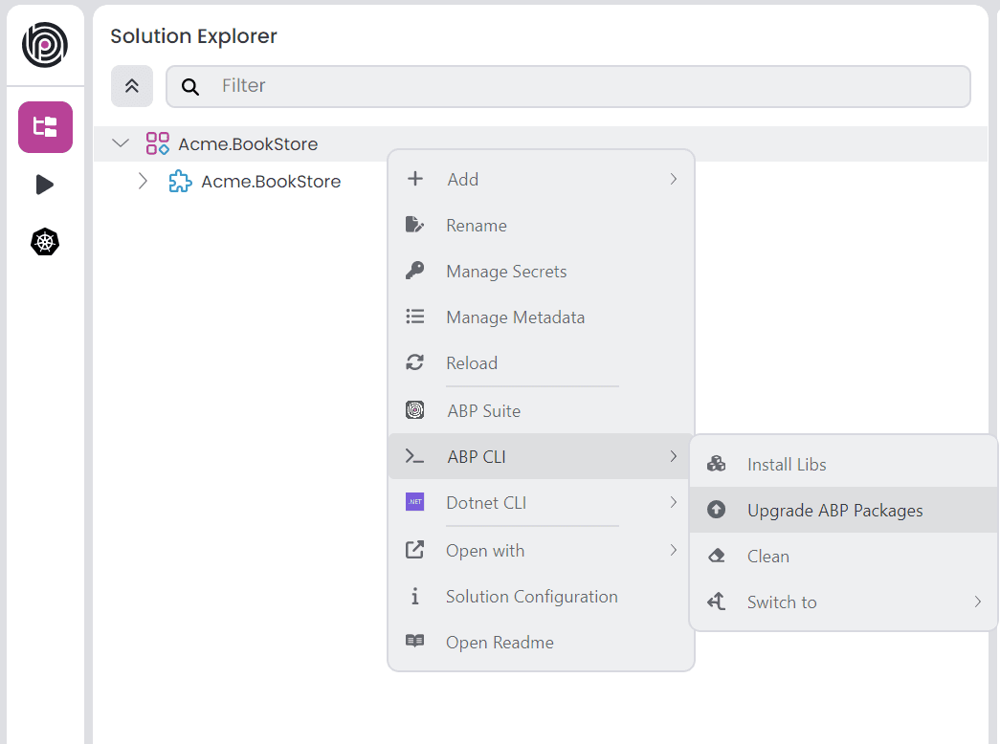

# ABP.IO Platform 11.0 Final Has Been Released!

We are glad to announce that [ABP](https://abp.io/) 11.0 stable version has been released based on [.NET 11.0](https://dotnet.microsoft.com/en-us/download/dotnet/11.0).

## What's New With Version 11.0?

All the new features were explained in detail in the [11.0 RC Announcement Post](https://abp.io/community/announcements/abp-platform-11.0-rc-has-been-released-a77t7jx8), so there is no need to review them all again. You can check it out for more details.

Here are some of the highlights of this version:

- **Upgraded to .NET 11 GA:** ABP v11.0 targets the stable .NET 11 SDK and packages (ASP.NET Core 11, EF Core 11, and MAUI 11), with Blazor startup templates adopting the `BasePath` component and updated Blazor WebAssembly host routing for .NET 11.
- **`IAsyncEnumerable<T>` support in async interceptors and C# client proxies:** Unit of work, auditing, and change tracking interceptors now run around each enumeration of `IAsyncEnumerable<T>` methods, and both dynamic and static C# client proxies can stream them.
- **Query projection for read-only application services:** Implement `IQueryProjector<TEntity, TDto>` so `GetAsync` and `GetListAsync` project queries at the database level and return only the columns required by the DTO.
- **FluentValidation rules in the API definition:** The new `Volo.Abp.Http.FluentValidation` package exposes FluentValidation constraints on the API definition alongside data annotations for client proxy generators.
- **Passkey authenticator display names:** Identity and Account Pro now store passkey AAGUIDs and infer authenticator display names (such as Windows Hello or Google Password Manager), configurable via `AbpIdentityPasskeyOptions.KnownAuthenticators`.
- **C# client proxy and localization performance improvements:** C# client proxy generation emits only contract types reachable from service signatures, static client proxy descriptions are deserialized on demand, and localization JSON dictionaries are built per requested culture.
- **Docs module modernization and library cleanup:** Docs PDF export replaces AGPL-licensed iText with `HtmlRenderer.PdfSharp` and `PDFsharp`, Docs full-text search upgrades from deprecated NEST 7 to `Elastic.Clients.Elasticsearch` 8.x, unmaintained MVC UI libraries (Owl Carousel, malihu custom scrollbar, `timeago` 1.x, `jquery-form`, and `toastr`) are replaced or removed, and `Polly` is replaced internally with `Volo.Abp.Threading.RetryHelper`.
- **Commercial module and localization updates:** Korean (`ko`) localization for commercial modules, Hebrew (`he`) localization for the framework and open-source modules, Portuguese (`pt`) Account localization, accessible password visibility toggles, CMS Kit Pro Blazor publish/draft actions, AI Management MCP session recovery, React Admin Console right-to-left (RTL) layout support, and `partial` ABP Suite generated test classes.
- **Dependency and security updates:** The final release also includes OpenIddict `7.9.0` (fixing authorization entry validation), `MongoDB.Driver` `3.14.0`, Angular `22.1`, `Devart.Data.Oracle.EFCore` `11.3.248.11`, and stability and security hardening fixes collected during the RC period.

## Getting Started with 11.0

### How to Upgrade an Existing Solution

You can upgrade your existing solutions with either ABP Studio or ABP CLI. In the following sections, both approaches are explained:

### Upgrading via ABP Studio

If you are already using the ABP Studio, you can upgrade it to the latest version. ABP Studio periodically checks for updates in the background, and when a new version of ABP Studio is available, you will be notified through a modal. Then, you can update it by confirming the opened modal. See [the documentation](https://abp.io/docs/latest/studio/installation#upgrading) for more info.

After upgrading the ABP Studio, then you can open your solution in the application, and simply click the **Upgrade ABP Packages** action button to instantly upgrade your solution:



> Please note that ABP CLI & ABP Studio only upgrade the related ABP packages, so you need to update your target framework to `net11.0` and upgrade non-ABP packages for .NET 11.0 manually.

### Upgrading via ABP CLI

Alternatively, you can upgrade your existing solution via ABP CLI. First, you need to install the ABP CLI or upgrade it to the latest version.

If you haven't installed it yet, you can run the following command:

```bash
dotnet tool install -g Volo.Abp.Studio.Cli
```

Or to update the existing CLI, you can run the following command:

```bash
dotnet tool update -g Volo.Abp.Studio.Cli
```

After installing/updating the ABP CLI, you can use the [`update` command](https://abp.io/docs/latest/CLI#update) to update all the ABP related NuGet and NPM packages in your solution as follows:

```bash
abp update
```

You can run this command in the root folder of your solution to update all ABP related packages.

> Please note that ABP CLI & ABP Studio only upgrade the related ABP packages, so you need to update your target framework to `net11.0` and upgrade non-ABP packages for .NET 11.0 manually.

## Migration Guides

This version includes breaking changes and migration-impacting updates that may affect existing applications. Key areas to review include upgrading to .NET 11, EF Core 11 database provider availability (PostgreSQL, MySQL, Pomelo, and Oracle), adding `Microsoft.EntityFrameworkCore.Design` for EF Core Tools, updating separate Blazor WebAssembly host projects, removed `Polly` and `SixLabors.ImageSharp` references, Docs module PDF (`HtmlRenderer.PdfSharp`) and Elasticsearch (`Elastic.Clients.Elasticsearch` 8.x) replacements, MVC UI library replacements, batch permission updates (`IPermissionManager`), C# client proxy generation and lazy loading, OpenIddict 7.9.0 / `Microsoft.IdentityModel.*` 8.23.0 alignment, Account Pro passkey and sign-in/extension grant constructor changes, Payment `float`-to-`decimal` conversions on .NET 11, and tightened permission checks on user invitations, language text restore, and QA organization membership.

Please read the migration guide carefully, if you are upgrading from v10.x or earlier versions: [ABP Version 11.0 Migration Guide](https://abp.io/docs/11.0/release-info/migration-guides/abp-11-0)

## Community News

### New ABP Community Articles

As always, exciting articles have been contributed by the ABP community. I will highlight some of them here:

- [QuickGrid in .NET 11: Sorting and Paging That Live in the URL](https://abp.io/community/articles/quickgrid-in-.net-11-sorting-and-paging-that-live-in-the-url-hypzmikw) by [Salih Özkara](https://abp.io/community/members/salih)
- [State Without a Circuit: TempData and Session in Blazor .NET 11 Static SSR](https://abp.io/community/articles/state-without-a-circuit-tempdata-and-session-in-blazor-.net-11-static-ssr-q8r6l6ug) by [Sümeyye Kurtuluş](https://abp.io/community/members/sumeyye.kurtulus)
- [System.Text.Json in .NET 11: Naming Policies, Union Types, and NDJSON Streaming](https://abp.io/community/articles/system.text.json-in-.net-11-naming-policies-union-types-and-ndjson-streaming-ul2reiuf) by [Okan Koca](https://abp.io/community/members/okankoca)
- [Vector and Hybrid Search with SQL Server in EF Core 11](https://abp.io/community/articles/vector-and-hybrid-search-with-sql-server-in-ef-core-11-8s06bcm7) by [Liming Ma](https://abp.io/community/members/maliming)
- [Blazor .NET 11: What's New in Virtualize, AnchorMode, and CSP Support](https://abp.io/community/articles/blazor-.net-11-whats-new-in-virtualize-anchormode-and-csp-support-hdpestha) by [Oğuzhan Ağır](https://abp.io/community/members/oguzhan.agir)

Thanks to the ABP Community for all the content they have published. You can also [post your ABP related (text or video) content](https://abp.io/community/posts/create) to the ABP Community.

## About the Next Version

The next feature version will be 11.1. You can follow the [release planning here](https://github.com/abpframework/abp/milestones). Please [submit an issue](https://github.com/abpframework/abp/issues/new) if you have any problems with this version.
