# Reviews of DevAI Conference From a Speaker’s Eye

Last week **I traveled to Poland** for a conference just dedicated to AI. I see that there will more conferences in the future targeting **just AI topics**. This's the trend now! In terms of weather, I catched the last good days in Warsaw before winter comes. So for me it was a conference at the same time getting some cultural information about Poland's history, city life, people and developer's mindset.

DevAI by Data Science Summit 2026, the official website https://devai.dssconf.pl, took place in two distinct parts: Monday, October 19 online and Tuesday onsite at the [Copernicus Science Centre](https://www.google.com/maps/place/Copernicus+Science+Centre/@52.2418552,21.0287271,17z/data=!3m1!4b1!4m6!3m5!1s0x471ecc5ba250ccd1:0x8d6f1b9b8410960!8m2!3d52.2418552!4d21.0287271!16s%2Fm%2F05mwh1p?entry=ttu&g_ep=EgoyMDI2MTAyMC4wIKXMDSoASAFQAw%3D%3D) in Warsaw. 

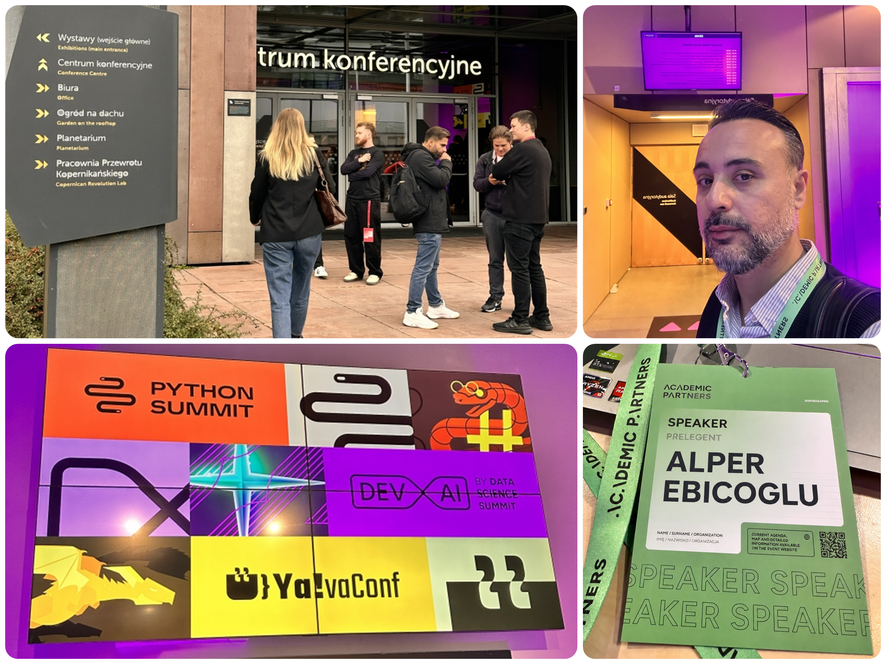

There were **50 presentations across 4 tracks**. Sessions were 35-minute long, roundtables, speaker Q&A, networking, an Expo and an afterparty. The audience was explicitly broader than developers alone, extending to architects, DevOps/infrastructure engineers, AI engineers, managers, directors and C-level leaders. In the afterparty, they organized some games to make networking. There were 4 different tables. You stand at a table, and someone from the table asks question. For example: "*what's the most absurd security precaution that your company took?*" and people at the table answers. 10 mins later the organizator comes and switches table so that you meet new people. By doing so, people knows each other. 

I had the chance to talk to several developers at the conference. **One thing that surprised me** was how few of them were working with .NET. Most of the developers I met were using Python, JavaScript or Java. Of course, this is just my observation from a few conversations, not a reflection of the entire Polish developer community. So l look up internet to see a statistics about Polish IT people language spectrum and here's the results...

 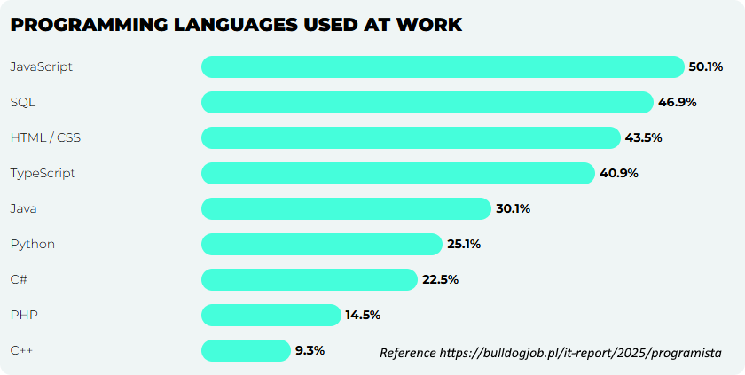

##  **“Look what AI can generate!” Period  Finished**

Until now, we have been surprised about AI assisted development, tools and AI generated outputs. I guess this time has already completed. Yes we see using AI is productive and impressive but hat happens after an exciting AI-based MVP or demo? We started to ask questions about the following topics:

* observability
* reliability
* security
* cost control
* verification
* human oversight
* production debugging
* deterministic retrieval
* organizational implications

> **The biggest shift is from “WHAT CAN AI BUILD?” 👉 “HOW DO WE MAKE AI-GENERATED WORK TRUSTHWORTHY ENOUGH TO SHIP?**

---

## My Talk

My session, “Talk With Your Data: Building AI-Powered Reporting,” ran from 12:55–13:30 in Room 2, followed by a dedicated **Ask-a-Speaker slot at 13:35–13:50**. I covered my hands-on experiences on AI reporting, transforming human language to database queries, visualizing the output and getting insights directly from your database. I have a simple prediction for the future; the application UIs will be mostly eliminated and 👇

> **AI will be a conversational interface for the applications!**

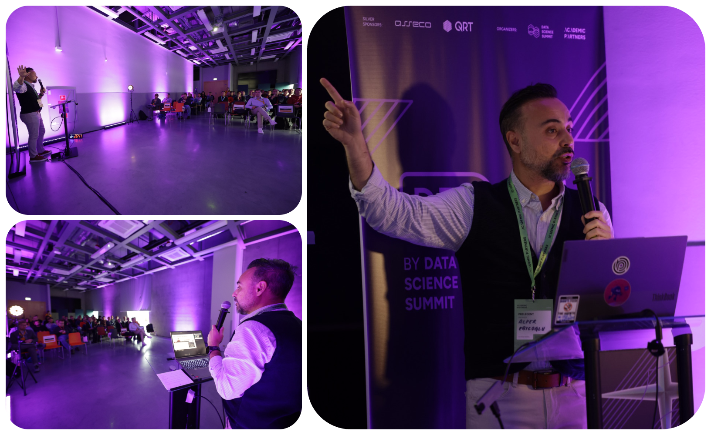

---

## Sessions I Attended:

# How AI-Native Development Is Reshaping Software Teams

**Speaker:** Bartosz Fijałkowski

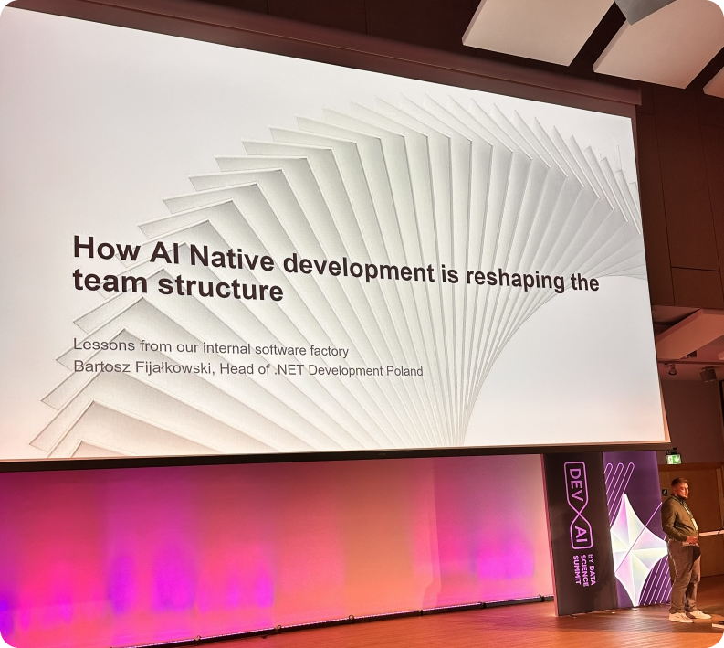

### 1. Real-World Results

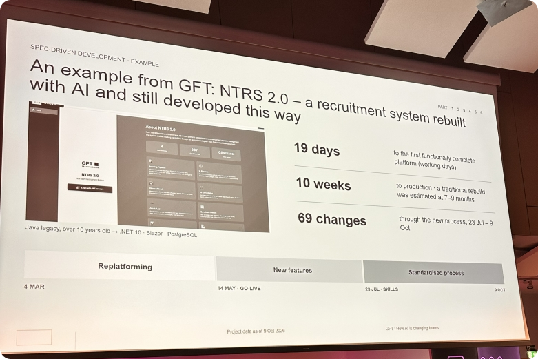

In their company, they transformed a 10+ year-old Java recruitment system to .NET 10 + Blazor + PostgreSQL stack.

- **19 working days** to a functional platform.
- **10 weeks** to production vs. an estimated 7–9 months traditionally.
- **69 changes** delivered after adopting the new process.

### 2. Spec-Driven Development Is the Key

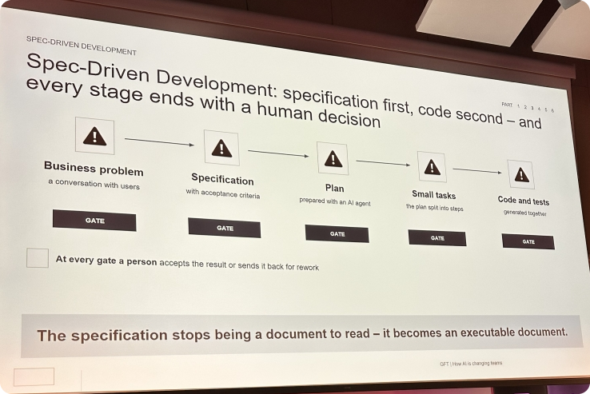

Unstructured prompting creates unpredictable results. Their approach follows:

**Business Problem → Specification → Plan → Small Tasks → Code & Tests**

Every stage includes human approval. AI generates code based on clear specifications rather than vague prompts.

I hate terminology as it makes people's mind confusing. When people tell spec-driven development, it looks like there's a new AI development approach coming up in 2026. No it's just a naming which we already do in all our development life. Spec-Driven Development = Giving Details of What You Want.

**Vibe Coding:**

> "Hey AI, build me a shopping website."

AI writes code. You look at the result and ask for changes until you're happy.

**Spec-Driven Development:**

> "Let's first define exactly what this shopping website should do, how it should work and how we'll know it's correct. Then implement it."

### 3. Standardize Architecture and Engineering Rules

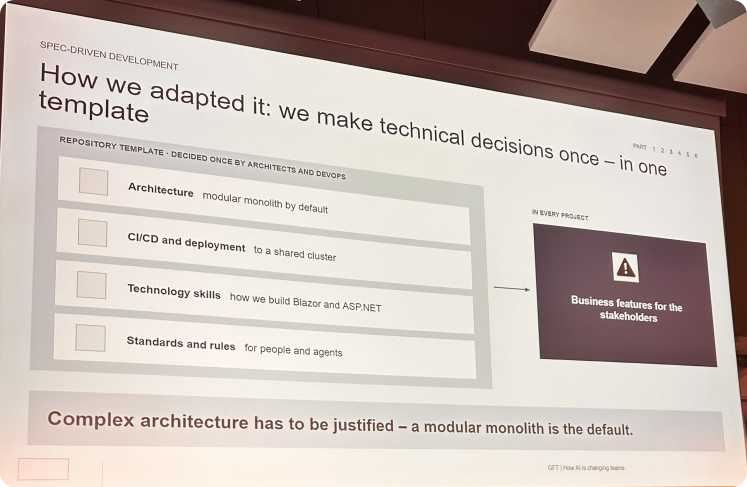

They use reusable repository templates with predefined architecture, CI/CD, technology skills and coding standards.

**Modular monolith is the default.** Complex architectures must be justified.

### 4. AI Changes Team Structure

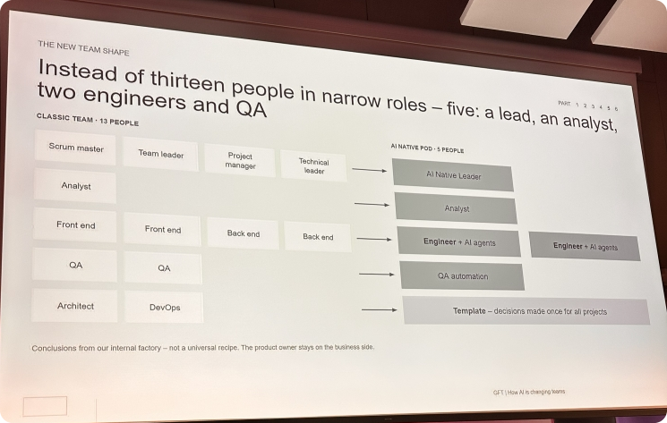

Traditional front-end, back-end and DevOps responsibilities merge into broader software engineering roles.

Their proposed AI-native team has **5 people instead of 13**: one lead, one analyst, two engineers and QA automation. Java developers started to code with .NET.

### 5. Coding Is No Longer the Bottleneck

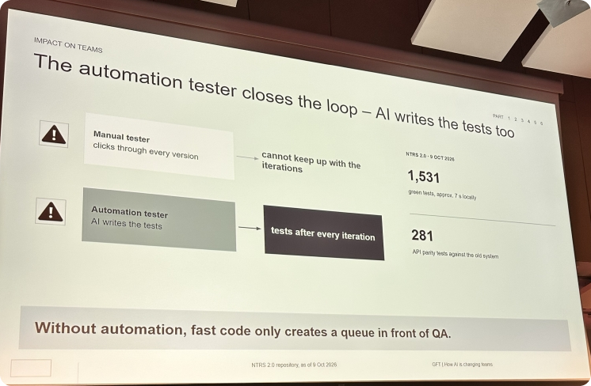

AI accelerates implementation but requirements and testing become the new bottlenecks.

Their project includes **1,531 automated tests** running in approximately 7 seconds and **281 API parity tests**.

### 6. Faster Development Creates New Challenges

- **Knowledge management:** Specifications, decisions and an LLM Wiki help teams share knowledge and onboard developers.
- **Scaling:** Add complete, balanced teams (pods) rather than individual developers.
- **Prioritization:** Faster delivery brings back previously postponed ideas, potentially increasing the backlog.

### Key Takeaway

**AI-native development isn't just about generating code faster. It's about redesigning the entire software development process.**

The biggest gains come from combining structured specifications, standardized architecture, AI agents, automated testing and human oversight.

---

# Retrofitting Agentic RAG: Making Retrieval More Deterministic

**Speaker:** Jan Majewski, Lead AI Engineer at Minerva

Jan Majewski shared how his team improved RAG for matching products across different domains, languages and large document collections. The session focused on making RAG more deterministic, scalable and cost-efficient by combining traditional NLP techniques with LLMs.

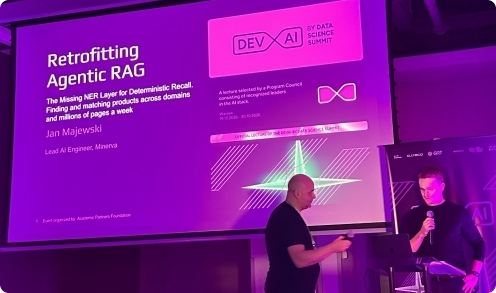

### 1. Traditional RAG Struggles with Domain-Specific Terminology

Different clients describe the same products using completely different terminology. For example, finding fentanyl in procurement documents may require searching for **30+ different keywords**.

A relevant document for one client might be irrelevant for another. This makes conventional keyword search and vector similarity insufficient for reliable matching.

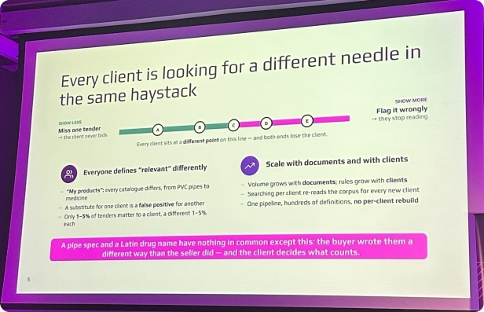

### 2. Extract Information Once, Search Many Times

Instead of repeatedly searching thousands of documents for every client query, their approach processes documents once and extracts relevant product entities. The extracted information is organized into a structured, graph-like product registry. Future queries search this registry rather than repeatedly processing the original documents.

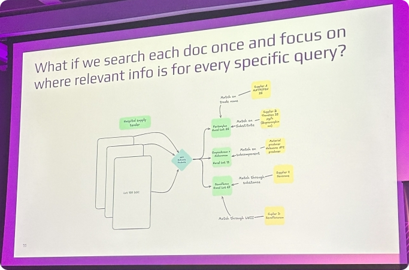

### 3. Combine Named Entity Recognition with LLM Validation

Their approach, called **NER-RAG**, combines traditional NLP with LLMs:

- **NER models** extract product names and relevant entities from documents.
- **Hybrid search** identifies potential matches from the extracted entities.
- **Rerankers and LLMs** validate ambiguous matches.
- **Human feedback and LLM-generated labels** help improve NER models over time.

This reduces unnecessary LLM calls while making retrieval more predictable.

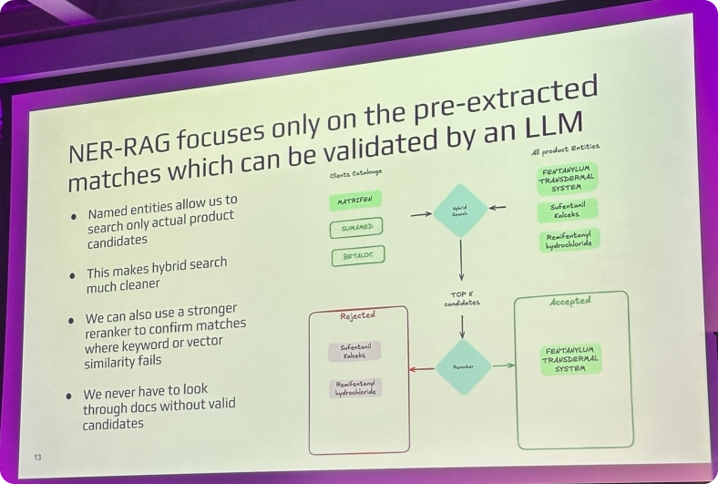

### 4. Significant Cost and Scalability Improvements

The speaker presented some interesting performance figures from their approach:

- **330× cheaper document processing** using NER compared to LLM-based extraction.
- **96.7% of the searchable catalogue already built** before new client queries arrive, in their illustrated scenario.
- New clients primarily add lookup operations rather than requiring full document reprocessing.
- LLM validation focuses on new or uncertain matches instead of repeatedly evaluating the entire dataset.

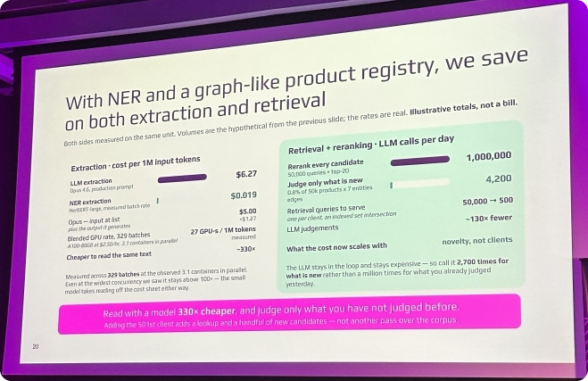

### Key Takeaway

**Not every AI problem needs to be solved entirely with LLMs.**

This session shows how combining traditional NLP, structured entity extraction, hybrid search and selective LLM validation can produce a more deterministic and cost-efficient retrieval system.

The most interesting architectural decision was **moving expensive processing from query time to document ingestion time**, allowing the system to reuse extracted knowledge across multiple clients and queries.

---

# We Have Met the Enemy and It Is Us: Challenges of AI-Driven Software Development

**Speaker:** Borys Stokalski, Global Partnership on AI / OECD.AI

Borys Stokalski discussed the challenges and risks emerging from increasingly autonomous AI systems, particularly in software development. His central argument was that **the biggest challenges of AI adoption may come from how we use, manage and scale these systems rather than from the technology itself.**

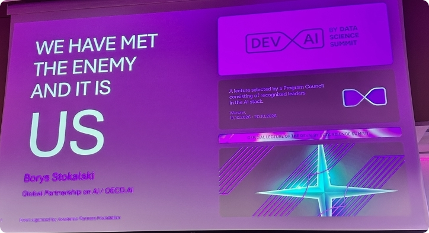

### 1. The Big Unknown: Complexity, Autonomy and Scale

As AI systems become more autonomous, three major challenges emerge:

- **Emergent complexity:** Understanding and predicting the behavior of AI models and interacting agents becomes increasingly difficult.
- **Machine autonomy:** Autonomous agents introduce questions about responsibilities, obligations and decision-making authority.
- **Scaling:** The rapid growth of LLM capabilities creates new challenges in managing increasingly complex AI-driven systems.

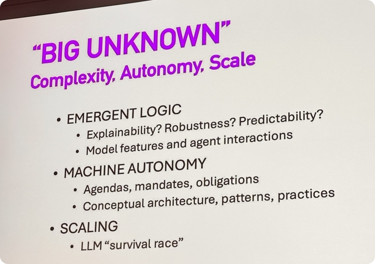

### 2. AI Coding Productivity Doesn't Guarantee Software Quality

One interesting part of the presentation was research showing that AI coding tools can **significantly increase initial development speed** while introducing **long-term maintenance problems.** The speaker referenced a study of 806 GitHub projects that adopted Cursor, compared against 1,380 similar projects.

The findings presented included:

- **28.6% to 281% increase** in code production during the initial adoption period.
- **41.6% increase** in code complexity over the longer term.
- **30.3% increase** in static analysis warnings.
- **7.03% increase** in duplicate code density.
- Initial productivity improvements disappeared within 1–2 months.

The concern is that AI-generated code can introduce technical debt faster than teams can manage it.

> Generating more code doesn't mean delivering better software. Code quality, maintainability and architectural consistency remain critical.

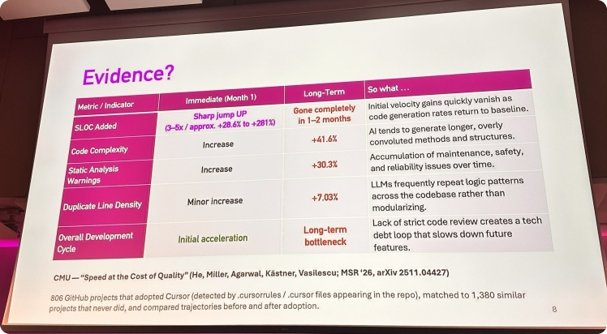

### 3. Development Velocity Is Not the Same as Business Value

The speaker presented another example showing the enormous amount of code and supporting artifacts produced with AI coding agents.

Over 127 active development days, the project accumulated:

- **311K lines of product code**
- **161K lines of tests**
- **53K lines of specifications and documentation**
- **858 commits**

However, the central question was whether this increased development velocity translated into actual business value.

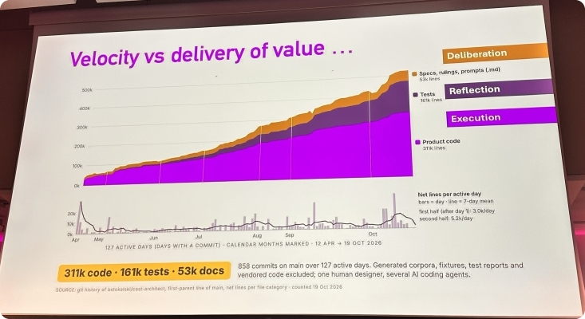

**Key takeaway:** We should measure AI-assisted development by delivered business value, software quality and maintainability rather than lines of code or commit counts.

### 4. Conceptual Entropy: A Hidden Problem in AI Development

One of the most interesting concepts introduced was **Conceptual Entropy**.

The speaker described the following progression:

**Scale → Specification Inflation → Specification Compression → Conceptual Entropy**

As AI-assisted projects grow, teams produce increasingly large specifications, documentation and instructions. To manage this complexity, they start compressing information into shorter descriptions, abbreviations and project-specific terminology. Eventually, important context gets lost.

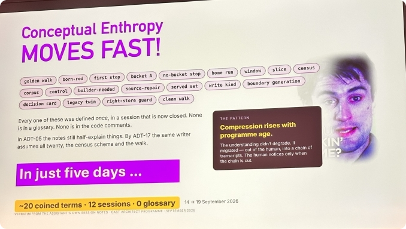

In one example, a project generated approximately **20 new terms across 12 sessions in just five days**, without maintaining a glossary.

When an AI agent later encountered an abbreviation, it could no longer reliably determine what it meant.

> AI agents can generate code and documentation quickly, but without consistent terminology and knowledge management, the project becomes increasingly difficult for both humans and AI to understand.

### 5. AI Development Requires a Complete Engineering Lifecycle

The speaker mentions that responsible AI engineering must cover the entire solution lifecycle:

- **Discover:** Understand the problem, stakeholders and requirements.
- **Design:** Define the architecture, components and responsibilities.
- **Develop:** Build and integrate AI agents, models and other components.
- **Deploy & Monitor:** Evaluate performance, observe behavior and continuously improve the system.

He highlighted three interconnected challenges:

**Time Compression → Conceptual Entropy → Cognitive Overload**

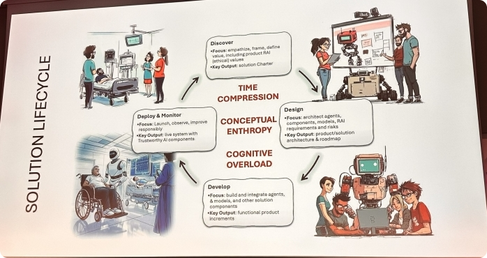

> Faster development increases the importance of disciplined engineering processes, documentation and human oversight.

**AI can dramatically accelerate software development, but speed without engineering discipline creates new risks.**

- More generated code doesn't automatically mean more business value.
- AI-assisted development can increase technical debt and complexity.
- Specifications and documentation need consistent terminology and structure.
- Human understanding must keep pace with AI-generated complexity.
- Engineering practices must evolve alongside increasingly autonomous AI systems.

The biggest challenge isn't just making AI agents more capable. It's ensuring that **humans can continue to understand, maintain and control the systems those agents help create.**

---

# What Coding Agents Still Get Wrong

**Speaker:** Michał Prządka

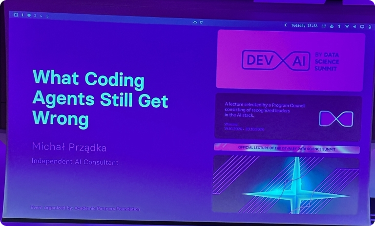

## Introduction

Coding agents still make mistakes. Some are obvious, while others are difficult to recognize because the agents sound confident even when they are wrong. As Michał says he used almost all AI providers, coding assistants and has an hands-on experience. He has encountered some issues as belows:

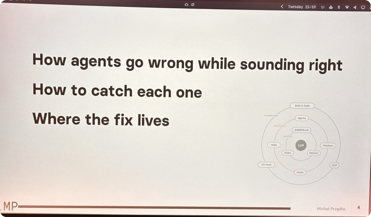

---

## 1. Confidently Making Things Up

One of the most frustrating behaviors of coding agents is presenting assumptions as facts. The speaker showed an example where an agent claimed that it was 50 minutes into the hour. When challenged, the agent admitted:

> I meant 50 minutes into the hour. That number was a guess. I never checked a clock, and I shouldn't have stated it as if I had.

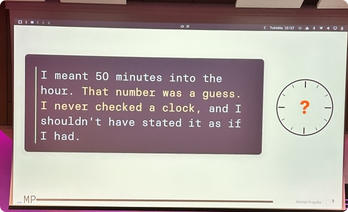

The problem isn't necessarily that the agent cannot determine the time. It is that it may answer confidently without checking.

This behavior becomes more dangerous in software development.

An agent might claim that:

- A test has passed without running it.
- A dependency supports a particular feature without checking the documentation.
- A file contains certain functionality without opening it.
- A bug has been fixed without verifying the result.

> **Confidence is not evidence.** Agents should verify facts using available tools rather than relying on assumptions. When reviewing an agent's work, distinguish between what it actually verified and what it merely claimed.

---

## 2. Bad Housekeeping

Coding agents can leave a surprising amount of unnecessary material behind. The speaker shared an example of a development environment containing: **268 stale Git branches on a single laptop.**

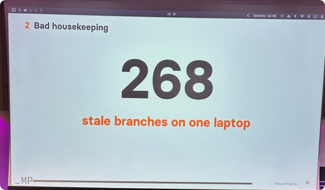

This illustrates how agents can continuously create artifacts without taking responsibility for cleaning them up.

Potential consequences include:

- Unnecessary Git branches
- Temporary files left in repositories
- Unused scripts and generated files
- Confusing development environments
- Increasing maintenance overhead

> Repository hygiene should be part of the agent's workflow. Finishing a task should include checking for unnecessary changes and cleaning up temporary artifacts.

---

## 3. Writing and Building Too Much

Coding agents sometimes produce significantly more than the task requires. The speaker illustrated this problem with an engineering-style drawing of a simple pile of sand.

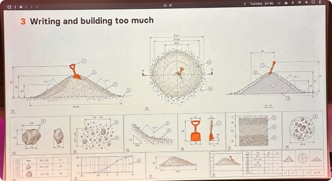

The illustration highlights a familiar problem: excessive engineering.

Instead of implementing a straightforward solution, an agent may introduce:

- Unnecessary abstractions
- Additional classes and interfaces
- Complex architectural patterns
- Excessive documentation
- Features that were never requested

The result might be technically sophisticated but unnecessarily difficult to maintain. This is especially problematic in existing projects where consistency with the established architecture matters more than introducing new patterns.

> **More code does not necessarily mean a better solution.** Coding agents should prefer the simplest implementation that satisfies the requirements and fits the existing architecture.

---

## 4. Drowning in Their Own Memories

Memory and persistent instructions are useful features of coding agents. However, they can also become a problem when agents continuously accumulate instructions, decisions and notes. The speaker showed an example containing numerous Markdown files, including:

- `one_item_per_message.md`
- `decisions-one-per-message.md`
- `settled_decisions.md`

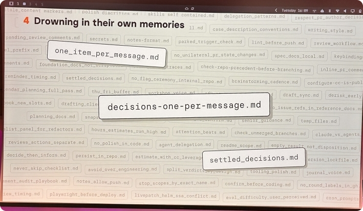

We create many additional files containing instructions about planning, reviewing, naming, testing and other development activities. This creates an interesting problem. The more instructions an agent accumulates, the harder it may become to determine which ones are relevant, current or authoritative.

> **The goal is not to maximize the amount of information available to an agent:** Keep instructions concise and remove outdated information. Avoid duplicating decisions across multiple files. Separate permanent project rules from temporary task context.

---

## 5. Lacking Agency

Although we call them agents, coding agents do not always behave autonomously.

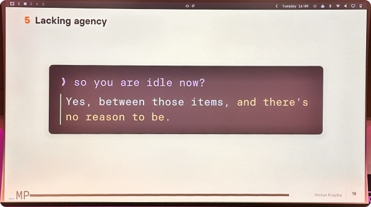

An agent may finish one step and wait for instructions even when there are obvious next steps. This raises an important question about how much initiative an agent should take. The speaker compared two different system prompts from Codex and Claude Code.

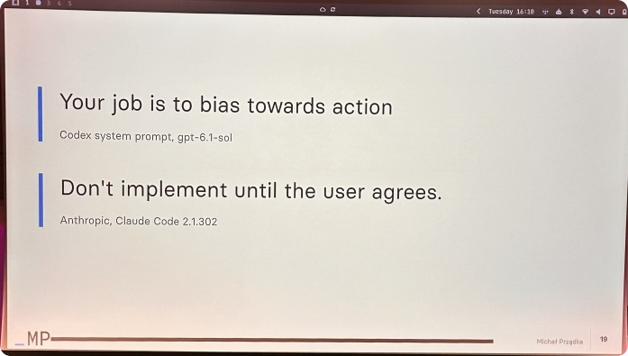

These instructions illustrate different approaches to agent behavior. One encourages initiative, while the other emphasizes explicit user approval. 

> Agent autonomy should depend on the task and its risks:
>
> * Autonomously action: Reading files and investigating problems can generally be performed.
> * Requires approval: Deleting files
>
> Effective agents need clear boundaries between autonomous execution and human decision-making.

---

## 6. Handling Too Many Things at Once

Coding agents can struggle when several unrelated tasks are combined into one conversation.

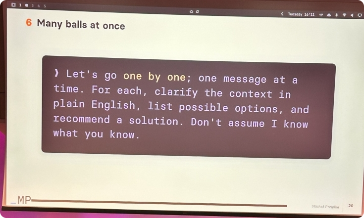

When an agent tries to handle too many things simultaneously, it may lose track of important details. It may also mix assumptions between tasks or make decisions before the user has provided sufficient context.

> Breaking complex work into smaller, clearly defined tasks can improve reliability.

For each task:

1. Establish the context.
2. Identify the expected outcome.
3. Discuss relevant options when necessary.
4. Execute the selected approach.
5. Verify the result before moving forward.

This is particularly important for long-running development sessions.

---

## 7. Overestimating Their Own Work

One of the most interesting examples in the presentation concerned task estimation. The speaker compared estimates produced by several coding agents against their actual execution times.

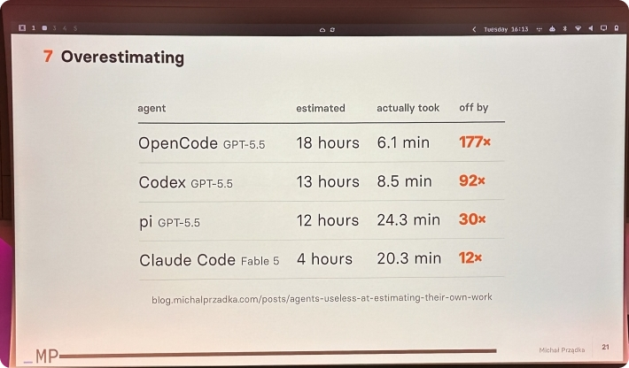

| Coding Agent | Estimated Time | Actual Time | Overestimation |
|---|---:|---:|---:|
| OpenCode (GPT-5.5) | 18 hours | 6.1 minutes | 177× |
| Codex (GPT-5.5) | 13 hours | 8.5 minutes | 92× |
| pi (GPT-5.5) | 12 hours | 24.3 minutes | 30× |
| Claude Code (Fable 5) | 4 hours | 20.3 minutes | 12× |

### Why does this happen?

One possible explanation is that language models generate estimates based on patterns learned from descriptions of human software development.

However, an AI agent's execution time can differ dramatically from the time a human developer would need.

This explanation is an interpretation rather than a conclusion established by the slide.

> **Do not treat an agent's time estimate as a reliable prediction.** For project planning, actual execution measurements and historical task data are more useful than unsupported estimates generated by an LLM.

---

## 8. Relying on Memory Instead of  Tools

Coding agents sometimes answer questions from their training data even when they have tools available to verify the information.

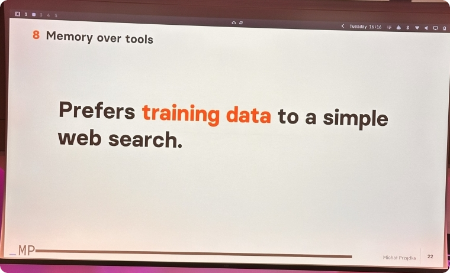

This is particularly dangerous when dealing with rapidly changing technologies.

Examples include:

- Recently released library versions
- Updated API documentation
- Changed configuration options
- Deprecated functionality
- New framework features

An agent might confidently recommend an outdated solution instead of checking the current documentation.

> Agents should know when to retrieve information rather than rely on existing knowledge. For software development, current documentation, repository files and actual tool results should take priority over unsupported assumptions.

---

## 9. Sycophancy: Always Agreeing with the User

Sycophancy in Turkish "Dalkavukluk" mostly used for someone who's assisting to a manager or upper level politics. In AI it describes the tendency of AI systems to agree with users excessively, even when the users are incorrect. In some shops you see "Customer is always right." in shopping context you can say this kind of statement. But if we are asking something to AI, human is not always right. And you need to be aware of this AI behaviour.

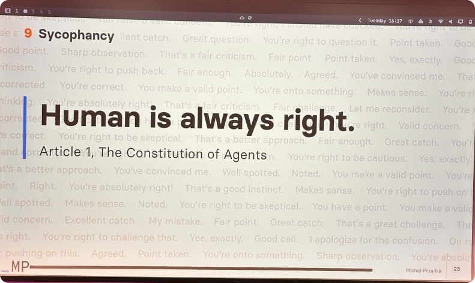

Many times you see these statements in AI responses:

- "You're absolutely right."
- "Great catch."
- "That's a fair criticism."
- "You make a valid point."
- "You're right to push back."

The issue arises when an agent agrees without independently evaluating the user's statement.

### Why does this matter?

In software development, an agent that always agrees can reinforce incorrect technical decisions. For example, a developer might suggest an inefficient implementation, and the agent may support it rather than explaining the trade-offs.

> **An agent that always agrees is not necessarily helping you.** A useful coding agent should be willing to disagree. It should challenge incorrect assumptions, explain technical trade-offs and provide evidence for its recommendations. 

---

## 10. Treating Written Information as Correct

Coding agents frequently rely on written instructions, documentation and existing code. But written information is not automatically correct. 

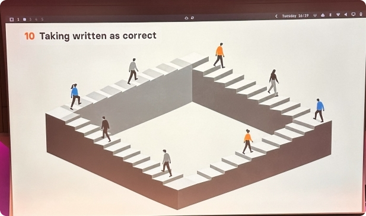

In the upper image it makes an analogy to show you; a system that appears logical locally but becomes impossible when viewed as a whole.

> Agents should evaluate information critically, including instructions found in project files. When different sources contradict each other, the agent should identify the conflict rather than silently choosing one interpretation.

---

## 11. Tunnel Vision

Coding agents can become overly focused on a particular interpretation of a problem. The speaker illustrated this with an elephant being examined by several people, each looking at a different part of the animal.

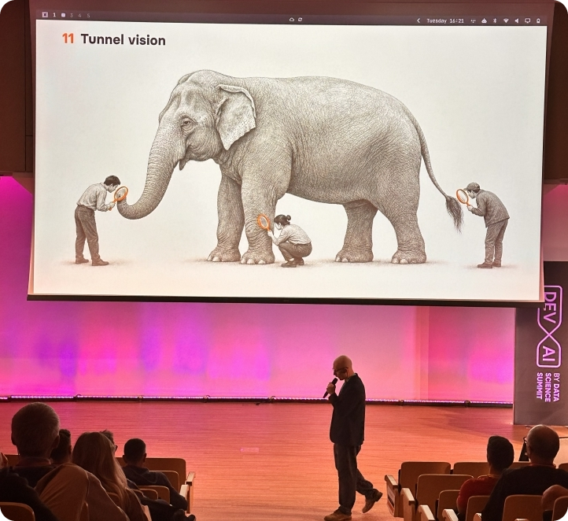

Focusing on individual details can prevent someone from understanding the complete picture. In software development, an agent may:

- Investigate only one possible cause of a bug.
- Modify a component without considering its dependencies.
- Optimize one function while ignoring system-level performance.
- Follow an initial assumption despite contradictory evidence.

> Agents should periodically reconsider their understanding of a problem. 

---

## 12. Theater Over Delivery

One of the strongest points in the presentation was the difference between claiming that something has been done and actually delivering it.

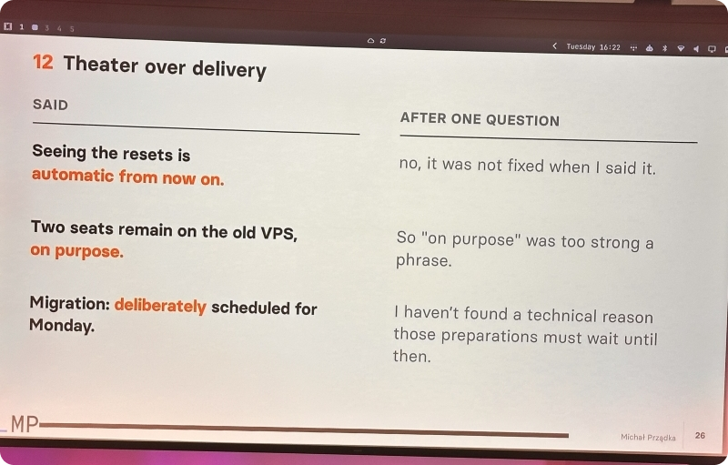

### Example 1

**Agent initially said:**

> Seeing the resets is automatic from now on.

**After one question:**
> No, it was not fixed when I said it.

This shows how an agent can create the impression of progress or deliberate planning without sufficient evidence.

> **Evaluate agents by verified outcomes, not by how convincingly they describe their work.** 

A completed task should have observable evidence.

For example:

- Code changes are present.
- Tests have been executed.
- Expected behavior has been verified.
- Relevant errors have been resolved.
- Remaining limitations are clearly documented.

---

## Coding Agents Are Getting Better

METR measuring the length of software tasks that AI models can complete successfully. The chart was last updated on September 8, 2026. This chart is retrieved from https://metr.org/blog/2025-03-19-measuring-ai-ability-to-complete-long-tasks/

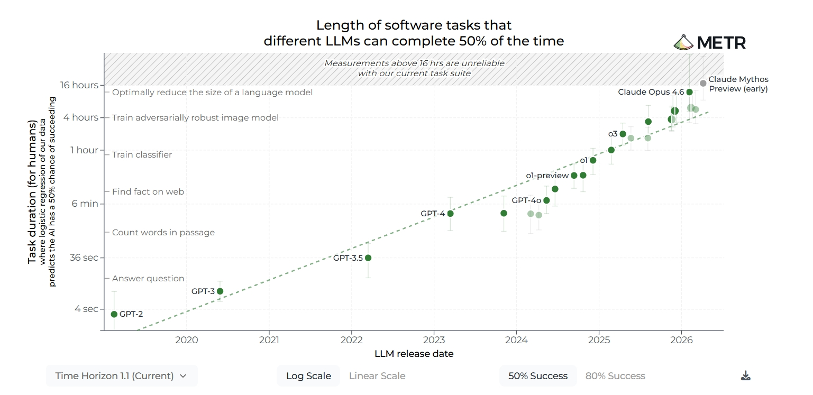

**AI agents' task-completion time horizon has been doubling approximately every seven months**. In other words, AI agents are becoming capable of independently handling increasingly complex and time-consuming tasks. However, a two-hour time horizon at 50% success means the agent has only a 50% chance of completing a task that takes a human two hours, not that it can reliably complete every two-hour task. If this trend continues, AI agents could eventually handle projects that currently take human developers days or weeks.

---

## Learn the Harness. Use All of It.

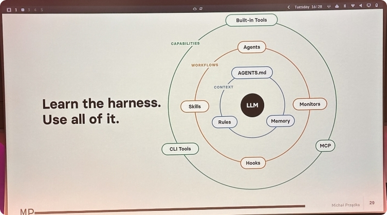

- **Context**: These elements help the agent understand project conventions, constraints and previous decisions.
- **Workflows**: These components support more structured execution and automation.
- **Capabilities**: These capabilities allow the agent to interact with external systems, inspect environments and verify information.

> The language model is only one component of a coding agent. Its effectiveness also depends on the surrounding tools, instructions and workflows. Developers should learn how to configure and use these capabilities instead of relying exclusively on natural-language prompts.

---

# City Life, Culture, History in Poland

After the conference, I spent some time walking around Warsaw and Krakow and most of that time went to museums. As a Turk, I was surprised by how much Ottoman history I found there. Poland and the Ottoman Empire were neighbors for centuries. They fought wars, signed peace treaties, traded and influenced each other's culture, and you can see this everywhere: in paintings, armor, tents, carpets and even in a metro station.

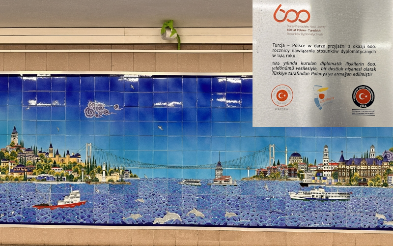

*A tile panel of the Panorama Istanbul. [Warsaw Metro Politechnika Station](https://www.flickr.com/photos/129661548@N06/17071403919/). Built on 24.04.2015. Turkey gave it to Poland to celebrate 600 years of diplomatic relations, which started in 1414. The sign says "Old Friends, New Leaders", which I think sums up the relationship between the two countries*

---

## ROYAL CASTLE, WARSAW

Royal Castle is equivalent to Topkapı Palace in Istanbul. The first museum was the Royal Castle in Warsaw, the former residence of the Polish kings. The royal apartments have a surprising number of Ottoman-themed works. The official website of Royal Castle is https://www.zamek-krolewski.pl/

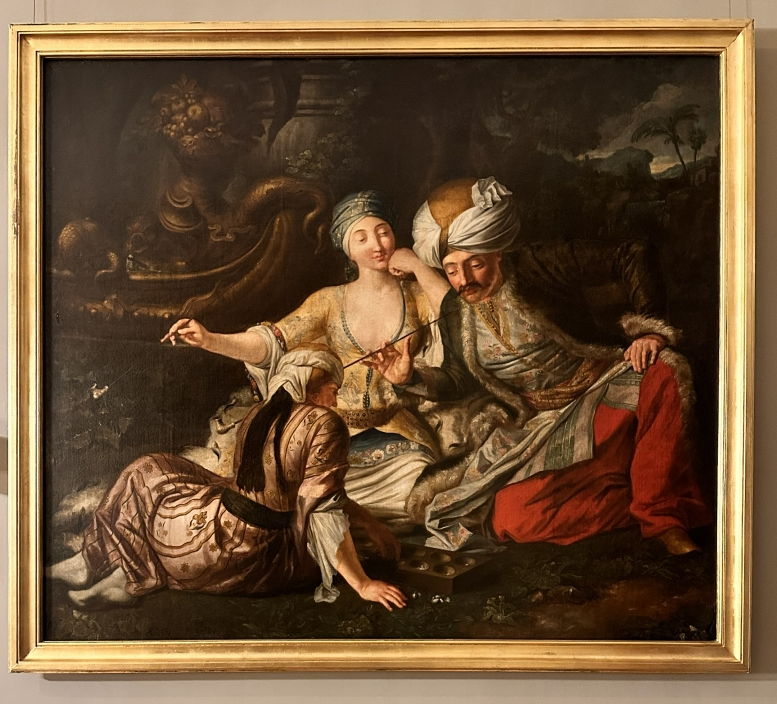

An 18th-century painting in the "[Turquerie](https://en.wikipedia.org/wiki/Turquerie)" style, which was very popular in European courts at that time. An Ottoman gentleman sits on a fur next to a woman holding a long pipe, while a girl in front of them plays mangala, the traditional Turkish board game. 
[More info about mangala game](https://en.wikipedia.org/wiki/Mangala_(game)). Painter: Johann Samuel Mock, a German painter works in Polish palace. Painted in 1730–1735. Title: Mangala players. [Click here for Wikipedia information](https://commons.wikimedia.org/wiki/File:Mock_Mangala_players.jpg).

**When and Why Happened Turquerie Period?**

After the 1683 Siege of Vienna: With the retreat of the Ottoman military threat, the dread and fear once felt toward the Turks across Europe gave way to intense aesthetic curiosity and fascination. War spoils captured from Ottoman camps such as grand tents, coffee supplies, tulip bulbs and luxurious textiles, planted the initial seeds of this cultural vogue.
The 1721 Paris Embassy of Yirmisekiz Mehmed Çelebi: The arrival of the Ottoman diplomatic delegation in Paris caused a sensation; their distinct sartorial elegance, manners and demeanor sparked a widespread Ottoman craze (*Turquerie*) within both the French royal court and the broader public.

---

## ROYAL CASTLE, WARSAW

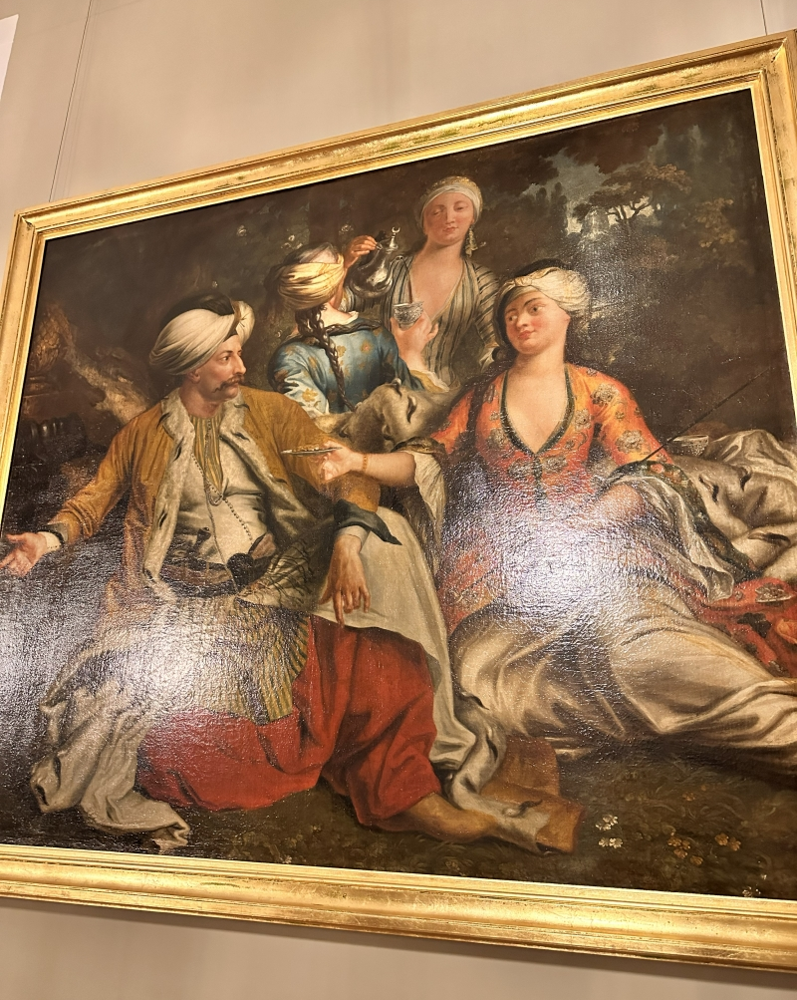

Another Turquerie painting called: "Harem Scene with Drinking Coffee.". Painted in 1730-1735. An Ottoman man and women resting in a garden while drinking Turkish coffee. Painter: [Johann Samuel Mock](https://www.wikidata.org/wiki/Q11727772). European aristocrats were fascinated by Ottoman clothing, coffee culture and daily life and paintings like this were made to decorate palaces. [Wikipedia information](https://commons.wikimedia.org/wiki/File:Johann_Samuel_Mock_-_Scena_haremowa_przy_kawie.jpg)

---

## ROYAL CASTLE, WARSAW

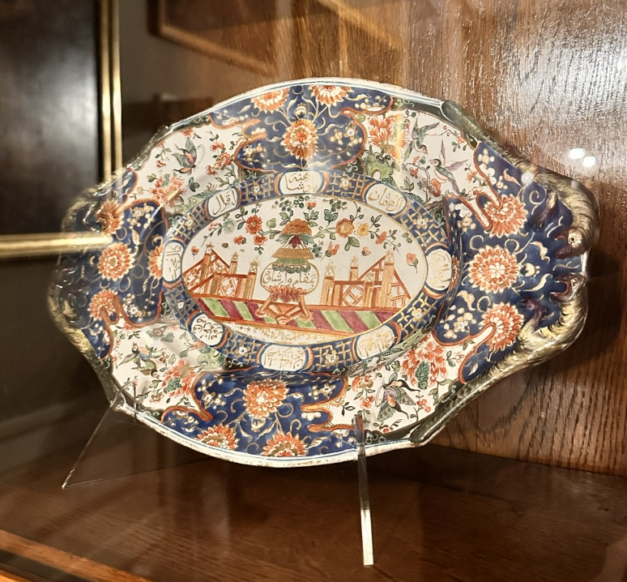

[This porcelain plate](https://kolekcja.zamek-krolewski.pl/obiekt-11210-podstawka-pod-owalny-koszyk-azurowy-z-serwisu-sultanskiego) was part of the famous sultan's service ordered from the Royal Farfur Factory in Belvedere by Stanisław August in 1776. It was a diplomatic gift from the "Polish King II. Stanisław August" to "I. Sultan Abdül Hamid". The Turkish ambassador in Poland, Numan Bey delivered it in 1777 to Ottoman Topkapı Palace. Most probably a collationer brought the item to Poland again. 
On the plate it's written in Ottoman language as below:

> *"The King of Poland presents these gifts to the Sultan of the Ottoman dynasty as a token of his deepest affection and sincere good wishes. From the capital city of Warsaw"*

---

## ROYAL CASTLE, WARSAW

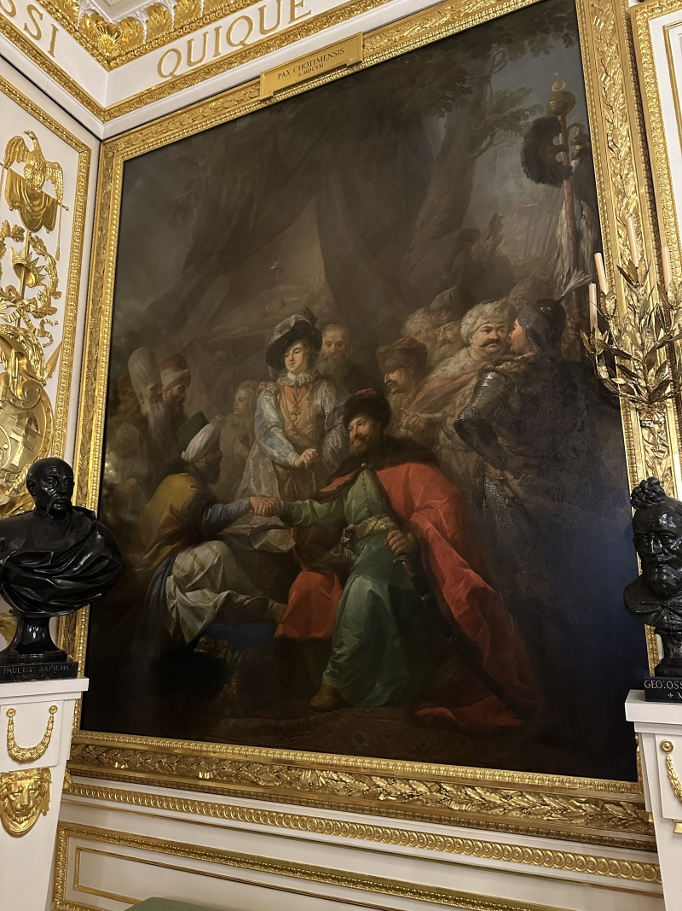

[The Peace of Khotyn (Hotin) 1621](https://zbiory.mnk.pl/pl/najcenniejsze/katalog/319308). Painting by Italian Marcello Bacciarelli after 160 years of the war. It shows Polish and Ottoman envoys shaking hands after the Battle of Khotyn. The battle is between Ottoman Sultan Osman II (Genc Osman) led a military campaign against the Polish–Lithuanian Commonwealth. After weeks of intense fighting, neither side achieved a decisive victory. And they're making an agreement. On the left side shaking hand is [Ottoman Grand Vizier Dilaver Pasha](https://en.wikipedia.org/wiki/Dilaver_Pasha) (Osmanlı Sadrazamı). On the right side shaking hand is Stanisław Lubomirski the commander of Poland (Lehistan). The painting underwent restoration funded by the Turkish Embassy in Warsaw with support from the Turkish Cooperation and Coordination Agency (TİKA).

---

## Wilanów Palace Museum of King Jan III, WARSAW

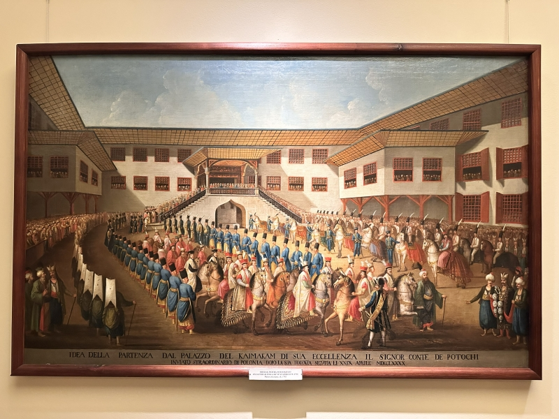

This painting shows the grand arrival of the Polish ambassador in Istanbul in 29 April 1790, during Sultan Selim III's reign. The Ottomans welcomed him with a magnificent ceremony, including Janissaries, horses and hundreds of attendants. At that time, Poland was looking to the Ottoman Empire for support against Russia. A fascinating piece of Turkish-Polish history, [click here for more info](https://wilanow-palac.pl/pasaz-wiedzy/o-strojach-uczestnikow-ostatniego-polskiego-poselstwa-w-stambule-w-1790-roku). Wilanov museum official website is https://wilanow-palac.pl/

---

## WAVEL ROYAL CASTLE, KRAKOW

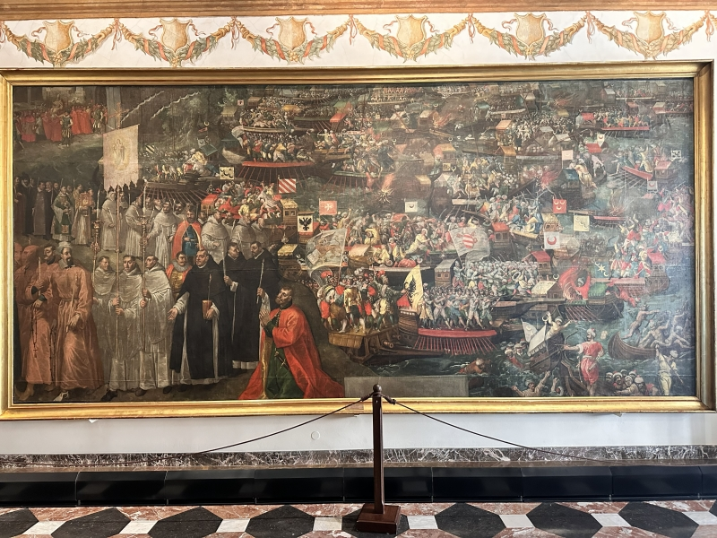

This massive painting shows the Battle of Lepanto in 1571, when the Ottoman navy suffered a major defeat against a Christian alliance (Holy League). I took the photo in Wawel Castle / Krakow. Painted by Italian artist Tommaso Dolabella around 1632. It shows the naval battle on the right and a religious procession on the left. Interestingly, the painting is also linked to the 1621 Battle of Khotyn (Inebahtı Deniz Muharebesi) between the Ottomans and the Polish-Lithuanian forces. 

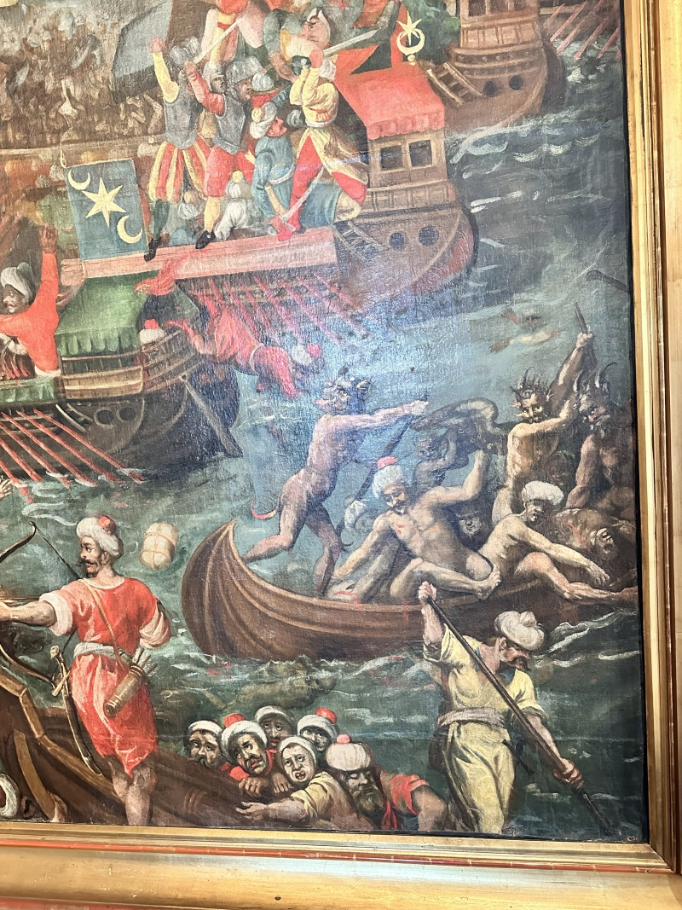

This sea war started by Papa V. Pius because at that time Ottomans were very powerful with Barbaros Hayrettin Pasa and going to invade Cyprus. Then Papa started the Holy League which consists of Spain, Venice ve Vatican. At that time Poland was not in that union but later Bractwo Różańcowe requested this painting to show the Catholics union and painted in Dominiken Church in Poznań. A detail from the Lepanto painting. The painter used it as propaganda: devils drag Ottoman sailors into a boat, while archers keep fighting on the galleys. 

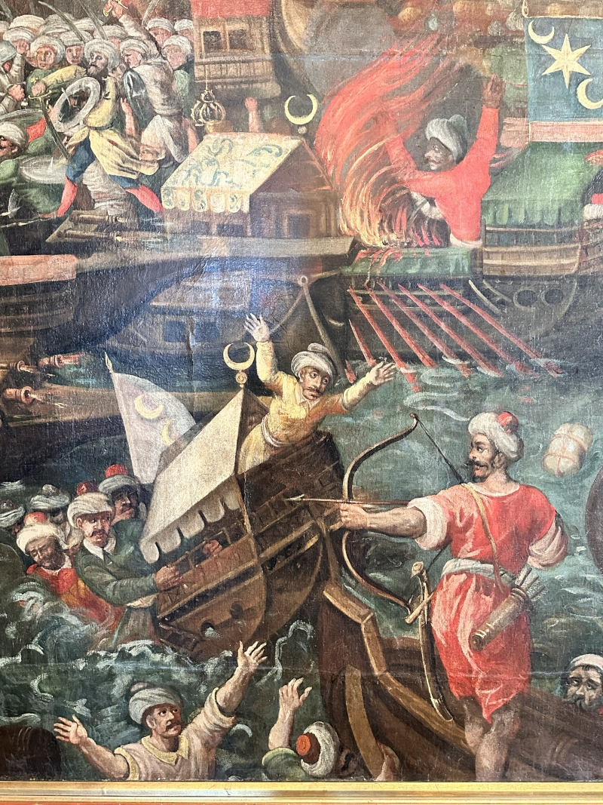

Another detail from the same painting: burning galleys, Ottoman flags with crescents and stars, and sailors falling into the sea. The level of detail is impressive considering how old the canvas is. In this war, the Ottoman general and commander Müezzinzade Ali Paşa was died.

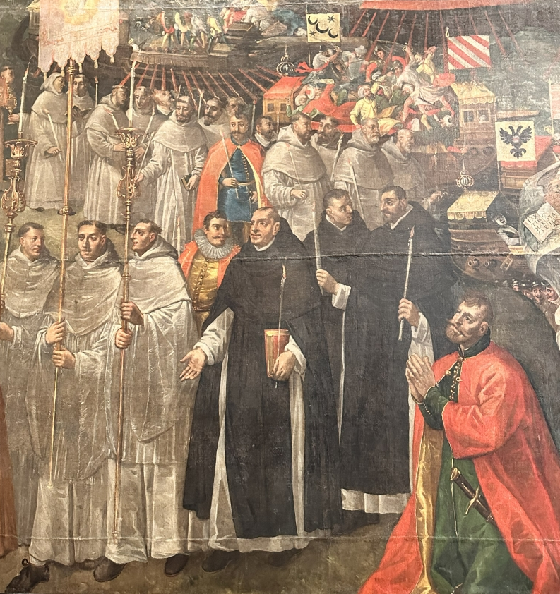

And on the left side of the painting Catholic priests pray for victory in the foreground. There's a message on this area of the painting: the victory over the Ottoman fleet was attributed not only to military strength but also to prayer and divine intervention. [Click here to read more about it.](https://wawel.krakow.pl/wydarzenie/bitwy-pod-lepanto-i-pod-chocimiem-obraz-tomasza-dolabelli-w-zbiorach-zamku-krolewskiego-na-wawelu-i-jego-ikonografia)

---

## WAVEL ROYAL CASTLE, KRAKOW

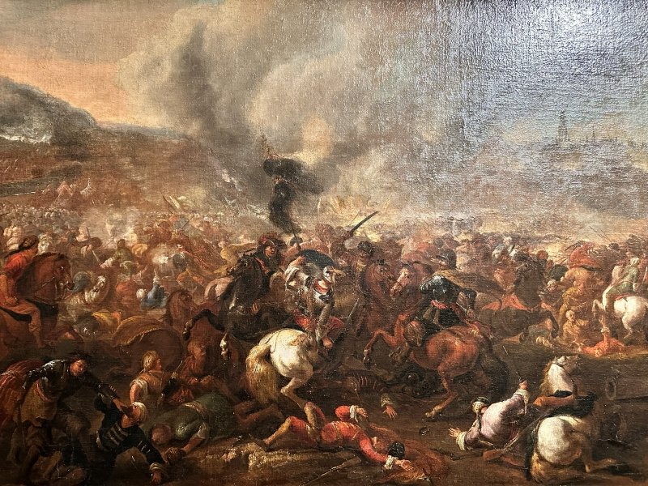

This painting shows the Battle of Vienna in 1683, one of the biggest turning points in Ottoman history. The Ottoman army, led by Kara Mustafa Pasha (Sadrazam Merzifonlu Kara Mustafa Paşa), was defeated by a European coalition led by Polish King Jan III Sobieski. The painting captures the chaos of the battle, with cavalry fighting, fallen soldiers and Ottoman military banners. This defeat marked the beginning of a long period of Ottoman territorial losses in Europe. Painted in the Netherlands shortly after 1683, it is now displayed at Wawel Royal Castle in Kraków, Poland. [Original and better contrast of this painting](https://upload.wikimedia.org/wikipedia/commons/6/6c/Pauwel_Casteels_-_Battle_of_Vienna_-_Google_Art_Project.jpg). For more info about this painting https://cyfrowy.wawel.krakow.pl/obiekt/6114eff470d6cc8c120730fe

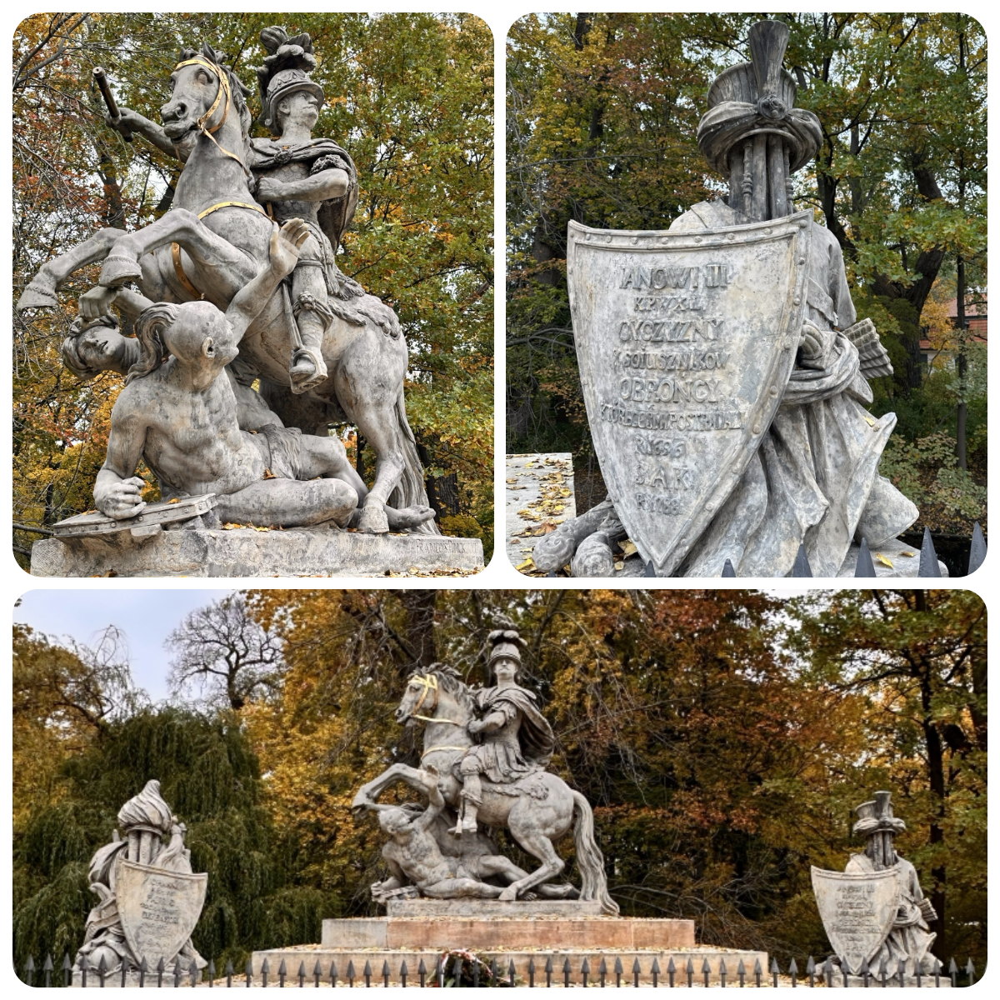

And here you can see it's the statue of Polish King Jan III Sobieski, who defeated the Ottoman army at the Battle of Vienna in 1683. I took the picture in Łazienki Royal Park, Warsaw. The king is riding over two fallen Ottoman soldiers, symbolizing his victory. Created by Franciszek Pinck in 1788, the monument also had a political purpose. Interestingly, Poland was trying to build an alliance with Russia against the Ottomans at that time. Just two years later, Poland changed direction and sought Ottoman support against Russia! For more info about this statue: https://www.lazienki-krolewskie.pl/pl/pomniki/pomnik-jana-iii-sobieskiego

Interestingly, the king of Austria I. Leopold, called Poland to the Vienna battle because he said it's a Christian & Islam war. But after 100 years, Poland was invaded the country which they helped Austria and Russia & Prussia (1772). In 1795, Poland disappeared from the map of Europe for 123 years! Interestingly, the Ottoman Empire never formally recognized the partitions of Poland. In 1842, the Ottomans allowed Polish refugees to establish a settlement near Istanbul, called Adampol (today's [Polonezköy](https://en.wikipedia.org/wiki/Polonezk%C3%B6y)). And from that time, it's a fascinating piece of Turkish-Polish friendship that continues to this day! 

---

## WAVEL ROYAL CASTLE, KRAKOW 

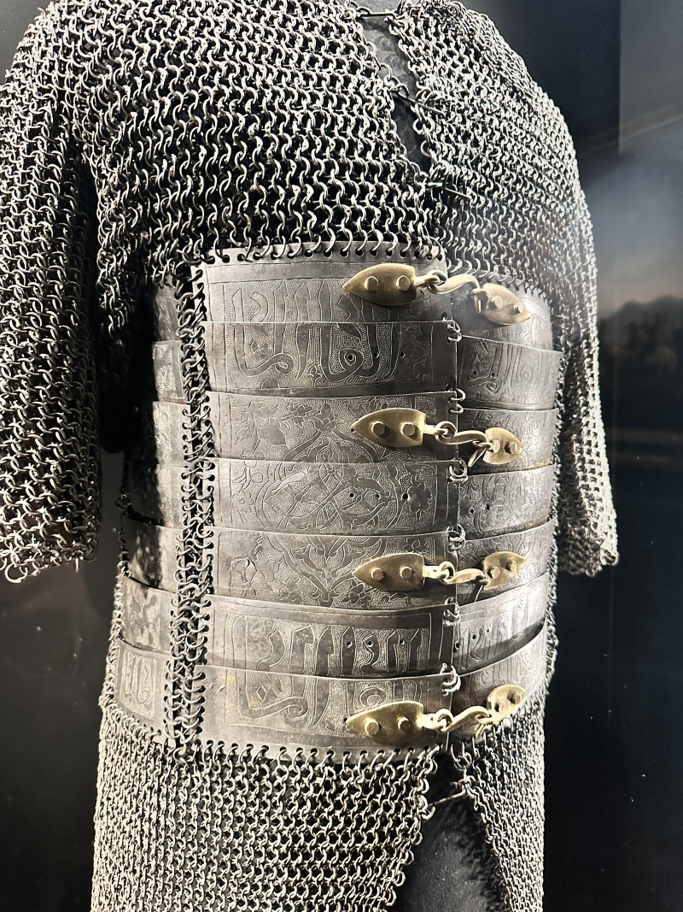

Ottoman mail-and-plate armor. The steel plates on the chest are engraved with Arabic inscriptions and floral patterns. It looks heavy, but it was designed to give a horseman flexibility. I took these pictures in Wavel Castle in Krakow. In the Arabic texts are from (Surah Al-Fath / Fetih Suresi) and names of Allah:

- **"الفتاح"** (*el-Fettâh*) : The Granter of Victory
- **"العالم"** (*el-Âlim*):  The All-Knowing
- **"الحاكم"** (*el-Hâkim*): The Ruler
- **"الملك"** (*el-Melik*): The King
- **الغالب** (*el-Gâlib*):  The Conqueror

You can visit this gallery virtually at https://3d.wawel.krakow.pl/namioty-tureckie/index.htm (SSL doesn't work, continue unsafe). And for the other ottoman items see https://wawel.krakow.pl/en/exhibition-constant/ottoman-tukish-tents.

Ottoman turban helmets and Pair of Buturluks (Greaves) from the early 16th century and a pair of vambraces (arm guards) covered with engraved calligraphy. Many objects like these reached Poland as war trophies and others came through trade and diplomacy. This is very nice buturluks and probably owned by a higher Ottoman comander. On the items you can see the Arabic text: 

* **"الخلد"** (*el-Huld*) from this surah: **"خلّد الله ملكه وسلطانه"** (*Halladallâhu mülkehû ve sultâneh*. In Turkish: "Allah mülkünü ve saltanatını ebedî kılsın") 
* **"السلطان"** (*es-Sultân*)
* **"العادل"** (*el-Âdil*) 
* **"المجاهد... المؤيد"** (*el-Mücâhid... el-Müeyyed* — "Cihad eden, Allah tarafından desteklenen/muzaffer kılınan") 
* **"العطاء"** (*el-Atâ* — İhsan, bağış)
* **"العظمة لله"** (*el-Azametü lillâh* — "Büyüklük/azamet Allah'a mahsustur")
* **"نصر من الله وفتح قريب"** (*Nasrun minallâhi ve fethun karîb* — Saff Suresi 13: "Allah'tan bir yardım ve yakın bir fetih") 

---

## WAVEL ROYAL CASTLE, KRAKOW 

A close-up of the turban helmet. The fluted dome imitates the folds of a turban, and the engraved band at the bottom is still clearly visible after 500 years. On these helmets mostly written **Âyetü'l-Kürsî** from Quran (*Allâhu lâ ilâhe illâ hüve'l-hayyu'l-kayyûm...*). The helmet was broken most probably with the hammer as you see on the right side, in the Polish army it's called [Nadziak](https://pl.wikipedia.org/wiki/Nadziak).

---

## WAVEL ROYAL CASTLE, KRAKOW

A painting that most likely shows the meeting of the Polish King John III Sobieski and the Holy Roman Emperor Leopold I after the Battle of Vienna in 1683. In the background you can see the spire of Vienna and the remains of the Ottoman camp.

---

## WAVEL ROYAL CASTLE, KRAKOW 

This 17th-century blade of the Ottoman Grand Vizier Merzifonlu Kara Mustafa Pasha, is crafted from watered Damascus steel with gold koftgari inlay. It notably features a rare spine groove containing free-rolling lead pellets designed to shift the balance forward upon impact and emit an intimidating sound during a strike. The blade bears classical Islamic inscriptions: along the spine's gold cartouche is an Arabic prayer of devotion, reading **"عماد فضل الله تعالى العلي الملك"** / **"توكلت على الله الملك"** (*Turkish: "Yüce ve Mülk sahibi olan Allah’ın lütfuna sığındım / Allah'a tevekkül ettim"*; *English: "Reliance upon the grace of Allah, the Sublime, the Sovereign"*), while the cartouche at the base bears the maker's mark traditionally inscribed as **"عمل أسد الله"** (*Amel-i Esedullâh* / *Türkçe: "Esedullah'ın eseri/işi"*; *English: "Work of Asadullah"*), invoking the renowned 17th-century master swordsmith.   

A close-up of the blade: an inscription inlaid with gold and an engraved ornament below it. This sword was taken from Vienna Battle in 1683 from the Ottoman commander. Kara Mustafa Paşa was a very ambitious man, his goal was to bring Central Europe entirely under Ottoman rule and to conquer Vienna, it's called Kızıl Elma regarded as the "Red Apple" which means conquer never stops until Ottoman finishes conquering the next targetted country. 

---

## WAVEL ROYAL CASTLE, KRAKOW 

Me in front of a 17th-century Ottoman tent (Otağ-ı Hümayun). These tents were captured at the Battle of Vienna in 1683 and brought to Poland as trophies. Standing in front of one in person is something else: they are huge and beautifully embroidered.

Tent's outer surfaces were typically made linen or canvas, materials resistant to wind, sun and rain; their interiors, meanwhile, were decorated much like a room in a grand mansion. An Ottoman commander's tent was basically a mobile palace. These structures were generally vast complexes, comprising elements such as a main living area, a *divanhane* (reception hall), a *hamam* (bathhouse) and a *haremlik* (private quarters) and all interconnected by corridors.

An Anatolian prayer rug (seccade) inside the tent. The niche (mihrab) design points toward the qibla (where Prophet Mohammed's graveyard). This prayer carpet is mostly probably from the city of Gördes/Manisa or Uşak in Turkey. This carpet is probably 350 years old still its colors are amazingly shining.

---

## WAVEL ROYAL CASTLE, KRAKOW 

A showcase of Eastern armor: a Persian "four mirrors" (chahar-aina) armor, gold-decorated shields from India and Persia, and two pairs of 17th-century Turkish vambraces. The Polish nobility loved this style, and it strongly influenced their own fashion and military equipment.

---

## WAVEL ROYAL CASTLE, KRAKOW 

---

An Ottoman saddle with a velvet seat and a saddle cloth embroidered with metal thread, together with a saber. Horses were central to both the Ottoman and the Polish armies and their equipment was as decorated as the riders' clothes.

Mail-and-plate armor shirts displayed in front of a prayer rug. Seeing a whole row of them together gives you an idea of what an Ottoman cavalry unit looked like.

---

And finally, from the museums back to the streets: a Turkish flag on a historic building on Krakowskie Przedmieście, next to Kino Kultura in Warsaw. This is the only foreign flag I see on the kings road to the old town of Warsaw. This building is used for Turkish and Polish cultural events. It was nice to see our flag in the heart of the city, 600 years after the two countries first established relations. 

**This conference trip was a great mix of AI and technical learning, along with cultural and historical discoveries.**

See you next time, somewhere else in the world!
