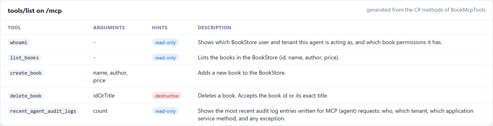
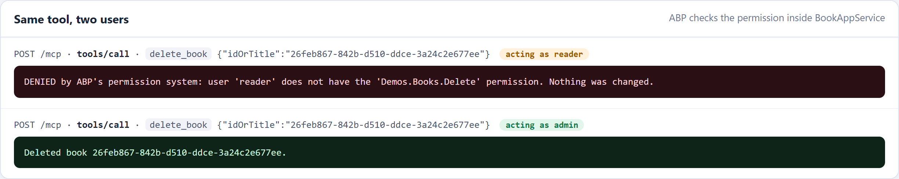
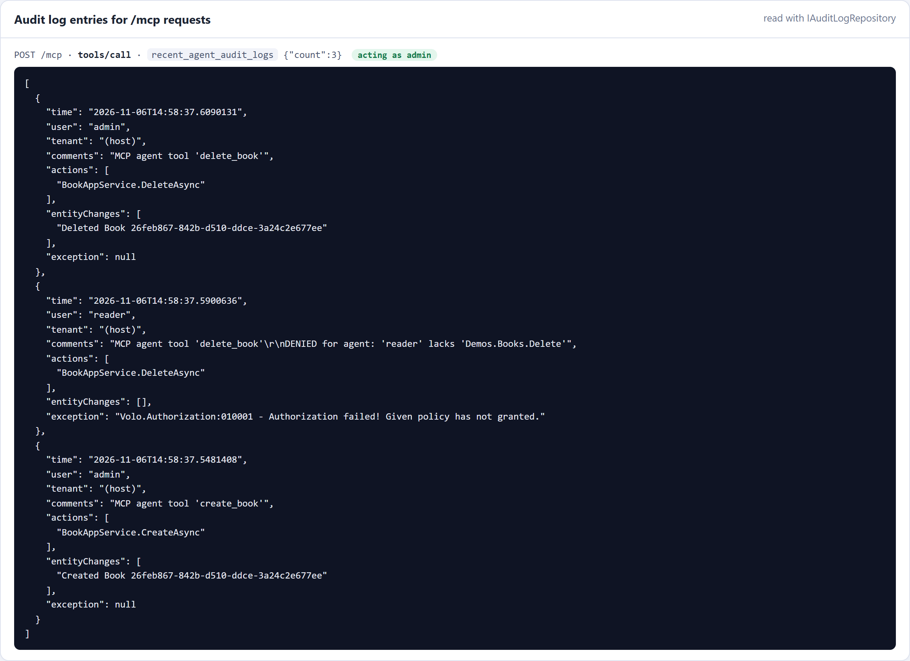
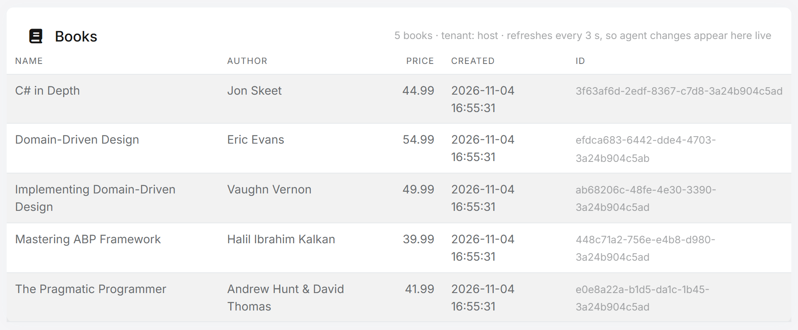

# Exposing ABP Application Services as MCP Tools for AI Agents

> **Tested with** ABP 11.0.0-rc.1, .NET 11 RC3 and the `ModelContextProtocol.AspNetCore` 2.3.1 package, on a single-layer MVC solution with EF Core and SQLite. The code uses only open-source ABP packages (application services, authorization, multi-tenancy, audit logging, OpenIddict), so it works with the free startup templates. It is a pattern you add to your own solution, **not a built-in ABP feature**.

AI agents such as Claude Code, GitHub Copilot and Cursor can call tools through the [Model Context Protocol (MCP)](https://modelcontextprotocol.io/). If your ABP application is an MCP server, an agent can list orders, approve invoices or create products in plain language.

The tempting shortcut is a separate "AI API" that talks to the database directly. Don't build it. That is a back door: no permission checks, no tenant isolation, no audit trail. Security research keeps showing that AI-generated access code is exactly where authorization and tenant boundaries go wrong.

ABP already solved this for human users. An **application service** checks permissions, applies multi-tenant data filters, runs inside a unit of work and writes an audit log. If every MCP tool calls an application service, the agent gets all of that for free.

This article builds it in about 150 lines:

- **One NuGet package**: Microsoft's official MCP C# SDK.
- **One tool class** whose methods call your existing application service.
- **One endpoint** (`/mcp`) registered through ABP's endpoint options, so you don't touch the template's module code.
- **A test** showing a "reader" agent denied by ABP's permission system and an "admin" agent allowed, with both calls in the audit log.
- **Use cases** such as selling flight tickets or ordering food through an AI assistant, and the rules that keep them safe.

## The idea in one picture

```
Claude Code / VS Code / Cursor
        │  MCP (Streamable HTTP)
        ▼
  /mcp endpoint  ──►  BookMcpTools  ──►  IBookAppService  ──►  Repository
                                           │
                     ABP interceptors: [Authorize] · UnitOfWork · Auditing
                     ABP ambient context: CurrentUser · CurrentTenant (data filters)
```

The MCP layer is thin on purpose. It translates "the agent wants to delete a book" into a normal application service call. Everything that makes the call safe stays where it already is.

## 1. Start from an ABP solution

Any open-source template works. The examples use the single-layer template:

```bash
abp new Acme.BookStore -t app-nolayers -u mvc -d ef -dbms SQLite --theme leptonx-lite
```

In a **layered** solution (`-t app`), put the tool class in the `*.HttpApi` project (or `*.HttpApi.Host`) and the registration in the host module. The application service stays in `*.Application`, as usual.

Then add the SDK to the project that hosts the endpoints:

```bash
dotnet add package ModelContextProtocol.AspNetCore
```

## 2. The application service: nothing new

This is a plain ABP application service with permissions. If you followed the [BookStore tutorial](https://abp.io/docs/latest/tutorials/book-store), you already have one like it. A fresh startup template has no `Book` entity or book permissions yet: define `BookStorePermissions.Books.Default/Create/Delete` in a `PermissionDefinitionProvider` as the tutorial shows. The only thing that matters for MCP is that the authorization lives **on the service**, not in a controller or a UI page.

```csharp
public interface IBookAppService : IApplicationService
{
    Task<List<BookDto>> GetListAsync();
    Task<BookDto> CreateAsync(CreateBookDto input);
    Task DeleteAsync(Guid id);
}

[Authorize(BookStorePermissions.Books.Default)]
public class BookAppService : ApplicationService, IBookAppService
{
    private readonly IRepository<Book, Guid> _bookRepository;

    public BookAppService(IRepository<Book, Guid> bookRepository)
    {
        _bookRepository = bookRepository;
    }

    public virtual async Task<List<BookDto>> GetListAsync()
    {
        var books = await _bookRepository.GetListAsync();
        return books.OrderBy(b => b.Name).Select(MapToDto).ToList();
    }

    [Authorize(BookStorePermissions.Books.Create)]
    public virtual async Task<BookDto> CreateAsync(CreateBookDto input)
    {
        var book = new Book(GuidGenerator.Create(), input.Name, input.Author, input.Price, CurrentTenant.Id);
        await _bookRepository.InsertAsync(book, autoSave: true);
        return MapToDto(book);
    }

    [Authorize(BookStorePermissions.Books.Delete)]
    public virtual async Task DeleteAsync(Guid id)
    {
        await _bookRepository.DeleteAsync(id, autoSave: true);
    }

    private static BookDto MapToDto(Book book) => new()
    {
        Id = book.Id, Name = book.Name, Author = book.Author, Price = book.Price
    };
}
```

Two details make the MCP layer safe:

- **Inject the interface (`IBookAppService`), not the class.** ABP wraps interface registrations in a proxy, so the authorization, unit-of-work and auditing interceptors run when the MCP tool calls the service. The `virtual` methods do the same for class proxies.
- **`Book` implements `IMultiTenant`** (add a `Guid? TenantId` property; the tutorial's `Book` doesn't have one). The repository then filters by `CurrentTenant` automatically, whether the caller is a person or an agent.

## 3. The MCP tool class

Each `[McpServerTool]` method becomes a tool the agent can call. The SDK builds the tool's JSON schema from the method signature and the `[Description]` attributes, and it creates the class through dependency injection, so constructor injection works normally.

```csharp
using System.ComponentModel;
using System.Text.Json;
using ModelContextProtocol.Server;
using Volo.Abp;
using Volo.Abp.Auditing;
using Volo.Abp.Authorization;
using Volo.Abp.Users;

namespace Acme.BookStore.Mcp;

[McpServerToolType]
public class BookMcpTools
{
    private readonly IBookAppService _bookAppService;
    private readonly IAuditingManager _auditingManager;
    private readonly ICurrentUser _currentUser;

    public BookMcpTools(IBookAppService bookAppService, IAuditingManager auditingManager, ICurrentUser currentUser)
    {
        _bookAppService = bookAppService;
        _auditingManager = auditingManager;
        _currentUser = currentUser;
    }

    [McpServerTool(Name = "list_books", ReadOnly = true)]
    [Description("Lists the books in the BookStore (id, name, author, price).")]
    public Task<string> ListBooks()
        => GuardedAsync("list_books", async () => ToJson(await _bookAppService.GetListAsync()));

    [McpServerTool(Name = "create_book")]
    [Description("Adds a new book to the BookStore.")]
    public Task<string> CreateBook(
        [Description("Book title")] string name,
        [Description("Author name")] string author,
        [Description("Price in USD")] decimal price)
        => GuardedAsync("create_book", async () => ToJson(
            await _bookAppService.CreateAsync(new CreateBookDto { Name = name, Author = author, Price = price })));

    [McpServerTool(Name = "delete_book", Destructive = true)]
    [Description("Deletes a book by its id.")]
    public Task<string> DeleteBook([Description("Book id (GUID)")] Guid id)
        => GuardedAsync("delete_book", async () =>
        {
            await _bookAppService.DeleteAsync(id);
            return $"Deleted book {id}.";
        });

    private async Task<string> GuardedAsync(string toolName, Func<Task<string>> action)
    {
        // Mark the request as an agent call; the comment is saved with the audit log entry.
        _auditingManager.Current?.Log.Comments.Add($"MCP tool '{toolName}'");

        try
        {
            return await action();
        }
        catch (AbpAuthorizationException)
        {
            // Return a clear answer the model can reason about, instead of a generic tool error.
            return $"DENIED: user '{_currentUser.UserName ?? "anonymous"}' is not allowed to do this. Nothing was changed.";
        }
        catch (UserFriendlyException ex)
        {
            return ex.Message;
        }
    }

    private static string ToJson(object value) => JsonSerializer.Serialize(value);
}
```

Some notes on the choices:

- **Tool annotations matter.** `ReadOnly = true` and `Destructive = true` are sent to the client as hints. VS Code, for example, asks the user to confirm destructive tools. They are hints, not security: the `[Authorize]` attribute on the service is what actually protects the delete.
- **Catch `AbpAuthorizationException`.** The SDK would turn an unhandled exception into a generic tool error. A short "DENIED … Nothing was changed." message lets the model explain the result to the user and not retry blindly. ABP's auditing interceptor has already recorded the exception before the catch runs.
- **Keep tools task-shaped.** Five well-described tools beat fifty auto-generated ones. Models choose better from a small, clearly named set, and every tool is a capability you have decided to give an agent.

## 4. Register the server and the endpoint

Add a few lines to your module's `ConfigureServices`. `AbpEndpointRouterOptions` lets you add endpoints without editing the template's `UseConfiguredEndpoints()` call:

```csharp
using Microsoft.AspNetCore.Routing;

public override void ConfigureServices(ServiceConfigurationContext context)
{
    // ...existing template code...

    context.Services
        .AddMcpServer()
        .WithHttpTransport(options => options.Stateless = true)
        .WithTools<BookMcpTools>();

    Configure<AbpEndpointRouterOptions>(options =>
    {
        options.EndpointConfigureActions.Add(endpointContext =>
        {
            endpointContext.Endpoints.MapMcp("/mcp");
        });
    });
}
```

**Stateless mode** handles each MCP request as an ordinary HTTP request. That is a good fit for ABP: the request goes through the normal middleware pipeline (authentication, multi-tenancy, unit of work, auditing), and it scales behind a load balancer without session affinity. The trade-off is that server-to-client features such as sampling and elicitation are unavailable, which a tool server like this one doesn't need.

Because `/mcp` is a normal endpoint, these keep working:

- **The current user** comes from the request's authentication (next section).
- **The tenant** is resolved by ABP's usual tenant resolvers, for example the `__tenant` header. The agent then only sees that tenant's books.
- **Auditing**: ABP's auditing middleware writes one audit log entry per `/mcp` request, including the application service methods that ran, any exception, and entity changes if you enable entity history for the entity.

## 5. Authentication: who is the agent acting for?

An MCP tool should always act **on behalf of a user**, with that user's permissions. ABP's startup templates already accept OpenIddict bearer tokens on API endpoints, because the template calls `ForwardIdentityAuthenticationForBearer(...)`. That covers `/mcp` too: an MCP client that sends `Authorization: Bearer <access token>` is that user, and every `[Authorize]` check applies.

To refuse anonymous agents at the endpoint, require authorization on it. In a solution where the application hosts its own OpenIddict server (single-layer, or a layered solution without a separate AuthServer), use the OpenIddict validation scheme, so an unauthenticated client gets a `401` rather than a redirect to the login page:

```csharp
using Microsoft.AspNetCore.Authorization;
using OpenIddict.Validation.AspNetCore;

endpointContext.Endpoints
    .MapMcp("/mcp")
    .RequireAuthorization(new AuthorizeAttribute
    {
        AuthenticationSchemes = OpenIddictValidationAspNetCoreDefaults.AuthenticationScheme
    });
```

In a **tiered** layered solution (separate `AuthServer`), the `HttpApi.Host` validates tokens with JWT bearer (`AddAbpJwtBearer`), so use `JwtBearerDefaults.AuthenticationScheme` there instead, or just `.RequireAuthorization()`, since bearer is already that host's default scheme.

Most MCP clients let you configure a static header for an HTTP server. For example, `.mcp.json` for Claude Code:

```json
{
  "mcpServers": {
    "bookstore": {
      "type": "http",
      "url": "https://localhost:44384/mcp",
      "headers": { "Authorization": "Bearer <access token>" }
    }
  }
}
```

That is fine for development. For production, use the MCP authorization flow instead: the server publishes OAuth protected-resource metadata, and the client signs the user in through your OpenIddict server and refreshes the token itself. The MCP C# SDK has a [protected server sample](https://github.com/modelcontextprotocol/csharp-sdk/tree/main/samples/ProtectedMcpServer) that shows the server side. Register the MCP client as an OpenIddict application with the scopes it needs.

> **Development shortcut (optional).** For a local demo you can map a header such as `X-Demo-User: reader` to an existing ABP user with a small middleware: look the user up with `IdentityUserManager`, build the principal with `IUserClaimsPrincipalFactory<IdentityUser>`, and assign it to `HttpContext.User` for `/mcp` requests only. Enable it **only in the Development environment**. It is handy on stage, and it must never reach production.

## 6. Try it

Run the application, then connect any MCP client to `/mcp`, such as Claude Code, VS Code or the [MCP Inspector](https://github.com/modelcontextprotocol/inspector). Use two users: `admin`, who has all book permissions, and `reader`, who only has the list permission.

> The screenshots below are from the sample application used for this article. Its tool class is the one above plus two extras: a `whoami` tool and the `recent_agent_audit_logs` tool from this section. Its `delete_book` also accepts a title, and its denial message names the missing permission. The sample's permission group is called `Demos`. The MCP screenshots show real requests sent to the running application's `/mcp` endpoint and the responses it returned.

**The tools.** The client asks the server for its tools (`tools/list`). Every `[McpServerTool]` method comes back with its name, arguments, description and hints, generated from the C# code:



**Same tool, two users.** The same `delete_book` call, first acting as `reader`, then as `admin`. Nothing in the tool class checks a permission: the `[Authorize(...Delete)]` attribute on `BookAppService.DeleteAsync` refuses the reader and allows the admin.



The full set of results from the test:

| Agent acting as | Tool call | Result |
|---|---|---|
| reader | `list_books` | ✅ returns the books |
| reader | `create_book` | ⛔ denied, nothing was created |
| reader | `delete_book` | ⛔ denied, the book is still there |
| admin | `create_book` | ✅ created |
| admin | `delete_book` | ✅ deleted |
| (no user) | `list_books` | ⛔ denied |

**The audit log.** ABP writes one audit log entry per `/mcp` request. The free templates store it in the `AbpAuditLogs` and `AbpAuditLogActions` tables but have no audit log page, so the sample adds a small read-only tool that reads recent `/mcp` entries through `IAuditLogRepository` (inject it into `BookMcpTools` next to `IBookAppService`; it lives in the `Volo.Abp.AuditLogging` namespace):

```csharp
[McpServerTool(Name = "recent_agent_audit_logs", ReadOnly = true)]
[Description("Shows the most recent audit log entries written for MCP (agent) requests.")]
public async Task<string> RecentAgentAuditLogs(int count = 5)
{
    var logs = await _auditLogRepository.GetListAsync(
        sorting: "ExecutionTime desc", maxResultCount: 50, url: "/mcp", includeDetails: true);

    return ToJson(logs
        .Where(l => l.Actions.Any())
        .Take(Math.Clamp(count, 1, 20))
        .Select(l => new
        {
            time = l.ExecutionTime,
            user = l.UserName ?? "(anonymous)",
            comments = l.Comments,
            actions = l.Actions.Select(a => $"{a.ServiceName.Split('.').Last()}.{a.MethodName}"),
            entityChanges = l.EntityChanges.Select(e => $"{e.ChangeType} {e.EntityTypeFullName.Split('.').Last()} {e.EntityId}"),
            exceptions = l.Exceptions
        }));
}
```

For the two deletes above, the log shows who called which application service method, the reader's authorization failure with ABP's error code, and the admin's entity change. The entity changes appear because entity history is enabled for `Book` (see the checklist below).



**The UI sees the same data.** The sample also has an ordinary Books page that calls the same `IBookAppService`. Keep it open next to the agent: a book the admin agent creates or deletes appears or disappears there, and a denied reader call leaves it unchanged.



No line of the tool class checks a permission or a tenant. ABP did that, because the tools call application services.

## 7. Use cases: what agents can do with your application

The BookStore is small on purpose. The same pattern fits any ABP application where users already do real work through application services: you choose a few of those operations, wrap them as tools, and a user can do the job by talking to their assistant instead of clicking through screens. Two examples in more detail, then a list of ideas.

### Selling flight tickets

> *"Find me a flight from Istanbul to Amsterdam next Friday morning, aisle seat, under €250, and book it."*

An airline or travel agency built on ABP already has application services for searching flights and creating bookings. The MCP layer exposes them as a few task-shaped tools:

| Tool | Calls | Notes |
|---|---|---|
| `search_flights(from, to, date, maxPrice)` | `IFlightAppService.SearchAsync` | Read-only |
| `hold_seat(flightId, seatPreference)` | `IBookingAppService.HoldSeatAsync` | Reserves a seat for 15 minutes and returns the total price. Nothing is charged |
| `confirm_booking(holdId)` | `IBookingAppService.ConfirmAsync` | Charges the user's saved payment method and issues the ticket |
| `get_my_bookings()` / `cancel_booking(id)` | `IBookingAppService` | Only the current user's bookings; cancellation rules live in the domain |

Booking is split into **hold** and **confirm** on purpose. The model gets a price back, shows it to the user, and only calls `confirm_booking` after the user agrees. Many MCP clients also ask the user before running a tool that isn't read-only, but don't rely on the client: the server checks everything again on confirm.

```csharp
[McpServerTool(Name = "hold_seat")]
[Description("Holds a seat for 15 minutes and returns the total price. Nothing is charged.")]
public async Task<string> HoldSeat(Guid flightId, string seatPreference)
    => ToJson(await _bookingAppService.HoldSeatAsync(new HoldSeatDto { FlightId = flightId, SeatPreference = seatPreference }));

[McpServerTool(Name = "confirm_booking")]
[Description("Books the held seat and charges the user's saved payment method. Call only after the user has confirmed the price.")]
public async Task<string> ConfirmBooking(Guid holdId)
    => ToJson(await _bookingAppService.ConfirmAsync(holdId));
```

The safety lives in the application and domain layers, exactly as it does for the web UI. A sketch of the hold:

```csharp
[Authorize(TravelPermissions.Bookings.Create)]
public virtual async Task<SeatHoldDto> HoldSeatAsync(HoldSeatDto input)
{
    // Two agents (or an agent and a human) must not get the same seat.
    await using var handle = await _distributedLock.TryAcquireAsync($"flight-seats:{input.FlightId}", TimeSpan.FromSeconds(5));
    if (handle == null)
    {
        throw new BusinessException(TravelErrorCodes.FlightBusy);
    }

    var flight = await _flightRepository.GetAsync(input.FlightId);
    var hold = flight.HoldSeat(CurrentUser.GetId(), input.SeatPreference, Clock.Now.AddMinutes(15));
    await _flightRepository.UpdateAsync(flight, autoSave: true);
    return MapToDto(hold);
}
```

What ABP gives this scenario:

- **Permissions**: only users allowed to book can book, whether they use the website, the mobile app or an agent.
- **Unit of work and distributed locking** (`IAbpDistributedLock`): the seat hold and the booking are consistent, even with many agents booking at once.
- **Multi-tenancy**: if each travel agency is a tenant, an agent working for agency A never sees agency B's bookings or prices.
- **Domain rules**: `ConfirmAsync` checks that the hold belongs to the current user, hasn't expired and still has the quoted price. A model can't skip these checks, because they aren't in the tool.
- **Audit log**: every booking records who made it, through which method, with a comment marking it as an agent call.
- **Events and background jobs**: the same booking-confirmed event still sends the e-ticket email and updates other systems.

The model never sees payment card numbers. Charge a payment method the user saved earlier, or return a payment link the user opens and pays themselves.

### Ordering food

> *"Order my usual from the Italian place near the office, no onions, delivered at 12:30."*

| Tool | Calls | Notes |
|---|---|---|
| `find_restaurants(near, openAt)` | `IRestaurantAppService.SearchAsync` | Read-only |
| `get_menu(restaurantId)` | `IMenuAppService.GetAsync` | Read-only; prices come from your data, never from the model |
| `get_my_recent_orders()` | `IOrderAppService.GetMyOrdersAsync` | So "my usual" is a lookup, not a guess |
| `place_order(restaurantId, items, note, deliveryTime)` | `IOrderAppService.PlaceAsync` | Returns the order and total |
| `track_order(orderId)` / `cancel_order(orderId)` | `IOrderAppService` | Cancel only while the kitchen hasn't started |

What ABP gives this scenario:

- **Ownership checks** in the application service: `GetMyOrdersAsync` and `CancelAsync` only work on `CurrentUser`'s orders. The agent can't read or cancel someone else's lunch by guessing an id.
- **Business rules as exceptions**: "the kitchen already started" or "below the minimum order" is a `BusinessException` from the domain. The agent gets a clear message it can explain to the user.
- **Validation on the DTOs**: limits on item counts and note length. Free-text fields like the delivery note come from a model that may have read untrusted text, so keep them bounded and never execute them.
- **Settings and features**: delivery radius, minimum order and opening hours come from ABP's setting system, so the agent and the website follow the same rules.
- **Data the model doesn't supply**: the delivery address and payment method come from the user's profile, not from the prompt.
- **Distributed events**: `OrderPlaced` reaches the restaurant's kitchen screen the same way, whether the order came from the app or an agent.

### More ideas

| Domain | The user says | Tools | What ABP enforces |
|---|---|---|---|
| HR / leave | "Book three days off next week." | `get_leave_balance`, `request_leave` | Balance rules in the domain, the manager approval workflow, permissions |
| Support desk | "What's happening with my ticket? Escalate it if nobody answered." | `get_my_tickets`, `add_comment`, `escalate_ticket` | Customer-tenant isolation, audit trail of every agent action |
| Appointments | "Move my appointment to Thursday afternoon." | `find_free_slots`, `reschedule` | Slot locking, cancellation-window rules, ownership |
| Invoicing (B2B) | "Approve the pending invoices under €500 from known suppliers." | `list_pending_invoices`, `approve_invoice` | Approval limits per role, feature limits per edition, full audit |
| E-commerce | "Return the shoes I bought last week." | `list_my_orders`, `create_return` | Return-window rules, ownership, refund through the normal flow |
| Back office | "Lock the account of the employee who left today." | `find_user`, `lock_user` | Identity permissions; a destructive tool most organizations keep for humans |

### Rules of thumb for actions that cost money or can't be undone

- **Quote first, confirm second.** One tool returns the price or the effect; another commits it. The server re-checks owner, expiry and price on confirm.
- **Make the confirm idempotent.** An agent may retry after a timeout. A unique constraint on the hold or order id keeps a retry from booking twice.
- **Keep secrets out of the conversation.** No card numbers, passwords or one-time codes in tool arguments or results.
- **Put limits where the rules already are.** Spending caps, daily limits and "agents may not do X" belong in permissions, features and settings, not in the tool description.
- **Leave a trail.** Mark agent calls in the audit log, so support can answer "who booked this?" with "your assistant did, on Friday at 09:14, acting as you".

## 8. Production checklist

- **Authenticate every request.** `RequireAuthorization()` on `/mcp`, with tokens issued by your OpenIddict server for a real user. Remove any demo header middleware.
- **Expose task-shaped tools, not your whole API.** Choose the operations an agent should perform, and give each one a clear name, description and annotation.
- **Keep business rules in the domain and application layers.** The tool class translates requests; it must not contain a second copy of your validation or permission logic.
- **Confirm destructive actions.** Mark them `Destructive = true`, and for high-impact operations consider a two-step flow such as `prepare_refund` → `confirm_refund`.
- **Treat tool input as untrusted.** It comes from a model that may have read a malicious web page or document. ABP's DTO validation runs on application service calls; keep it strict.
- **Enable entity history** for entities agents can change (`AbpAuditingOptions.EntityHistorySelectors`), so you can see exactly what an agent modified.
- **Rate-limit `/mcp`.** Agents call tools in loops; ASP.NET Core's rate-limiting middleware works on this endpoint like any other.

## Conclusion

Making an ABP application agent-ready doesn't need a new architecture. Application services are already the boundary where ABP enforces permissions, tenant isolation, validation, units of work and auditing. Put a thin MCP layer in front of them, and AI agents use your application under the same rules as your users.

The same idea could go further: ABP already generates HTTP API controllers from application services, and it could generate MCP tools from them the same way. Until then, about 150 lines get you there today.

