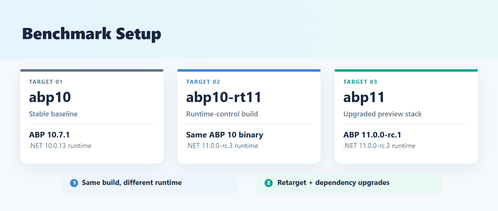
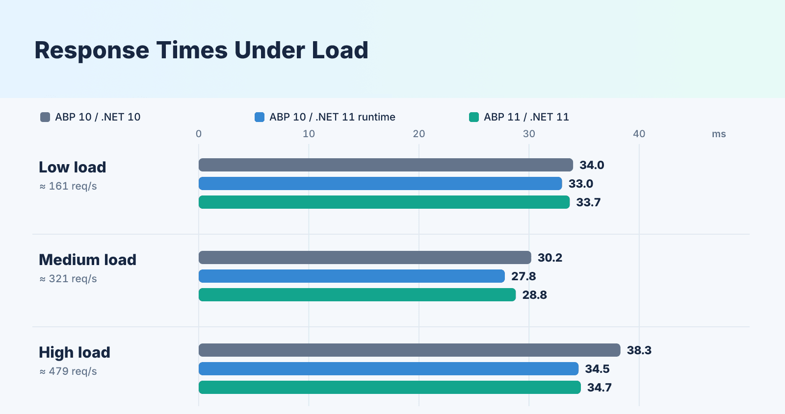
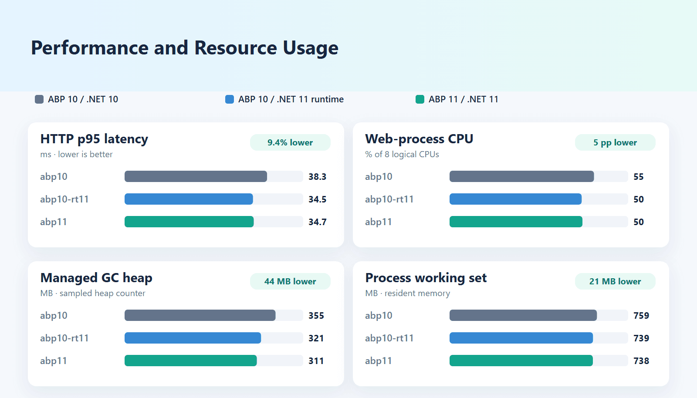
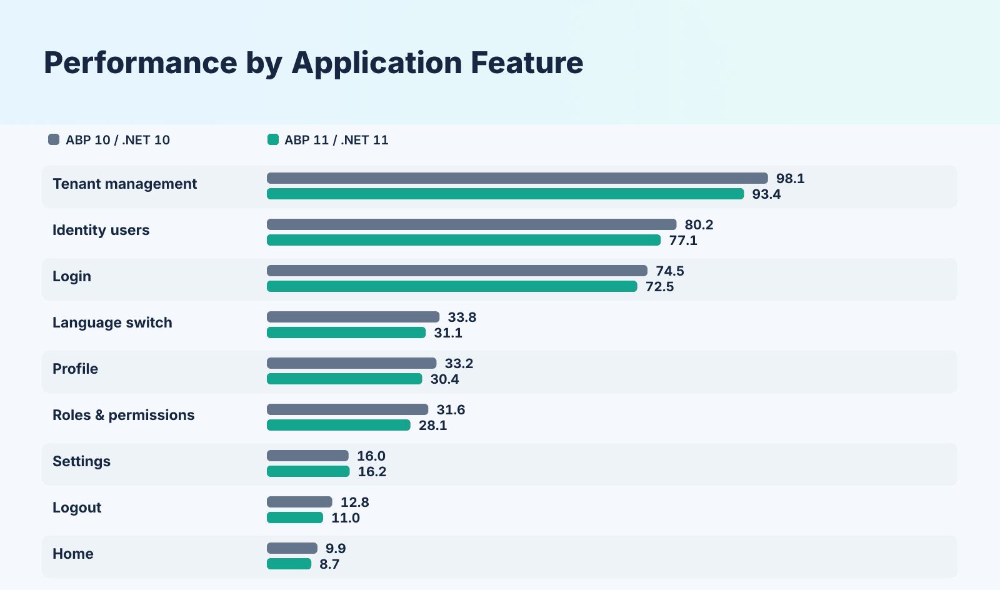

# Benchmarking .NET 10 vs .NET 11 with ABP Framework: Load Testing and Performance Results

How does an ABP application perform after upgrading from **ABP 10 on .NET 10** to **ABP 11 on .NET 11**?

To investigate, I load-tested two **template-based ABP Framework MVC applications**: **ABP 10.7.1 on .NET 10.0.13** (stable baseline) and **ABP 11.0.0-rc.1 on .NET 11.0.0-rc.3** (preview upgrade). Both exercised the same authentication, identity, role, permission, tenant, settings, and localization operations against PostgreSQL. I also ran the unchanged ABP 10 application on the .NET 11 runtime as a **supporting control**, not as a third framework version under comparison.

The **main comparison is ABP 10 + .NET 10 versus ABP 11 + .NET 11**, measured by **response time, throughput, errors, CPU, and memory** under the same workload. The additional runtime-control run helps interpret the observed difference, but does not change the two applications being compared.

## Results at a glance

Upgrading from **ABP 10 on .NET 10** to **ABP 11 on .NET 11** lowered response times and resource use at the same load. The numbers below come from **27 measured runs** (three configurations, three load levels, three repetitions each) and show the highest routinely tested load: **6 it/s**, or six complete scenario iterations per second, which is about **479 HTTP requests per second**.

- **9.4% lower HTTP p95 latency:** **38.3 ms → 34.7 ms**.
- **5 percentage points lower normalized web-process CPU:** **55% → 50%**.
- **44 MB lower reported managed GC heap size:** **355 MB → 311 MB**.
- **21 MB lower process working set:** **759 MB → 738 MB**.
- **The same throughput:** **478.1 → 478.8 HTTP requests per second**.

These results come from one controlled environment and workload, using **.NET 11.0.0-rc.3 and ABP 11.0.0-rc.1**. They are observations, not guaranteed improvements for all applications. In particular, **a lower p95 at a fixed offered load does not prove a higher maximum throughput**.

## 1. Application setup and comparison design

The applications were created from the same ABP MVC/Razor Pages template with **Entity Framework Core, PostgreSQL, and LeptonX Lite**. The upgraded project was based on a copy of the stable application to limit template drift. The initial database contained the same schema and seeded application data; the test harness added 1,000 dedicated user accounts.

| Configuration | Application and target framework | Selected .NET runtime | Purpose |
|---|---|---|---|
| `abp10` | ABP **10.7.1**, `net10.0` | **10.0.13** | Stable baseline |
| `abp10-rt11` | **Same published ABP 10 binary**, `net10.0` | **11.0.0-rc.3** | Runtime-control configuration |
| `abp11` | ABP **11.0.0-rc.1**, `net11.0` | **11.0.0-rc.3** | Upgraded preview stack |

Throughout the charts and tables, `abp10` is the **ABP 10 + .NET 10 baseline** and `abp11` is the **ABP 11 + .NET 11 upgrade**. The additional `abp10-rt11` series is a **supporting runtime-control measurement**.



The middle configuration uses the exact same compiled .NET 10 application with a different runtime. The **primary comparison** is between `abp10` and `abp11`: the stable ABP 10/.NET 10 stack versus the preview ABP 11/.NET 11 stack. As a secondary check, `abp10-rt11` shows what happens when the **same ABP 10 application binary** runs on the newer runtime. Moving from `abp10-rt11` to `abp11` upgrades not only ABP itself, but also the target framework (`net11.0`), EF Core (**10.0.11** to **11.0.0-rc.3**), the Npgsql EF Core provider, and the theme packages.

## 2. The application workflow under test

I used **Grafana k6** to replay a recorded HTTP workflow through the built-in pages and features of a template-based ABP application. **k6 Studio** captured the initial browser traffic; the scenario was then adapted to manage dynamic authentication tokens, cookies, and entity identifiers reliably under load. The tool choice matters mainly because the same workflow needed to run consistently against every configuration.

### Making the recorded scenario replayable

Simply replaying the recorded requests was not enough: replaying recorded tokens caused anti-forgery failures, while redirects could disguise a failed login as a successful `200 OK` response. Concurrency introduced another problem when multiple users attempted to create entities with the same recorded names.

The final scenario addressed these issues by:

- Extracting fresh hidden `__RequestVerificationToken` values for form submissions.
- Reading the `XSRF-TOKEN` cookie and using it in ABP AJAX requests.
- Correlating newly created user, role, and tenant IDs and their `ConcurrencyStamp` values.
- Assigning each virtual user its own account and giving newly created entities unique identifiers.
- Checking response status **and**, where applicable, returned data or redirect targets.

The journey covers nine functional groups:

| Functional group | Representative operations |
|---|---|
| Login | Authenticate and establish a cookie-based session |
| Home | Render the home page and request ABP dynamic scripts |
| Users | List, filter, create, edit, assign permissions, delete |
| Roles | Create/edit roles, manage permissions, delete |
| Tenants | Create/edit tenants, manage features, delete |
| Settings | Load settings views and update email settings |
| Profile | Read and update profile details |
| Language | Switch between English and Turkish |
| Logout | Terminate the session |

The original recorded journey contained approximately **92 HTTP requests**, but **not every measured iteration repeats all 92**. Virtual users retain their sessions and normally log out and back in every ten iterations; measured throughput therefore averages roughly **80 requests per iteration**. The script also fetches three ABP dynamic script endpoints per page in parallel, while omitting static assets.

This is a **stateful HTTP workflow**, not a full browser-rendering or frontend paint-time benchmark. It exercises the template's principal built-in features rather than custom enterprise business logic.

## 3. Making the measurements comparable

The test started **2, 4, or 6 scenario iterations per second (`it/s`)**. In k6, this is called a **constant-arrival-rate** workload: the tool aims to start new iterations at a fixed pace, rather than maintaining a fixed number of virtual users. Each iteration contains multiple HTTP requests, so **6 it/s is not 6 HTTP requests per second**. The number of concurrently active virtual users can vary with server response time. Actual completed iterations, dropped iterations, and failures must therefore be checked.

Each measured run used the same procedure:

- **120 seconds of warm-up**, a **10-second grace interval**, and **300 seconds of measurement**.
- **Three repetitions** per configuration and load level, with alternating target order.
- Release-published apps in **Production** mode with reduced logging noise.
- A clean PostgreSQL database recreated from a seeded template before each run, after preparing query-planner statistics with `VACUUM ANALYZE`.
- Web-process affinity to logical CPUs **0–7** (four P-cores / eight hardware threads), and k6 affinity to CPUs **16–23** (E-cores).
- `dotnet-counters` and Docker statistics for server-side resource measurements.

The workstation had an **Intel Core i7-14650HX**, **31.7 GB RAM**, Windows 11, and **PostgreSQL 18.6** running under Docker Desktop/WSL2. The database was not independently pinned to a dedicated core set; affinity reduced contention but did not make the experiment equivalent to isolated servers.

For the reported results, each value is the **median of three separately measured runs** for that application and load level. The full comparison comprises 27 measured runs. Medians help limit the influence of individual noisy measurements, but they do **not** establish statistical confidence intervals.

## 4. Benchmark results

### 4.1 Response time and throughput

The table summarizes the repeated measurements at three load levels. **Arrival rate (`it/s`)** is the configured rate of complete scenario iterations per second, while **HTTP req/s** is the traffic actually handled by the server. Every HTTP request in this measurement set was reported as successful by k6’s HTTP failure metric; application-level checks are a separate consideration.

| Arrival rate | Configuration | HTTP req/s | Avg (ms) | p95 (ms) | p99 (ms) | HTTP errors |
|---|---|---:|---:|---:|---:|---:|
| **2 it/s** | `abp10` | 160.8 | 10.8 | 34.0 | 78.7 | 0.00% |
| | `abp10-rt11` | 160.5 | 10.6 | 33.0 | 77.1 | 0.00% |
| | `abp11` | 160.5 | 10.7 | 33.7 | 80.0 | 0.00% |
| **4 it/s** | `abp10` | 321.1 | 10.0 | 30.2 | 77.8 | 0.00% |
| | `abp10-rt11` | 321.4 | 9.4 | 27.8 | 77.0 | 0.00% |
| | `abp11` | 321.1 | 9.6 | 28.8 | 77.2 | 0.00% |
| **6 it/s** | `abp10` | 478.1 | 12.8 | 38.3 | 102.1 | 0.00% |
| | `abp10-rt11` | 479.1 | 11.7 | 34.5 | 97.0 | 0.00% |
| | `abp11` | 478.8 | 11.6 | **34.7** | **96.7** | 0.00% |



At light load, the two ABP versions performed similarly. As the load increased, **ABP 11 on .NET 11 generally showed lower p95 response times** than ABP 10 on .NET 10. At the highest repeated load, the upgraded application had **9.4% lower p95 latency** while handling essentially the same number of HTTP requests per second.

### 4.2 Performance and resource usage

These measurements were taken at the **highest repeated load** (`6 it/s`, six scenario iterations started per second):

| Metric | `abp10` | `abp10-rt11` | `abp11` |
|---|---:|---:|---:|
| Web-process CPU | 55% | 50% | 50% |
| Process working set | 759 MB | 739 MB | 738 MB |
| Reported managed GC heap | 355 MB | 321 MB | 311 MB |
| HTTP p95 | 38.3 ms | 34.5 ms | 34.7 ms |



The CPU percentages are **normalized to the web process's eight available logical processors**, not the entire machine. Thus **55% to 50%** is a drop of **5 percentage points**. Similarly, the GC number is a **sampled managed-heap-size counter**: a 44 MB difference in that counter is not the same as 44 MB fewer allocations, and it is not the total process memory footprint.

### 4.3 Performance across application features

Looking at the application's individual features, **ABP 11 on .NET 11 showed lower p95 response times in eight of the nine groups**, including user, role, and tenant management; only the settings group stayed flat (16.0 ms to 16.2 ms). Tenant management, user operations, and login had the highest request latencies overall.



The chart compares **HTTP-request p95 values within each feature group**, rather than the time needed to complete an entire multi-request workflow.

### 4.4 Higher-load observations

In a separate, repeated higher-load test at **7 it/s** (seven scenario iterations per second, approximately **557 HTTP requests per second**), p95 latency remained close: **39.5 ms** for ABP 10 + .NET 10, **40.2 ms** for ABP 11 + .NET 11, and **40.3 ms** for the supporting ABP 10 + .NET 11 runtime control. At **8 it/s**, an exploratory test showed sharply higher latency and dropped iterations; because that load level was not tested repeatedly, it was **not used to rank maximum throughput**.

## 5. What the upgrade to ABP 11 gives

Upgrading from **ABP 10.7.1 on .NET 10** to **ABP 11.0.0-rc.1 on .NET 11** gave **lower p95 response times at the same throughput**. At the highest repeated load, p95 fell from **38.3 ms** to **34.7 ms**, and CPU and memory use were lower as well. At light load (2 it/s) the two stacks performed similarly.

The runtime-control test shows where the gain comes from: the **unchanged ABP 10 binary on .NET 11** reached a similar **34.5 ms p95**. The gain therefore appears to come with the move to .NET 11, and the ABP 11 preview packages **did not add a substantial performance penalty in this workload**.

## 6. Scope and limitations

The results apply to a **template-based ABP MVC application**, not to all production systems. The test used preview versions of .NET 11 and ABP 11, ran on a single workstation, and measured HTTP requests rather than browser rendering. Each condition was repeated three times, and the reported values are medians, not cross-environment guarantees. The preview EF Core PostgreSQL provider also showed a package-compatibility warning in this setup.

The repository includes benchmark summary tables, while the PowerShell runner generates per-run k6 summaries and telemetry files locally when the tests are executed.

## 7. Reproducing the experiment

All benchmark application source code, k6 load-testing scenarios, PowerShell runners, and published result summaries are available in the [AbpNet10vsNet11PerfTest test suite](https://github.com/abpframework/abp/tree/dev/test/AbpNet10vsNet11PerfTest) of the ABP repository. **The commands below refer to that benchmark implementation**, rather than being stand-alone commands. With its source code available, the required .NET SDKs/runtimes, Docker, k6, Node.js, and `dotnet-counters` installed, local OpenIddict certificate settings configured, and test credentials provided, an example run is:

```powershell
docker compose up -d
./scripts/publish.ps1

./scripts/db.ps1 -Target abp10 -Action seed
./scripts/db.ps1 -Target abp11 -Action seed

$env:BENCH_PASSWORD = '<seeded_admin_password>'

./scripts/run-bench.ps1 `
    -Mode fixed `
    -Rates 2,4,6 `
    -Targets abp10,abp10-rt11,abp11 `
    -Repeats 3 `
    -Batch article-comparison

node k6/tools/summarize.mjs results/article-comparison report/results-article-comparison.md
```

The `-Batch` value is only a folder name for organizing output, not a distinct benchmark methodology. The runner resets the database, starts the selected web process with the configured affinity, collects telemetry, invokes k6, and aggregates the results. **Recording and replay are separate steps**: k6 Studio is used to capture the initial traffic; the correlated, parameterized k6 scenario is what performs the actual concurrent benchmark.

## Conclusion

Upgrading to **ABP 11.0.0-rc.1 on .NET 11** lowered **p95 latency by 9.4%** at the highest repeated load (38.3 ms → 34.7 ms), with lower CPU and memory use at the same throughput. Eight of the nine tested feature groups were faster as well.

The unchanged ABP 10 application also improved on the .NET 11 runtime (34.5 ms p95), so the gain comes with the move to .NET 11 and the ABP 11 preview upgrade added no substantial penalty. These findings apply to the tested applications and preview dependencies, not to every ABP deployment.
