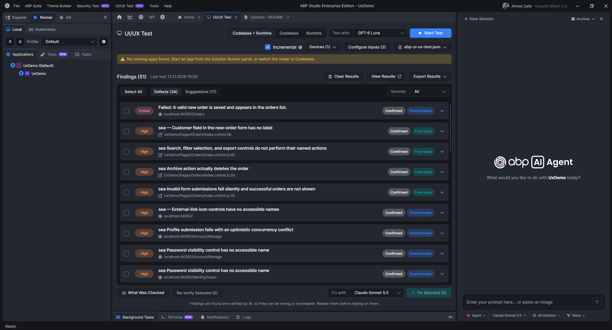
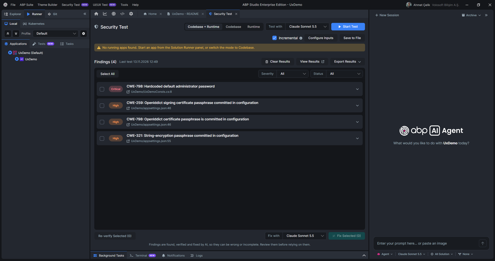
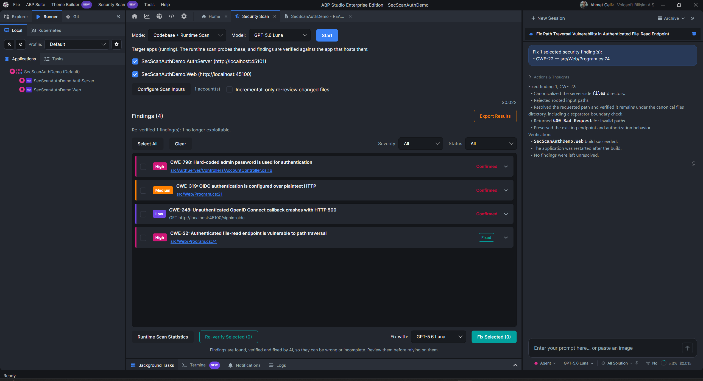
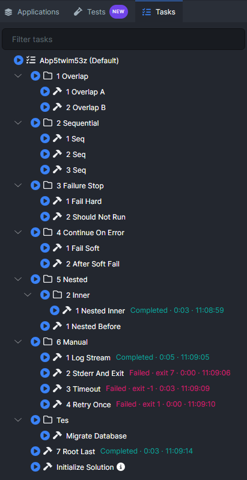
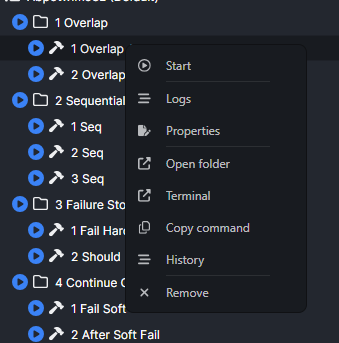

# What's New in ABP Studio 4.0: UI/UX and Security Tests, Image and Video Generation

Most AI coding tools stop once the code is written. Someone still has to open the app, click through the pages, try the forms on a phone-sized screen and think like an attacker for a while. That work usually happens late, if it happens at all.

With ABP Studio 4.0, we wanted Studio to take on part of that work too. The release brings 2 new AI tests, **UI/UX Test** and **Security Test**. They check your code and your **running** applications, verify what they find and hand the findings to ABP Agent for a fix. You can run both from the menu bar and you can run both headless from the command line or in your CI pipeline.

The release also includes:

* image and video generation in ABP Agent;
* a much more capable task system in Solution Runner;
* several improvements to AI chat.

Let's go through them one by one.

## UI/UX Test: An AI Tester for Your Interface

Open **UI/UX Test** from the menu bar, select the apps you started in Solution Runner, pick the device sizes and click **Start Test**. That is all it needs.



There are three modes: **Codebase + Runtime**, **Runtime** and **Codebase**. In the runtime part, Studio opens every page of the selected apps in a headless browser at the widths you pick: **Phone** (360 px), **Tablet** (768 px), **Laptop** (1280 px) and **Desktop** (1920 px). It then works in layers:

* **Checks without AI.** These are fast, deterministic checks on every page. The test reports:
  * layout problems: overflow, clipped text, covered controls and touch targets that are too small;
  * untranslated localization keys, unrendered templates and raw values on the screen;
  * console errors and failed requests;
  * broken links and links that a signed-in user cannot actually open.
* **AI page review.** The AI looks at every page at every width, using screenshots and an outline of the page. A second pass compares the pages of an app with each other, so it can spot inconsistent buttons, headers or spacing.
* **AI interaction.** The AI uses each page the way a test team would. It opens menus and dialogs, submits forms (empty, invalid and valid), adds, edits and deletes records and tries search, filter and sort. Each scenario ends with an independent check. A failed scenario becomes a confirmed defect and a passed one is kept as proof that the flow works.
* **Code and localization review.** The AI reviews your UI source code in two passes and verifies what it finds. Your localization files (JSON and resx) are compared without AI, so missing translations show up reliably.

> **Important:** The UI/UX Test really clicks buttons and submits forms, so it can change or delete data. Run it against a development or test instance whose data you can afford to lose. Studio and the CLI both remind you of this.

### Fewer False Positives

An AI tester is only useful if you can trust what it reports. So we added a few rules:

* An AI-reported defect must say what *should* be true and a second look must confirm it. Defects that are not confirmed become suggestions and the ones the second look disproves are dropped.
* When the same problem appears on many pages, it is folded into one finding per app or per component. The other places are listed under it.
* Runs are incremental. UI files that did not change since the last test are not reviewed again and their findings carry over. The running apps are still tested in full, because a changed file doesn't tell you which pages it affects.

### Test as a Second User

You can add a second test account, ideally one with fewer permissions. Studio checks the apps again as that user. Every page that user can reach gets the automatic checks. Only the pages the first account did not see get the AI review and the clicking. If the second user sees a link that leads to an access-denied page, or sends them back to the home page, that is reported too. Each finding shows which account saw it.

When the test finishes, **What Was Checked** shows, for each app, how many of the discovered pages were checked, on which devices, as which account and the test scenarios with their outcome. Few findings with high coverage means your app looks good. Few findings with low coverage means the test could not reach much of it, so check your test account and login settings.

## Security Test: Find, Verify and Fix Vulnerabilities

The **Security Test** looks for vulnerabilities in the open solution. It uses the same three modes:

* **Codebase:** the AI reviews the security-relevant source files for problems such as missing authorization, injection or hardcoded secrets.
* **Runtime:** an agent tests the selected running apps the way an attacker would. It crawls the pages, sweeps the API routes, fuzzes parameters, checks common exposures and tests both anonymous and signed-in access.
* **Codebase + Runtime:** runs both and merges findings that point to the same issue.



With two test accounts, the first one is used for the attack and both are used to check whether one user can reach the other user's data. That is one of the most common real-world problems and it is hard to find by reading the code alone.

> **Important:** The runtime test sends real requests, including writes. Use a development or test instance, never production.

### Every Finding Is Verified

The scary part of security reports is usually not the real issues but the long list of maybe-issues. So a separate agent checks each finding against the running app that hosts it and marks it **Confirmed**, **Unconfirmed** or **Incomplete**. Findings it proves false are removed. **Incomplete** usually means the app was not running, so start it and re-verify.

### Single-Page Apps Are Covered Too

A single-page app (Angular, React, Blazor WebAssembly) returns the same empty shell from the server for every route and the real navigation is rendered by JavaScript. A plain HTTP crawl finds almost nothing there except ABP's built-in pages.

The runtime test now crawls the app in its own signed-in browser and reads the rendered pages. That way it finds your project's own routes, forms and inputs, up to 3 levels deep and 80 pages. The agent is also told to open menus and click navigation controls that change the view without a link. When no browser is available, the test falls back to the HTTP crawl as before. The API sweep (Swagger and ABP's API definition) works as it did before.

## What the Two Tests Share

The two tests are built on a shared scanning layer, so they look and work the same way. They share the run status, model picker, target apps, inputs dialog, finding list and fix flow. Only one of the two can run at a time.

### Fix and Re-verify

Finding problems is half the job. Tick the findings you want to fix (or **Select All**), optionally choose a model in **Fix with** and click **Fix Selected**. ABP Agent opens a new chat with those findings and changes the code like in any other chat.



When the agent is done, Studio offers to **Re-verify**. If the app still runs the old code, Studio offers to restart it first. Re-verify then checks the findings again against the code and the running app:

* **UI/UX Test** results: **Fixed**, **Still failing** or **Could not re-verify**, with before and after screenshots.
* **Security Test** results: **Fixed**, **Still exploitable**, **Not exploitable**, **Could not re-verify** or **Re-verify interrupted**.

If you select unconfirmed findings, Studio asks whether to re-verify them first, so the agent doesn't spend time fixing a problem that isn't there.

### Test Accounts and Sign-in

Most of an application is behind its login page, so sign-in has to be reliable. Click **Configure Inputs** to add up to two test accounts, a login page URL and free-text instructions (what to focus on, what to skip). A few details make sign-in work in real ABP solutions:

* **A login counts only when the app shows something different afterwards.** Cookies alone are not proof, because localhost cookies are shared across ports.
* **Separate auth server:** sign-in starts from the app itself, so an Angular app starts its own login flow and gets its own token. If that fails, the login URL you gave is tried once.
* **SPA tokens:** tokens kept in memory are captured from the app's requests together with their expiry, so a long test renews them in time.
* **No account lockouts:** a password the app rejects is not tried again and a warning tells you why sign-in failed.
* **Your test account is protected:** in the UI/UX Test, the AI knows the signed-in user name (never the password) and is told not to edit, lock or delete that account.
* **Passwords stay out of the AI:** passwords are never sent to the model or written to logs.

### The Inputs File

Click **Save to File** to save your inputs to the solution folder as `abp-ui-ux-test.json` or `abp-security.json`. You can commit the file, so your teammates and your CI pipeline use the same setup. A UI/UX Test inputs file looks like this:

```json
{
  "targets": [
    { "name": "Acme.BookStore.Web", "url": "https://localhost:44321" }
  ],
  "loginUrl": "https://localhost:44321/Account/Login",
  "accounts": [
    { "username": "admin", "passwordEnv": "BOOKSTORE_ADMIN_PASSWORD" },
    { "username": "editor", "passwordEnv": "BOOKSTORE_EDITOR_PASSWORD" }
  ],
  "mode": "both",
  "viewports": [360, 768, 1280, 1920],
  "instructionsFile": "abp-ui-ux-test.md"
}
```

Passwords are never written to the file. Each account names an environment variable instead. To stop a cloned repository from sending those passwords somewhere else, the apps and the login page in the file must be local addresses such as `localhost`. The instructions file must also be inside the solution folder. In `abp-security.json`, you can also set the test's scope, suppressions and severity overrides.

### Results and Export

The last results of a solution come back when you reopen the test or restart Studio. Click **View Results** to read them in their own tab, or **Export Results** to save them as Markdown or JSON. The Security Test also exports **SARIF**, which GitHub code scanning and other tools understand.

### When AI Access Runs Out

Some provider errors cannot be fixed by retrying: no credit left or a key limit (HTTP 402), a rejected key (401), or managed AI turned off by your organization. In these cases the test now stops cleanly instead of failing pass after pass. The findings found so far are kept (as unverified), verdicts already reached are kept and a **Test stopped** dialog and an OS notification tell you why. Clicking **Stop Test** yourself also keeps everything found so far.

If AI is not usable before you start, the page tells you what is missing and offers an **Open AI Settings** button that goes straight to the Models tab.

## Run the Tests from the CLI and on CI

Using these new features from ABP Studio's GUI is good but a test that only runs when someone remembers to click a button is easy to forget. So both tests are also available as ABP CLI commands, with no UI. You can include these commands in your CI/CD pipelines to for automatic tests.

```bash
abp test ui-ux --solution ./Acme.BookStore.abpsln --mode both --start
abp test security --solution ./Acme.BookStore.abpsln --mode both --start
```

The `--start` option is what makes this practical on a clean machine. It does what Solution Runner does: it starts the run profile's Docker containers, runs the tasks that prepare the solution (such as database migration), builds the .NET solution, starts the apps, runs the test and stops everything it started at the end.

| Option | What it does |
| --- | --- |
| `--mode` | `codebase`, `runtime` or `both` |
| `--url Name=<url>` | Tests an app that is already running (instead of the targets in the inputs file) |
| `--start [--profile <name>]` | Starts the solution with the default (or the given) run profile and stops it afterwards |
| `--changed-since <value>` | Reviews only the code changed since a git ref (`origin/main`), a date (`2026-11-01`) or a time span (`7d`, `2w`, `12h`, `3mo`) |
| `--fail-on` | When the run fails. UI/UX: `defect` (default), `confirmed`, `high`, `none`. Security: `high` (default, High and Critical), `any`, `confirmed`, `none` |
| `--model`, `--output` | The AI model and where the reports are written |

Reports are written to `TestResults/ui-ux` and `TestResults/security` by default: JSON and Markdown for both tests (with screenshots for UI/UX), plus SARIF for the Security Test. The exit code tells your pipeline what happened:

| Exit code | Meaning |
| --- | --- |
| `0` | Passed |
| `1` | Findings past `--fail-on` |
| `2` | Error (for example, an app failed to start) |
| `3` | The AI stopped the test |
| `4` | AI cannot be used (sign in, or check the license) |

### Set Up GitHub Actions with One Command

Run this in your repository:

```bash
abp test init-ci
```

It opens the browser to create a CI token for your account (two-factor authentication included), stores it as the `ABP_ACCESS_TOKEN` secret using the GitHub CLI (`gh`) and writes `.github/workflows/abp-tests.yml`. The workflow:

* runs on pull requests, weekly and on demand;
* reviews only the changed code on a pull request and everything on the weekly and manual runs;
* uploads the reports as build artifacts and the Security Test's SARIF file to GitHub code scanning;
* skips pull requests from forks and Dependabot, because the job holds your token.

Use `--mode codebase` if you only want the code reviewed on CI and `--force` to replace an existing workflow. Keep in mind that each run uses the AI credits of the account behind the token. If you want to run it on demand only, remove the weekly schedule.

## ABP Agent Can Now Create Images and Videos

ABP Agent can now generate images and short videos and save them right into your solution. Ask for a hero image for your landing page, a set of icons, or a short product clip and the file lands in your workspace. Both tools use the built-in ABP Agent connection (ABP AI Credits) and work only in **Agent** mode. Plan and Ask don't generate media.


### Images

* The new `generate_image` tool creates or edits a PNG, JPEG or WebP file.
* It accepts up to 4 reference images. The aspect ratio can be 1:1 (the default), 16:9, 9:16, 4:3 or 3:4.
* The chat shows **Generating image**, then the picture. The picture stays visible after the agent's steps collapse.
* Click the picture to see it full size. Right-click it for **Copy**, **Edit**, **Show in folder** and **View full size**. **Edit** opens the image editor on a copy, so you can annotate it, then copy or save the result.
* Ask for a change to an existing image and the agent passes it as a reference.

### Videos

* The new `generate_video` tool creates a short MP4 file. You can give it an opening frame and up to 4 style references.
* Before anything is sent, a **Choose video settings** panel shows the suggested duration, resolution, aspect ratio and audio option. They are adjusted to what the selected model supports and you can change them.
* The chat shows **Generating video** with the elapsed time, then a file card with **Open** and **Show in folder**. The video plays in your system player and the card is still there when you reopen the chat.

### Choosing the Models

**Settings > Models > Included models** now has **Chat**, **Image** and **Video** segments:

| Segment | Default models |
| --- | --- |
| Image | Gemini 3 Pro Image, Gemini 3.1 Flash Image, GPT Image 2 |
| Video | Veo 3.1 Lite, Veo 3.1 |

The subagent model settings also get **Image Model** and **Video Model**. Pick a fixed model, or choose **(Ask me every time)** to get a model picker in the chat. You can turn the tools off with the **Generate Image** and **Generate Video** toggles under Tools and your organization's AI policy can turn them off too.

### Image Previews in the Code Tab

The Code tab now previews raster images (png, jpg, jpeg, gif, bmp, webp and ico) instead of opening them as binary text, with an expand overlay and a **Copy** button. Other binary files show **Binary file** and can't be edited and SVG files still open as text.

## Solution Runner: Folders, Batch Runs and Run History for Tasks

Real solutions need more than "start the apps". You migrate databases, seed data, install client packages and run scripts. Tasks in Solution Runner have grown into a proper task system for this.



### Organize and Run Tasks in Folders

* Tasks live in a folder tree. Drag a task or a folder onto another folder to move it.
* The Tasks root and every folder have their own play and stop buttons. Stopping a folder stops every task under it, including the ones in nested folders.
* Right-click a folder and choose **Manage Start Actions** to set the order of its items. For each item, choose **Start**, **Start and Wait For Ready** (wait until the command exits before the next one) or **Don't Start**.

### Configure How a Task Runs

Each task has:

* a start command, its arguments, a working directory and environment variables;
* a behaviour that decides when it starts on its own: **None**, **Run on solution open**, **Run on solution initialization (1 time per computer)** or **Run before applications start** (if it fails, the applications stay stopped);
* failure settings: a timeout, a retry count and **Continue on error**, so a failing task doesn't stop the rest of the batch.

A solution is marked as initialized only after every run-on-initialization task succeeds.

### See What Happened

After a task finishes, its row shows the result (with the exit code if it failed), the duration and the completion time. Right-click it and choose **History** to see its last 25 runs in this session. Each run shows who started it (**User**, **Agent** or **On open**) and its logs.



ABP Agent and the **Run Task** step in workflows can also run a single task, a folder, or all tasks. So "reset the database and seed it" can become one step the agent runs for you.

## AI Chat Improvements

### Add Any MCP Server Manually

The MCP **Add integration** gallery now has an **Add manually** option for servers that are not in the catalog. You'll find it next to the search bar and in the "no results" state. The dialog supports both transports:

| Transport | Required fields | Advanced fields |
| --- | --- | --- |
| HTTP | Name, server URL | Headers; transport: Auto-detect, Streamable HTTP or SSE (legacy) |
| Stdio | Name, command, arguments (optional) | Environment variables; working directory |

**Enable and connect after adding** is checked by default. Header and environment variable values are stored only in your operating system's secure storage, never in `agent-settings.json`. The form also runs the same safety checks as the JSON editor: HTTPS for remote servers, no credentials in the URL query and no credential-like command-line options.

### Run Git AI Review While an Agent Chat Is Working

Git AI Review no longer has to wait for ABP Agent. You can start a review while an Agent chat is running and a confirmation reminds you that the chat may still change the files. A running review no longer locks the chat input or the model picker either. Sending a review, or merge conflicts, to the agent still waits until the chat is idle.

### Plan and Ask Markers and a Pinned Scope

* Messages you sent in **Plan** or **Ask** mode now have a colored stripe with the mode's icon, so you can see at a glance how each message was sent. Agent messages stay unmarked and the markers are still there when you reopen the chat.
* Once a chat has started, its scope and workflow are pinned to it. The flyouts show only the pinned selection with a pin icon and **Settings** is still available. If you edit the pinned workflow, the new steps apply from your next message. Editing the scope doesn't change a chat that is already running. Start a new chat to use a different scope.

## Getting Started

Update ABP Studio to 4.0, then try these:

1. Start your apps from Solution Runner, open **UI/UX Test** or **Security Test** from the menu bar and click **Start Test**.
2. Save your test inputs to a file and run `abp test init-ci` in your GitHub repository, so both tests run on every pull request.
3. In an Agent chat, ask ABP Agent to create an image for your app.
4. Open the **Tasks** tab in Solution Runner and organize your tasks into folders.

The AI tests and the AI chat features need an AI connection: an ABP AI plan or your own API key in **AI Settings**. Image and video generation use ABP AI Credits through the built-in ABP Agent connection.

These tests don't replace your test team or a professional penetration test. They do bring a first round of UI and security testing into your daily development loop: every pull request, not once before a release. Give them a try and tell us what they find in your apps. Your feedback will shape the next steps.
