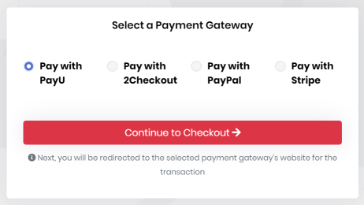
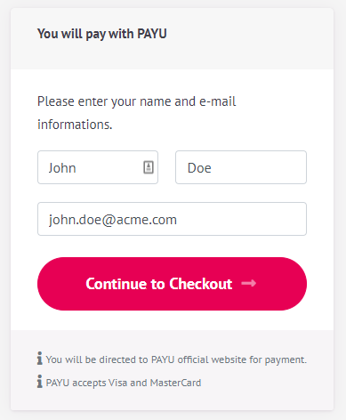
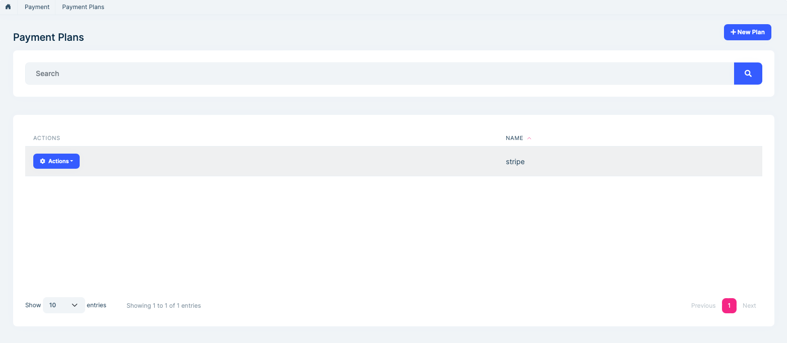
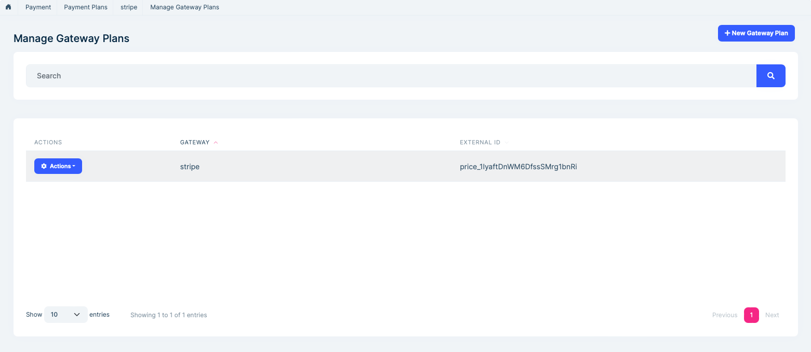
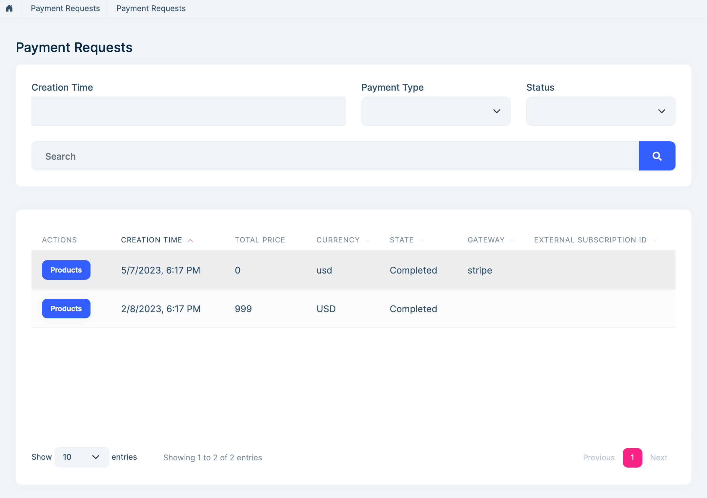
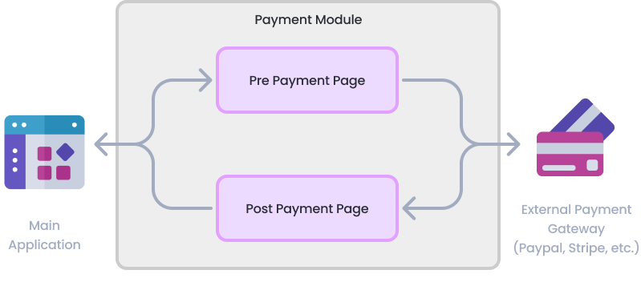
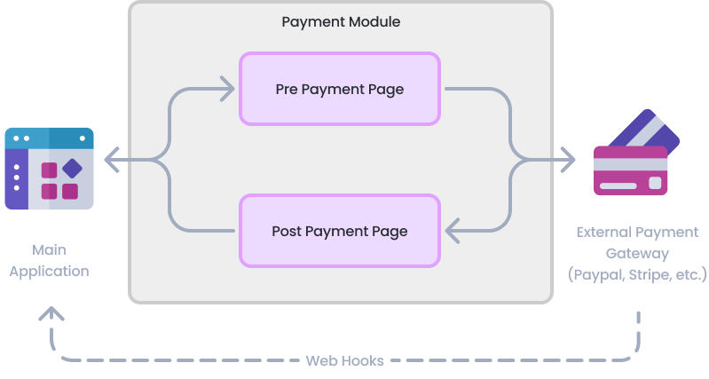

```json
//[doc-seo]
{
    "Description": "Integrate payment gateways seamlessly with the ABP Payment Module, supporting multiple options like Stripe and PayPal for one-time and recurring payments."
}
```

# Payment Module (Pro)

> You must have an [ABP Team or a higher license](https://abp.io/pricing) to use this module.

Payment module implements payment gateway integration of an application. It provides one time payment and recurring payment options. 

* Supports [Stripe](https://stripe.com/), [PayPal](https://www.paypal.com/), [2Checkout](https://www.2checkout.com/), [PayU](https://corporate.payu.com/), [Iyzico](https://www.iyzico.com/en), and [Alipay](https://global.alipay.com/) payment gateways.
* All listed gateways support one-time payments. Stripe also supports subscriptions.

See [the module description page](https://abp.io/modules/Volo.Payment) for an overview of the module features.

## How to Install

The Payment module is not installed in [the startup templates](../solution-templates/layered-web-application). So, it needs to be installed manually. There are two ways of installing a module into your application.


### Using ABP CLI

Use the ABP CLI `add-module` command to add the Payment module to an existing solution:

```bash
abp add-module Volo.Payment
```

### Manual Installation

If you modified your solution structure, adding a module using ABP CLI might not work for you. In such cases, the Payment module can be added to a solution manually.

In order to do that, add packages listed below to matching project on your solution. For example, `Volo.Payment.Application` package to your **{ProjectName}.Application.csproj** like below;

```xml
<PackageReference Include="Volo.Payment.Application" Version="x.x.x" />
```

After adding the package reference, open the module class of the project (eg: `{ProjectName}ApplicationModule`) and add the below code to the `DependsOn` attribute.

```csharp
[DependsOn(
  //...
  typeof(AbpPaymentApplicationModule)
)]
```

> If you are using Blazor Web App, you need to add the `Volo.Payment.Admin.Blazor.WebAssembly` package to the **{ProjectName}.Blazor.Client.csproj** project and add the `Volo.Payment.Admin.Blazor.Server` package to the **{ProjectName}.Blazor.csproj** project.

> For Blazor UI public pages (payment gateway selection, pre-payment, and post-payment pages), see the [Blazor UI](#blazor-ui) section below for detailed installation and configuration instructions.

### Supported Gateway Packages

In order to use a Payment Gateway, you need to add related NuGet packages to your related project as explained in Manual Installation section above and add `DependsOn` to your related module. For example, if you don't want to use PayU, you don't have to use its NuGet packages.

After adding packages of a payment gateway to your application, you also need to configure global payment module options and options for the payment modules you have added. See the Options section below.

### Creating Custom Payment Gateways

If you require a different payment gateway than existing ones, you can create a custom payment gateway by your own. 2 steps are required to create a custom payment gateway. First is creating a payment gateway object that implements `IPaymentGateway`. This interface exposes core payment operations without any UI. Second step is creating UI for the payment gateway. This UI is used to redirect user to payment gateway and validate payment.

Follow the [instructions here](payment-custom-gateway) to create a custom payment gateway.

## Packages

This module follows the [module development best practices guide](../framework/architecture/best-practices) and consists of several NuGet and NPM packages. See the guide if you want to understand the packages and relations between them.

You can visit [Payment module package list page](https://abp.io/packages?moduleName=Volo.Payment) to see list of packages related with this module.

## User Interface

The Payment module provides both **public pages** (for payment processing) and **admin pages** (for managing payment plans and requests). The UI is available for **MVC/Razor Pages**, **Blazor**, and **Angular** applications. See the UI-specific sections below for installation and configuration details.

### MVC / Razor Pages UI

For MVC/Razor Pages applications, add `Volo.Payment.Web` and the Web package for each gateway you want to use, then add the corresponding module dependencies. Configure `PaymentWebOptions` as explained in the [PaymentWebOptions](#paymentweboptions) section.

### Blazor UI

For Blazor applications, add the core Blazor package and the packages for the gateways you want to use, then add the corresponding module dependencies. Configure `PaymentBlazorOptions` as explained below.

#### Installation

To use the Payment module's public pages in a Blazor application, you need to install the core Blazor packages and the gateway-specific Blazor packages for each payment gateway you want to support.

##### Core Blazor Packages

For **Blazor Server** applications, add the following package to your **{ProjectName}.Blazor.Server.csproj** (or **{ProjectName}.Blazor.csproj** for Blazor Web App):

```xml
<PackageReference Include="Volo.Payment.Blazor.Server" Version="x.x.x" />
```

For **Blazor WebAssembly** applications, add the following package to your **{ProjectName}.Blazor.csproj** (or **{ProjectName}.Blazor.Client.csproj** for Blazor Web App):

```xml
<PackageReference Include="Volo.Payment.Blazor.WebAssembly" Version="x.x.x" />
```

##### Gateway-Specific Blazor Packages

Each supported Blazor gateway integration requires its own package. Add the packages for the integrations you want to use:

**Stripe:**
- Blazor Server: `Volo.Payment.Stripe.Blazor.Server`
- Blazor WebAssembly: `Volo.Payment.Stripe.Blazor.WebAssembly`

**PayPal:**
- Blazor Server: `Volo.Payment.PayPal.Blazor.Server`
- Blazor WebAssembly: `Volo.Payment.PayPal.Blazor.WebAssembly`

**PayU:**
- Blazor Server: `Volo.Payment.Payu.Blazor.Server`
- Blazor WebAssembly: `Volo.Payment.Payu.Blazor.WebAssembly`

**Iyzico:**
- Blazor Server: `Volo.Payment.Iyzico.Blazor.Server`
- Blazor WebAssembly: `Volo.Payment.Iyzico.Blazor.WebAssembly`
- HttpApi (required for callbacks): `Volo.Payment.Iyzico.HttpApi`

> **Important:** Iyzico requires the `Volo.Payment.Iyzico.HttpApi` package because Blazor cannot directly handle POST requests from external payment gateways. This package provides an API endpoint to receive the POST callback from Iyzico and redirect to the Blazor post-payment page.

**Alipay:**
- Blazor Server: `Volo.Payment.Alipay.Blazor.Server`
- Blazor WebAssembly: `Volo.Payment.Alipay.Blazor.WebAssembly`

**TwoCheckout:**
- Blazor Server: `Volo.Payment.TwoCheckout.Blazor.Server`
- Blazor WebAssembly: `Volo.Payment.TwoCheckout.Blazor.WebAssembly`

##### Module Dependencies

After adding the package references, add the module dependencies to your Blazor module class. For example, for a Blazor Server application with Stripe and PayPal:

```csharp
[DependsOn(
    // ... other dependencies
    typeof(AbpPaymentBlazorServerModule),
    typeof(AbpPaymentStripeBlazorServerModule),
    typeof(AbpPaymentPayPalBlazorServerModule)
)]
public class YourBlazorModule : AbpModule
{
    // ...
}
```

For Blazor WebAssembly:

```csharp
[DependsOn(
    // ... other dependencies
    typeof(AbpPaymentBlazorWebAssemblyModule),
    typeof(AbpPaymentStripeBlazorWebAssemblyModule),
    typeof(AbpPaymentPayPalBlazorWebAssemblyModule)
)]
public class YourBlazorModule : AbpModule
{
    // ...
}
```

#### Configuration

Configure `PaymentBlazorOptions` in your Blazor module's `ConfigureServices` method:

```csharp
Configure<PaymentBlazorOptions>(options =>
{
    options.RootUrl = configuration["App:SelfUrl"];
    options.CallbackUrl = configuration["App:SelfUrl"] + "/PaymentSucceed";
    options.GatewaySelectionCheckoutButtonStyle = "btn btn-primary"; // Optional CSS class
});
```

##### Gateway-Specific Blazor Options

Each supported Blazor gateway integration has its own options for customizing the UI. The gateway modules bind them from the following configuration sections:

| Gateway | Blazor configuration section |
| --- | --- |
| PayU | `Payment:PayuBlazor` |
| PayPal | `Payment:PayPalBlazor` |
| Iyzico | `Payment:IyzicoBlazor` |
| Alipay | `Payment:AlipayBlazor` |
| Stripe | `Payment:Stripe` |
| TwoCheckout | `Payment:TwoCheckout` |

For example:

```json
{
  "Payment": {
    "PayuBlazor": {
      "PrePaymentCheckoutButtonStyle": "btn btn-success",
      "Recommended": true,
      "ExtraInfos": ["Fast checkout", "Secure payment"]
    },
    "Stripe": {
      "Recommended": true,
      "ExtraInfos": ["Credit/Debit cards", "Apple Pay", "Google Pay"]
    }
  }
}
```

#### Creating Payments in Blazor

To initiate a payment in a Blazor component, inject `IPaymentRequestAppService` and `NavigationManager`, create a payment request, and navigate to the gateway selection page:

```csharp
@page "/"
@using Microsoft.AspNetCore.Components
@using Volo.Payment
@using Volo.Payment.Requests
@inject IPaymentRequestAppService PaymentRequestAppService
@inject NavigationManager NavigationManager

<button class="btn btn-primary" @onclick="StartPaymentAsync">
    Pay Now
</button>

@code {
    private async Task StartPaymentAsync()
    {
        var paymentRequest = await PaymentRequestAppService.CreateAsync(
            new PaymentRequestCreateDto
            {
                Currency = "USD",
                Products = new List<PaymentRequestProductCreateDto>
                {
                    new PaymentRequestProductCreateDto
                    {
                        Code = "Product_01",
                        Name = "LEGO Super Mario",
                        Count = 2,
                        UnitPrice = 60,
                        TotalPrice = 120
                    }
                }
            });

        NavigationManager.NavigateTo($"/Payment/GatewaySelection?paymentRequestId={paymentRequest.Id}");
    }
}
```

##### Passing Extra Parameters

Some payment gateways require additional parameters. You can pass these as extra properties when creating the payment request:

```csharp
var paymentRequest = await PaymentRequestAppService.CreateAsync(
    new PaymentRequestCreateDto
    {
        Currency = "USD",
        Products = new List<PaymentRequestProductCreateDto>
        {
            new PaymentRequestProductCreateDto
            {
                Code = "Product_01",
                Name = "LEGO Super Mario",
                Count = 1,
                UnitPrice = 60,
                TotalPrice = 60
            }
        },
        ExtraProperties =
        {
            // For Iyzico - Customer information
            { "Name", "John" },
            { "Surname", "Doe" },
            { "Email", "john.doe@example.com" },
            { "Address", "123 Main St" },
            { "City", "Istanbul" },
            { "Country", "Turkey" },
            { "ZipCode", "34000" },

            // For PayU - Customer information
            { "BuyerName", "John" },
            { "BuyerSurname", "Doe" },
            { "BuyerEmail", "john.doe@example.com" }
        }
    });
```

#### Handling the Callback (Optional)

When a payment provider redirects the user back to the application, the following flow occurs:

1. The user is redirected to the **PostPayment page** (handled internally by the payment module)
2. The PostPayment page validates the provider response and updates the payment request state
3. If a `CallbackUrl` is configured in `PaymentBlazorOptions`, the user is then redirected to that URL with the `paymentRequestId` as a query parameter

The callback URL is a browser navigation target, not proof that the payment succeeded. Query the payment request and check its state before showing a result:

```csharp
@page "/PaymentSucceed"
@using Microsoft.AspNetCore.Components
@using Volo.Payment.Requests
@inject IPaymentRequestAppService PaymentRequestAppService

@if (PaymentRequest is null)
{
    <p>Payment request not found.</p>
}
else if (PaymentRequest.State == PaymentRequestState.Completed)
{
    <h3>Payment Successful!</h3>
    <p>Thank you for your purchase.</p>
}
else
{
    <p>The payment was not completed.</p>
}

@code {
    [Parameter]
    [SupplyParameterFromQuery]
    public Guid? PaymentRequestId { get; set; }

    private PaymentRequestWithDetailsDto PaymentRequest { get; set; }

    protected override async Task OnParametersSetAsync()
    {
        PaymentRequest = PaymentRequestId.HasValue
            ? await PaymentRequestAppService.GetAsync(PaymentRequestId.Value)
            : null;
    }
}
```

Keep the callback page limited to displaying the current result because users can revisit a callback URL. `PaymentRequestCompletedEto` is published when `IPaymentRequestAppService.CompleteAsync` completes a request, so an idempotent handler can fulfill orders for flows that finish through that application service. It isn't emitted for every direct request-state update; for example, the built-in Stripe webhook can complete a request without publishing this event. If your gateway can complete payments only through a webhook, add an application-owned, idempotent fulfillment or reconciliation path for that trusted webhook flow and verify the persisted payment-request state before granting access.

### Angular UI

For Angular applications, you need to read and apply the steps explained in the following sections:

#### Configurations

Add `providePaymentAdminConfig` from `@volo/abp.ng.payment/admin/config` to the root application configuration. The same example shows the optional remote endpoint entries when the public and admin APIs are hosted separately:

```typescript
// app.config.ts
import { ApplicationConfig } from '@angular/core';
import { providePaymentAdminConfig } from '@volo/abp.ng.payment/admin/config';

export const appConfig: ApplicationConfig = {
  providers: [
    // ...
    providePaymentAdminConfig(),
  ],
};

// environment.ts
export const environment = {
  apis: {
    default: {
      url: 'https://localhost:44300',
    },
    AbpPaymentCommon: {
      url: 'https://localhost:44301',
    },
    AbpPaymentAdmin: {
      url: 'https://localhost:44302',
    },
  },
};
```

`AbpPaymentCommon` is used by the payment-request proxies and is the server-side remote service name for the gateway endpoints. The currently published Angular gateway proxy, which is used by the public gateway-selection component, sends gateway requests through `AbpPaymentAdmin`; administration proxies also use `AbpPaymentAdmin`. When the APIs are hosted separately, configure both entries and expose `/api/payment/gateways` through the `AbpPaymentAdmin` URL until the client and server remote service names are aligned. Each missing entry independently falls back to `default.url`.

Lazy-load both the admin and public payment routes under the `payment` path:

```typescript
// app.routes.ts
import { Routes } from '@angular/router';

const APP_ROUTES: Routes = [
  // ...
  {
    path: 'payment',
    loadChildren: () =>
      Promise.all([
        import('@volo/abp.ng.payment/admin').then(c => c.createRoutes()),
        import('@volo/abp.ng.payment').then(c => c.createRoutes()),
      ]).then(([adminRoutes, publicRoutes]) => [...adminRoutes, ...publicRoutes]),
  },
];
```

The public route factory adds `gateway-selection`, `:gateway/prepayment`, and `:gateway/post-payment`. The admin route factory adds plans, gateway plans, requests, and payment request products.

The public package exposes replaceable component keys through `ePaymentComponents`. Use `registerPrePaymentComponent` or `registerPostPaymentComponent` with `ReplaceableComponentsService` to replace a gateway-specific payment page. The admin `createRoutes` method accepts `PaymentConfigOptions` for entity action, toolbar action, entity property, create form, and edit form contributors on the plans and gateway plans pages.

### Pages

#### Public Pages

##### Payment Gateway Selection

This page allows selecting a payment gateway. If there is only one payment gateway configured for the application, this page will be skipped.



##### PrePayment Page

Some payment gateways require additional information before redirecting to the payment gateway. For example, PayU and Iyzico require customer information (Name, Surname, Email Address, etc.) before processing the payment.



#### Admin Pages

##### Payment Plans Page

Payment plans for subscriptions can be managed on this page. You can connect external subscriptions for each gateway to a plan.





##### Payment Request List

This page lists all the payment request operations in the application.



## Options

### PaymentOptions

`PaymentOptions` is used to store list of payment gateways. You don't have to configure this manually for existing payment gateways. You can, however, add a new gateway like below;

Add `using Volo.Abp.Localization;` to the module class file for `FixedLocalizableString`.

````csharp
Configure<PaymentOptions>(options =>
{
    options.Gateways.Add(
        new PaymentGatewayConfiguration(
            "MyPaymentGatewayName",
            new FixedLocalizableString("MyPaymentGatewayName"),
            isSubscriptionSupported: false,
            typeof(MyPaymentGateway)
        )
    );
});
````

`PaymentOptions` properties:

* `Gateways`: Dictionary of gateway configurations keyed by gateway name.
  * `Name`: Name of payment gateway.
  * `DisplayName`: DisplayName of payment gateway.
  * `IsSubscriptionSupported`: Whether the gateway can process recurring payment products.
  * `PaymentGatewayType`: type of payment gateway.
  * `Order`: Order of payment gateway.

### PaymentWebOptions

`PaymentWebOptions` is used to configure web application related configurations.

* `CallbackUrl`: Final callback URL for internal payment gateway modules to return. A redirect to this URL is not proof of a successful payment. Query the payment request and check its state before displaying the result.
* `RootUrl`: Root URL of your website.
* `GatewaySelectionCheckoutButtonStyle`: CSS style to add Checkout button on gateway selection page. This class can be used for tracking user activity via 3rd party tools like Google Tag Manager.
* `Gateways`: Used to store web related payment gateway configurations.
  * `Name`: Name of payment gateway.
  * `PrePaymentUrl`: URL of the page before redirecting user to payment gateway for payment.
  * `PostPaymentUrl`: URL of the page when user redirected back from payment gateway to your website. This page is used to validate the payment mostly.
  * `Order`: Order of payment gateway for gateway selection page.
  * `Recommended`: Is payment gateway recommended or not. This information is displayed on payment gateway selection page.
  * `ExtraInfos`: List of informative strings for payment gateway. These texts are displayed on payment gateway selection page.

### PaymentBlazorOptions

`PaymentBlazorOptions` is used to configure Blazor application related configurations. This is the Blazor equivalent of `PaymentWebOptions`.

* `CallbackUrl`: Final callback URL for internal payment gateway modules to return. A redirect to this URL is not proof of a successful payment. Query the payment request and check its state before displaying the result.
* `RootUrl`: Root URL of your Blazor application.
* `GatewaySelectionCheckoutButtonStyle`: CSS style to add to the Checkout button on the gateway selection page. This class can be used for tracking user activity via 3rd party tools like Google Tag Manager.
* `Gateways`: Used to store Blazor related payment gateway configurations.
  * `Name`: Name of payment gateway.
  * `PrePaymentUrl`: URL of the Blazor page before redirecting user to payment gateway for payment.
  * `PostPaymentUrl`: URL of the Blazor page when user is redirected back from payment gateway to your website.
  * `Order`: Order of payment gateway for gateway selection page.
  * `Recommended`: Is payment gateway recommended or not. This information is displayed on payment gateway selection page.
  * `ExtraInfos`: List of informative strings for payment gateway. These texts are displayed on payment gateway selection page.

### PayuOptions

`PayuOptions` is used to configure PayU payment gateway options.

* `CheckoutLink`: PayU checkout URL. Its default value is `https://secure.payu.ro/order/lu.php`.
* `Merchant`: Merchant code for PayU account.
* `Signature`: Signature of Merchant.
* `LanguageCode`: Language of the order. This will be used for notification email that are sent to the client, if available.
* `VatRate`: Vat rate of order.
* `PriceType`: Price type of order (GROSS or NET).
* `Shipping`: A positive number indicating the price of shipping.
* `Installment`: The number of installments. It can be an integer between 1 and 12.
* `TestOrder`: Is the order a test order or not (true or false).
* `Debug`: Writes detailed log on PAYU side.

### PayuWebOptions

`PayuWebOptions` is used to configure PayU payment gateway web options.

* `Recommended`: Is payment gateway recommended or not. This information is displayed on payment gateway selection page.
* `ExtraInfos`: List of informative strings for payment gateway. These texts are displayed on payment gateway selection page.
* `PrePaymentCheckoutButtonStyle`: CSS style to add to the Checkout button on the PayU prepayment page. This class can be used for tracking user activity via 3rd party tools like Google Tag Manager.

### PayuBlazorOptions

`PayuBlazorOptions` is used to configure PayU payment gateway Blazor options.

* `Recommended`: Is payment gateway recommended or not. This information is displayed on payment gateway selection page.
* `ExtraInfos`: List of informative strings for payment gateway. These texts are displayed on payment gateway selection page.
* `PrePaymentCheckoutButtonStyle`: CSS style to add to the Checkout button on the PayU prepayment page.

### TwoCheckoutOptions

`TwoCheckoutOptions` is used to configure TwoCheckout payment gateway options.

* `Signature`: Signature of Merchant's 2Checkout account.
* `CheckoutUrl`: 2Checkout checkout URL (it must be set to https://secure.2checkout.com/order/checkout.php).
* `LanguageCode`: Language of the order. This will be used for notification email that are sent to the client, if available.

### TwoCheckoutWebOptions

`TwoCheckoutWebOptions` is used to configure TwoCheckout payment gateway web options.

* `Recommended`: Is payment gateway recommended or not. This information is displayed on payment gateway selection page.
* `ExtraInfos`: List of informative strings for payment gateway. These texts are displayed on payment gateway selection page.

### TwoCheckoutBlazorOptions

`TwoCheckoutBlazorOptions` is used to configure TwoCheckout payment gateway Blazor options.

* `Recommended`: Is payment gateway recommended or not. This information is displayed on payment gateway selection page.
* `ExtraInfos`: List of informative strings for payment gateway. These texts are displayed on payment gateway selection page.

### StripeOptions

`StripeOptions`: is used to configure Stripe payment gateway options.

* `PublishableKey`: Publishable Key for Stripe account.
* `SecretKey`: Secret Key for Stripe account.
* `WebhookSecret`: Used for handling webhooks. You can get if from [Stripe Dashboard](https://dashboard.stripe.com/webhooks). If you don't use subscription & recurring payment it's not necessary.
* `Currency`: Currency code of order (USD, EUR, etc..., see [Stripe docs](https://stripe.com/docs/currencies) for the full list). Its default value is USD.
* `Locale`: Language of the order. Its default value is 'auto'.
* `PaymentMethodTypes`:  A list of the types of payment methods (e.g., card) this Checkout session can accept. See https://stripe.com/docs/payments/checkout/payment-methods. Its default value is 'card'.

### StripeWebOptions

`StripeWebOptions` is used to configure Stripe payment gateway web options.

* `Recommended`: Is payment gateway recommended or not. This information is displayed on payment gateway selection page.
* `ExtraInfos`: List of informative strings for payment gateway. These texts are displayed on payment gateway selection page.

### StripeBlazorOptions

`StripeBlazorOptions` is used to configure Stripe payment gateway Blazor options.

* `Recommended`: Is payment gateway recommended or not. This information is displayed on payment gateway selection page.
* `ExtraInfos`: List of informative strings for payment gateway. These texts are displayed on payment gateway selection page.

### PayPalOptions

`PayPalOptions` is used to configure PayPal payment gateway options.

* `ClientId`: Client Id for the PayPal account.
* `Secret`: Secret for the PayPal account.
* `Environment`: Payment environment. ("Sandbox" or "Live", default value is "Sandbox")
* `Locale`: PayPal-supported language and locale to localize PayPal checkout pages. See https://developer.paypal.com/docs/api/reference/locale-codes/.

### PayPalWebOptions

`PayPalWebOptions` is used to configure PayPal payment gateway web options.

* `Recommended`: Is payment gateway recommended or not. This information is displayed on payment gateway selection page.
* `ExtraInfos`: List of informative strings for payment gateway. These texts are displayed on payment gateway selection page.

### PayPalBlazorOptions

`PayPalBlazorOptions` is used to configure PayPal payment gateway Blazor options.

* `Recommended`: Is payment gateway recommended or not. This information is displayed on payment gateway selection page.
* `ExtraInfos`: List of informative strings for payment gateway. These texts are displayed on payment gateway selection page.

### IyzicoOptions

`IyzicoOptions` is used to configure Iyzico payment gateway options.

* `BaseUrl`: Base API URL for the Iyzico (ex: https://sandbox-api.iyzipay.com).
* `ApiKey`: API key for the Iyzico account.
* `SecretKey`: Secret for the Iyzico account.
* `Currency`: Currency code for the order (USD, EUR, GBP and TRY can be used).
* `Locale`: Language of the order.

### IyzicoWebOptions

`IyzicoWebOptions` is used to configure Iyzico payment gateway web options.

* `Recommended`: Is payment gateway recommended or not. This information is displayed on payment gateway selection page.
* `ExtraInfos`: List of informative strings for payment gateway. These texts are displayed on payment gateway selection page.
* `PrePaymentCheckoutButtonStyle`: CSS style to add to the Checkout button on the Iyzico prepayment page. This class can be used for tracking user activity via 3rd party tools like Google Tag Manager.

### IyzicoBlazorOptions

`IyzicoBlazorOptions` is used to configure Iyzico payment gateway Blazor options.

* `Recommended`: Is payment gateway recommended or not. This information is displayed on payment gateway selection page.
* `ExtraInfos`: List of informative strings for payment gateway. These texts are displayed on payment gateway selection page.
* `PrePaymentCheckoutButtonStyle`: CSS style to add to the Checkout button on the Iyzico prepayment page.

### AlipayOptions

`AlipayOptions` is used to configure Alipay payment gateway options. **Alipay gateway only supports CNY currency**.

* `Protocol`: Protocol for Alipay (for example, https).
* `GatewayHost`: Gateway host for Alipay.
* `SignType`: Sign type for the Alipay.
* `AppId`: AppId for the Alipay account.
* `MerchantPrivateKey`: Merchant private key of the Alipay account.
* `MerchantCertPath`: Merchant certificate path of the Alipay account.
* `AlipayCertPath`: Alipay cert path of the Alipay account.
* `AlipayRootCertPath`: Alipay root cert path of the Alipay account.
* `AlipayPublicKey`: Alipay public key of the Alipay account.
* `NotifyUrl`: Notify url of the Alipay.
* `EncryptKey`: Encrypt key of the Alipay.

### AlipayWebOptions

* `Recommended`: Is payment gateway recommended or not. This information is displayed on payment gateway selection page.
* `ExtraInfos`: List of informative strings for payment gateway. These texts are displayed on payment gateway selection page.
* `PrePaymentCheckoutButtonStyle`: CSS style to add to the Checkout button on the Alipay prepayment page. This class can be used for tracking user activity via 3rd party tools like Google Tag Manager.

### AlipayBlazorOptions

`AlipayBlazorOptions` is used to configure Alipay payment gateway Blazor options.

* `Recommended`: Is payment gateway recommended or not. This information is displayed on payment gateway selection page.
* `ExtraInfos`: List of informative strings for payment gateway. These texts are displayed on payment gateway selection page.
* `PrePaymentCheckoutButtonStyle`: CSS style to add to the Checkout button on the Alipay prepayment page.

> You can check the [Alipay document](https://opendocs.alipay.com/open/02np97) for more details.

Set the currency for a one-time payment with `PaymentRequestCreateDto.Currency`. The legacy `CurrencyCode` settings on PayU, PayPal, and TwoCheckout options are obsolete fallbacks. In the current TwoCheckout integration, you must still configure `CurrencyCode` because it is also used when the product price parameters are generated.

Instead of configuring options in your module class, you can configure it in your appsettings.json file like below;

```json
{
  "Payment": {
    "Payu": {
      "Merchant": "TEST",
      "Signature": "SECRET_KEY",
      "LanguageCode": "en",
      "VatRate": 0,
      "PriceType": "GROSS",
      "Shipping": 0,
      "Installment": "1",
      "TestOrder": "1",
      "Debug": "1"
    },
    "TwoCheckout": {
      "Signature": "SECRET_KEY",
      "CheckoutUrl": "https://secure.2checkout.com/order/checkout.php",
      "LanguageCode": "en",
      "CurrencyCode": "USD",
      "TestOrder": true
    },
    "PayPal": {
      "ClientId": "CLIENT_ID",
      "Secret": "SECRET",
      "Environment": "Sandbox",
      "Locale": "en_US"
    },
    "Stripe": {
      "PublishableKey": "PUBLISHABLE_KEY",
      "SecretKey": "SECRET_KEY",
      "PaymentMethodTypes": ["alipay"]
    },
    "Iyzico": {
      "ApiKey": "API_KEY",
      "SecretKey": "SECRET_KEY",
      "BaseUrl": "https://sandbox-api.iyzipay.com",
      "Locale": "en",
      "Currency": "USD"
    },
    "Alipay": {
      "AppId": "APP_ID",
      "GatewayHost": "openapi.alipaydev.com",
      "AlipayPublicKey": "ALIPAY_PUBLIC_KEY",
      "MerchantPrivateKey": "MERCHANT_PRIVATE_KEY"
    }
  }
}
```

The domain and MVC gateway modules share `Payment:Payu`, `Payment:PayPal`, `Payment:Iyzico`, `Payment:Stripe`, and `Payment:TwoCheckout`. Alipay MVC options use `Payment:AlipayWeb`.

## Error Notifications

The Payment module can collect the exceptions of failing payment gateway operations and email them as a digest. `IPaymentRequestAppService` reports an error when the gateway's `StartAsync` or `HandleWebhookAsync` throws, or when its `CompleteAsync` throws or returns no payment request.

Exceptions implementing `IUserFriendlyException`, including `UserFriendlyException` and its subclasses, are excluded. This check applies to the thrown exception itself. A technical exception wrapping a user-friendly inner exception still sends a notification. Other exceptions, including `BusinessException`, can send notifications. Iyzico reports every error returned by its API as a `UserFriendlyException`, including configuration errors such as an invalid API key, so these errors aren't reported by default. Override `ShouldReport` (see [Customizing Notifications](#customizing-notifications)) to include them.

Only these gateway calls are covered. Errors outside them, such as an unknown gateway name or a payment request that can't be found in `StartAsync`, don't send a notification. A payment request that ends in the `Failed` state without an exception doesn't send one either. The original exception is always re-thrown. Notification activation or sending failures are logged without replacing it.

Notifications are turned on and off with the `Volo.Payment.ErrorNotification.IsEnabled` setting. It is `false` by default, so no email is sent even when receivers are configured. Set it to `true` and configure at least one valid receiver in `Volo.Payment.ErrorNotification.ReceiverEmailAddresses`. Separate addresses with a semicolon (`;`) or comma (`,`).

```json
{
  "Settings": {
    "Volo.Payment.ErrorNotification.IsEnabled": "true",
    "Volo.Payment.ErrorNotification.ReceiverEmailAddresses": "accounting@mycompany.com;dev@mycompany.com"
  }
}
```

The module doesn't provide a settings UI for these values. Besides configuration, both settings can be stored globally in code with `ISettingManager` from the [Setting Management module](setting-management.md). Tenant and user level values are ignored because payment requests and their notification settings belong to the host. Invalid receiver addresses are logged and skipped. If notifications are enabled but no valid receiver is configured, a warning is logged for each error and the error isn't collected.

### Digest Emails

Errors aren't emailed one by one. The first reported error starts a batch in the [distributed cache](../framework/fundamentals/caching.md). Later errors with the same stage, gateway, exception type and exception message are counted in a single entry; other errors get their own entry. A [background worker](../framework/infrastructure/background-workers/index.md) checks the batch every hour and, once `BatchWindow` (one day by default) has passed since the first error, sends all entries in a single email and clears the batch. Later errors don't delay the digest, and the next error after it starts a new batch.

* If notifications are turned off, no new errors are collected and the pending digest isn't sent. The collected errors stay in the cache until they expire (see below); if notifications are turned on again before that, they are sent at the next check. The errors are still in the application logs.
* If the receivers are removed after errors were collected, the batch is kept and sent once a receiver is configured again. A batch that is never sent is removed from the cache `BatchWindow` plus `DigestCheckPeriod` plus one day after its last error.
* With a background job implementation, the digest is queued for each receiver and failed deliveries are retried by the background job system. A receiver that the digest can't be queued or sent to is logged and retried at the next check, without sending the digest again to the receivers that already got it. Receivers removed from the setting in the meantime aren't retried.
  Errors reported in the meantime start a new batch, so they are never added to a digest that some receivers already got. A digest that still has failed receivers is retried until the next digest is due. It is then dropped with an error log, and the next digest is sent to all receivers.

Adding an error to the batch holds a short lock only while the batch is updated. The digest is sent without holding it, so a slow email server doesn't delay failing payment requests. If an error can't be added to the batch (the lock can't be acquired within a few seconds or the cache fails), a warning is logged and the error is left out of the digest. The original exception is still thrown and is still in the application logs.

Consider the following when deploying:

* The digest is sent by the background worker, so [background workers](../framework/infrastructure/background-workers/index.md) must be enabled on at least one instance. Instances with workers disabled still add errors to the batch when they share the cache with that instance.
* With the default in-memory cache, restarting the application loses the errors collected so far. The exceptions are still in the application logs. Use a distributed cache, such as [Redis](../framework/fundamentals/redis-cache.md), to keep the batch across restarts.
* When the application runs on multiple instances, use a shared distributed cache and a [distributed lock](../framework/infrastructure/distributed-locking.md) provider. Without a shared cache, every instance collects and sends its own digest. Without a distributed lock, instances can overwrite each other's counts or send the same digest twice.
* Errors whose messages contain unique values (such as an id) aren't grouped, so each gets its own entry. A batch keeps at most `MaxEntryCount` entries; further error types are only counted, and the digest reports how many were left out.

### PaymentErrorNotificationOptions

`PaymentErrorNotificationOptions` controls the digest timing and size:

* `BatchWindow` (default: one day): How long after the first error of a batch the digest is sent.
* `DigestCheckPeriod` (default: `3600000` milliseconds, one hour): How often the background worker checks whether the digest is due.
* `MaxEntryCount` (default: `50`): The maximum number of distinct errors kept in a batch.

```csharp
Configure<PaymentErrorNotificationOptions>(options =>
{
    options.BatchWindow = TimeSpan.FromHours(12);
});
```

### Email Content and Delivery

Notifications run in the host context, with the caller's tenant restored afterward. The batch is kept in the cache, so it is not affected when the payment unit of work rolls back. The digest is sent with `IEmailSender.QueueAsync`, so configure your application's [email sending](../framework/infrastructure/emailing.md) settings. When a [background job](../framework/infrastructure/background-jobs) implementation is available, a separate unit of work preserves the queued email job even if the surrounding unit of work rolls back. Without a background job implementation, `QueueAsync` falls back to sending synchronously in the host context. Sending failures are logged.

The email starts with the total number of errors, the number of distinct errors and the period they occurred in. Errors are listed from the most frequent. Each entry contains the number of occurrences, the stage (`Start`, `Complete` or `Webhook`), gateway name, exception type and message, the first and last occurrence times with their UTC offset (for example, `2026-11-03 14:05:12 +03:00`), up to five related payment request ids (when known), and the full exception details of the first occurrence (including inner exceptions and available stack traces). Exception messages are truncated to 1,000 characters and exception details to 10,000 characters. Exception text is HTML-escaped and included without automatic redaction. Its body uses the `Payment.ErrorNotification` [text template](../framework/infrastructure/text-templating), which can be overridden like other text templates.

### Customizing Notifications

The module only provides the on/off setting and the options above. To control which errors are reported or how they are delivered, replace `PaymentErrorEmailSender` and override its methods:

* **Filter notifications** by overriding the protected `ShouldReport(PaymentErrorNotificationContext context)` method. It returns `false` for user-friendly exceptions by default; return `true` to report an error or `false` to skip it. The `context` provides `Stage`, `Gateway`, `Exception` and, when known, `PaymentRequestId`. Skipped errors are never added to a batch.
* **Change the receivers, the email or the delivery** by overriding the protected `SendCoreAsync(PaymentErrorNotificationBatchCacheItem batch, IReadOnlyList<string> receivers)` method. It runs when the digest is due, after the enable check, host context, receiver validation and separate unit of work are applied. In the override you can pass a different receiver list to the base method, change the subject, the body or the template, redact sensitive values, or send the errors to another channel (such as a chat or incident tool) instead of, or in addition to, email. `SendCoreAsync` returns the receivers it couldn't send to, and only those are retried at the next check. If it throws, all receivers of that attempt are retried.
* **Change how errors are grouped** by overriding the protected `AddOrIncrementEntry` method.

The following example skips webhook errors:

```csharp
using Microsoft.Extensions.Localization;
using Microsoft.Extensions.Options;
using Volo.Abp.Caching;
using Volo.Abp.DependencyInjection;
using Volo.Abp.DistributedLocking;
using Volo.Abp.Emailing;
using Volo.Abp.MultiTenancy;
using Volo.Abp.Settings;
using Volo.Abp.TextTemplating;
using Volo.Abp.Timing;
using Volo.Abp.Uow;
using Volo.Payment.Emailing;
using Volo.Payment.Localization;

[Dependency(ReplaceServices = true)]
[ExposeServices(typeof(PaymentErrorEmailSender))]
public class MyPaymentErrorEmailSender : PaymentErrorEmailSender
{
    public MyPaymentErrorEmailSender(
        IEmailSender emailSender,
        ITemplateRenderer templateRenderer,
        ISettingProvider settingProvider,
        IUnitOfWorkManager unitOfWorkManager,
        IStringLocalizer<PaymentResource> stringLocalizer,
        IClock clock,
        ICurrentTenant currentTenant,
        IDistributedCache<PaymentErrorNotificationBatchCacheItem> batchCache,
        IAbpDistributedLock distributedLock,
        IOptions<PaymentErrorNotificationOptions> options)
        : base(emailSender, templateRenderer, settingProvider, unitOfWorkManager,
            stringLocalizer, clock, currentTenant, batchCache, distributedLock,
            options)
    {
    }

    protected override bool ShouldReport(PaymentErrorNotificationContext context)
    {
        return context.Stage != PaymentErrorStage.Webhook && base.ShouldReport(context);
    }
}
```

A failure in an override is logged and does not replace the original gateway exception.

## Internals

### Domain layer

#### Aggregates

This module follows the [Entity Best Practices & Conventions](../framework/architecture/best-practices/entities.md) guide.

##### PaymentRequest

A payment request represents a request for a payment in the application.

* `PaymentRequest` (aggregate root): Represents a payment request in the system.
  * `Products` (collection): List of products for payment request.
  * `State` : State of payment request (can be Waiting, Completed, Failed or Refunded).
  * `Currency` : Currency code of payment request (USD, EUR, etc...).
  * `Gateway` : Name of payment gateway used for this payment request.
  * `FailReason`: Reason for failed payment requests.

`Complete()` moves a waiting or failed request to `Completed` and is idempotent for an already completed request. `Failed()` accepts waiting or failed requests, while `Refunded()` accepts only completed requests.

##### Plan

A plan is used for subscription payments. It contains a `GatewayPlans` collection for gateway-specific configurations.

- `Plan` (aggregate root): Represents a plan for recurring payments.
  - `GatewayPlans` (collection): List of gateway plans.
  - `Name`: Required name of the plan.
- `GatewayPlan` (entity): Represents a gateway configuration for a plan.
  - `PlanId`: Represents a plan belong to.
  - `Gateway`: Represents a gateway belong to. It has to be unique.
  - `ExternalId`: Stores the gateway's external subscription configuration, such as a price ID, plan ID, subscription ID, or product ID.

#### Repositories

This module follows the [Repository Best Practices & Conventions](../framework/architecture/best-practices/repositories.md) guide.

Following custom repositories are defined for this module:

* `IPaymentRequestRepository`
* `IPlanRepository`

### Application layer

#### Application services

* `PaymentRequestAppService` (implements `IPaymentRequestAppService`): Used to create payment requests and access payment request details.
* `GatewayAppService` (implements `IGatewayAppService`): Used to provide payment gateway list to UI.
* `PlanAppService` (implements `IPlanAppService`): Used to manage Subscription Plans.

### Database providers

#### Common

##### Table / collection prefix & schema

All tables/collections use the `Pay` prefix by default. Set static properties on the `PaymentDbProperties` class if you need to change the table prefix or set a schema name (if supported by your database provider).

##### Connection string

This module uses `Payment` for the connection string name. If you don't define a connection string with this name, it falls back to the `Default` connection string.

See the [connection strings](../framework/fundamentals/connection-strings.md) documentation for details.

#### Entity Framework Core

##### Tables

* **PayPaymentRequests**
* **PayPaymentRequestProducts**
* **PayPlans**
* **PayGatewayPlans**

#### MongoDB

##### Collections

* **PayPaymentRequests**
* **PayPlans**

## Entity Extensions

[Module entity extension](../framework/architecture/modularity/extending/module-entity-extensions.md) system is a **high-level** extension system that allows you to **define new properties** for existing entities of the dependent modules. It automatically **adds properties to the entity**, **database**, **HTTP API and user interface** in a single point.

To extend entities of the payment module, open your `YourProjectNameModuleExtensionConfigurator` class inside of your `DomainShared` project and change the `ConfigureExtraProperties` method like shown below.

```csharp
public static void ConfigureExtraProperties()
{
    OneTimeRunner.Run(() =>
    {
        ObjectExtensionManager.Instance.Modules()
            .ConfigurePayment(payment =>
            {
                payment.ConfigurePlan(plan => // extend the Plan entity
                {
                    plan.AddOrUpdateProperty<string>( //property type: string
                      "PlanDescription", //property name
                      property => {
                        //validation rules
                        property.Attributes.Add(new RequiredAttribute()); //adds required attribute to the defined property

                        //...other configurations for this property
                      }
                    );
                });
              
              payment.ConfigureGatewayPlan(gatewayPlan => // extend the GatewayPlan entity
                {
                    gatewayPlan.AddOrUpdateProperty<string>( //property type: string
                      "GatewayPlanDescription", //property name
                      property => {
                        //validation rules
                        property.Attributes.Add(new RequiredAttribute()); //adds required attribute to the defined property
                        property.Attributes.Add(
                          new StringLengthAttribute(MyConsts.MaximumDescriptionLength) {
                            MinimumLength = MyConsts.MinimumDescriptionLength
                          }
                        );

                        //...other configurations for this property
                      }
                    );
                });     
            });
    });
}
```

* `ConfigurePayment(...)` method is used to configure the entities of the payment module.

* `payment.ConfigurePlan(...)` is used to configure the **Plan** entity of the payment module. You can add or update your extra properties of the
**Plan** entity. 

* `payment.ConfigureGatewayPlan(...)` is used to configure the **GatewayPlan** entity of the payment module. You can add or update your extra properties of the **GatewayPlan** entity. 

* You can also set some validation rules for the property that you defined. In the above sample, `RequiredAttribute` and `StringLengthAttribute` were added for the property named **"GatewayPlanDescription"**. 

* When you define the new property, it will automatically add to **Entity**, **HTTP API** and **UI** for you. 
  * Once you define a property, it appears in the create and update forms of the related entity. 
  * New properties also appear in the datatable of the related page.

## Distributed Events

- `Volo.Payment.PaymentRequestCompleted` (**PaymentRequestCompletedEto**): Published by `IPaymentRequestAppService.CompleteAsync` when the resolved gateway returns a completed payment request. It isn't a notification for every direct payment-request state update; for example, the built-in Stripe webhook can complete a request without publishing this event.
  
  - `Id`: Represents PaymentRequest entity Id.
  - `Gateway`: Represents the gateway which payment was done with.
  - `Currency`: Represents the currency of payment.
  - `Products` (collection): Represents which products are included in PaymentRequest.
  
- `Volo.Payment.SubscriptionCanceled` (**SubscriptionCanceledEto**): Published when a subscription is stopped or canceled.

  - `PaymentRequestId`: Represents PaymentRequest entity Id.
  - `State`: Represents state of PaymentRequest, such as `Waiting`, `Completed`, `Failed` or `Refunded`.
  - `Currency`: Represents the currency of payment.
  - `Gateway`: Represents the gateway which payment was done with.
  - `FailReason`: Represents a fail reason which is provided by gateway.
  - `ExternalSubscriptionId`: Represents subscription Id of Gateway.
  - `PeriodEndDate`: Represents end date of subscription. _Subscriptions may canceled but lasts until end of last period._

- `Volo.Payment.SubscriptionCreated` (**SubscriptionCreatedEto**): Published when a subscription is created.

  - `PaymentRequestId`: Represents PaymentRequest entity Id.
  - `State`: Represents state of PaymentRequest, such as `Waiting`, `Completed`, `Failed` or `Refunded`.
  - `Currency`: Represents the currency of payment.
  - `Gateway`: Represents the gateway which payment was done with.
  - `ExternalSubscriptionId`: Represents subscription Id of Gateway.
  - `PeriodEndDate`: Represents end date of subscription. _Subscriptions may canceled but lasts until end of last period._

- `Volo.Payment.RecurringPaymentUpdated` (**SubscriptionUpdatedEto**): Published when a subscription is updated in application or in payment gateway dashboard. If subscription is updated from gateway dashboard, this event will be published right after webhook delivery.

  - `PaymentRequestId`: Represents PaymentRequest entity Id.
  - `State`: Represents state of PaymentRequest, such as `Waiting`, `Completed`, `Failed` or `Refunded`.
  - `Currency`: Represents the currency of payment.
  - `Gateway`: Represents the gateway which payment was done with.
  - `ExternalSubscriptionId`: Represents subscription Id of Gateway.
  - `PeriodEndDate`: Represents end date of subscription. _Subscriptions may canceled but lasts until end of last period._

  
> Couldn't find what you need? Check out the [standard distributed events](../framework/infrastructure/event-bus/distributed).

## One-Time Payments

This module implements one-time payments;

* Supports [Stripe](https://stripe.com/), [PayPal](https://www.paypal.com/), [2Checkout](https://www.2checkout.com/), [PayU](https://corporate.payu.com/), [Iyzico](https://www.iyzico.com/en), and [Alipay](https://global.alipay.com/) payment gateways.

You can get one-time payments from your customers using one or more payment gateways supported by the payment module. Payment module works in a very simple way for one-time payments. It creates a local payment request record and redirects customer to payment gateway (PayPal, Stripe etc...) for processing the payment. When the customer pays on the payment gateway, payment module handles the external payment gateway's response and validates the payment to see if it is really paid or not. If the payment is validated, payment module redirects customer to main application which initiated the payment process at the beginning.

Image below demonstrates the flow of a payment process;



Each payment gateway implementation contains PrePayment and PostPayment pages. 

PrePayment page asks users for extra information if requested by the external payment gateway. For example, 2Checkout doesn't require any extra information, so PrePayment page for 2Checkout redirects user to 2Checkout without asking any extra information. 

PostPayment page is responsible for validating the response of the external payment gateway. When a user returns from the gateway, the PostPayment page validates the payment and updates the payment request state. A subsequent redirect to the main application is a browser navigation target, not proof that the payment succeeded.

Query the payment request and check its state before displaying the result. Do not perform fulfillment from the callback page because users can revisit or forge callback URLs. For flows that finish through `IPaymentRequestAppService.CompleteAsync`, use an idempotent `PaymentRequestCompletedEto` handler. For webhook-only completion, use an application-owned, idempotent fulfillment or reconciliation path that runs after the trusted webhook is processed and verifies the persisted request state.

### Creating One-Time Payment

In order to initiate a payment process, inject `IPaymentRequestAppService`, create a payment request using its `CreateAsync` method and redirect user to gateway selection page with the created payment request's Id. Here is a sample Razor Page code which starts a payment process on its OnPost method.

> Redirection of the gateway selection page has to be a **POST** request. If you implement it as a **GET** request, you will get an error. You can use `LocalRedirectPreserveMethod` to keep the method as POST in the redirected request.

```csharp
public class IndexModel : PageModel
{
    private readonly IPaymentRequestAppService _paymentRequestAppService;

    public IndexModel(IPaymentRequestAppService paymentRequestAppService)
    {
        _paymentRequestAppService = paymentRequestAppService;
    }

    public virtual async Task<IActionResult> OnPostAsync()
    {
        var paymentRequest = await _paymentRequestAppService.CreateAsync(new PaymentRequestCreateDto()
        {
            Currency = "USD",
            Products = new List<PaymentRequestProductCreateDto>()
            {
                new PaymentRequestProductCreateDto
                {
                    Code = "Product_01",
                    Name = "LEGO Super Mario",
                    Count = 2,
                    UnitPrice = 60,
                    TotalPrice = 120
                }
            }
        });
        
        return LocalRedirectPreserveMethod("/Payment/GatewaySelection?paymentRequestId=" + paymentRequest.Id);
    }
}
```

`TotalPrice` is optional. When it is omitted, the module calculates it as `UnitPrice * Count`.

The Payment module can redirect the browser to the configured `PaymentWebOptions.CallbackUrl` after processing the gateway response. Treat this URL only as a result page: query the payment request and check its state before displaying the result. `PaymentRequestCompletedEto` can drive idempotent fulfillment for flows completed through `IPaymentRequestAppService.CompleteAsync`; cover webhook-only completion with a trusted, application-owned reconciliation or fulfillment path as described above.

## Subscriptions

This module also implements recurring payments;

* Supports only [Stripe](https://stripe.com/) for now.

You can start a subscription and get recurring payment from your customers using payment gateways supported by this module. It works different from one-time payment. Payment module works with events over webhooks of selected gateway. It creates a local payment request record like one-time payment, but it tracks that payment request in every period that customer pays and publishes events for cancels, updates and continues.



### Enabling WebHooks

Configuring Web Hooks is highly important for subscriptions otherwise your application won't be able to get subscription changes, such as canceled or updated states. Each gateway has its own configuration:

#### Stripe

1. Go to [WebHooks on Stripe Dashboard](https://dashboard.stripe.com/webhooks)
2. Create a new webhook via using **Add endpoint** button.
   - **Endpoint URL**:  `yourdomain.com/api/payment/stripe/webhook`
   - **Events to send**: 
     - `customer.subscription.created`
     - `customer.subscription.deleted`
     - `customer.subscription.updated`
     - `checkout.session.completed` (optional) _If you don't set this, payment will be proceed with callback._
3. Stripe will create a webhook secret key. Copy that and configure it as `WebhookSecret` under [StripeOptions](#stripeoptions).

### Configuring Plans

Before starting a recurring payment, **Plan** and **GatewayPlan** must be configured properly. 

1. Go to your payment gateway (Stripe) dashboard and create product & pricing.
2. Create a **Plan** entity in your application.
3. Go to 'Manage Gateway Plans' section and create a new **GatewayPlan** for gateway and paste price or product id as `ExternalId`.

### Creating a Tenant-Edition Subscription

Follow [saas](saas.md#tenant-edition-subscription) documentation.

### Creating a Recurring Payment

Creating a recurring payment almost same as creating a payment. Setting `PaymentType` property as **Recurring** and passing `PlanId` are enough to start a recurring payment request. If given Plan has multiple GatewayPlan, user will be able to choose gateway to pay.

> Redirection of the gateway selection page has to be a **POST** request. If you implement it as a **GET** request, you will get an error. You can use `LocalRedirectPreserveMethod` to keep the method as POST in the redirected request.

```csharp
public class SubscriptionModel : PageModel
{
    private IPaymentRequestAppService PaymentRequestAppService { get; }

    public SubscriptionModel(IPaymentRequestAppService paymentRequestAppService)
    {
        PaymentRequestAppService = paymentRequestAppService;
    }

    public virtual async Task<IActionResult> OnPostAsync()
    {
        var paymentRequest = await PaymentRequestAppService.CreateAsync(
            new PaymentRequestCreateDto()
            {
                Products =
                {
                    new PaymentRequestProductCreateDto
                    {
                        PaymentType = PaymentType.Subscription,
                        Name = "Enterprise Plan",
                        Code = "EP",
                        Count = 1,
                        // Place your created PlanId below.
                        PlanId = DemoAppData.Plan_2_Id, 
                    }
                }
            });

        return LocalRedirectPreserveMethod("/Payment/GatewaySelection?paymentRequestId=" + paymentRequest.Id);
    }
}
```

> To track whether the subscription continues or is canceled, store its `ExternalSubscriptionId`. All subscription lifecycle events contain this value.
