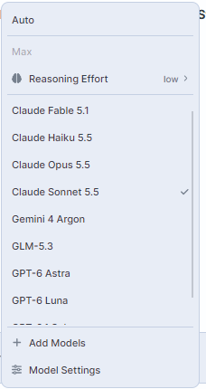
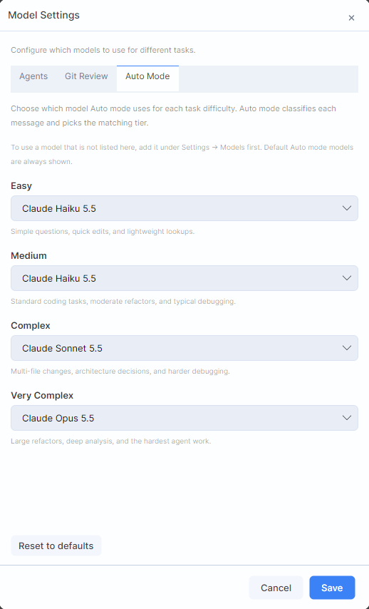
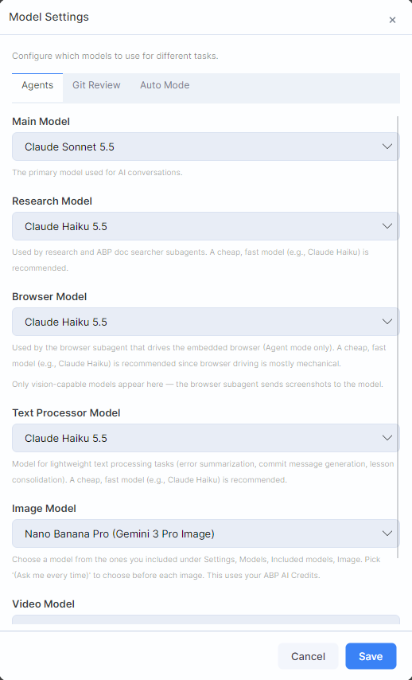
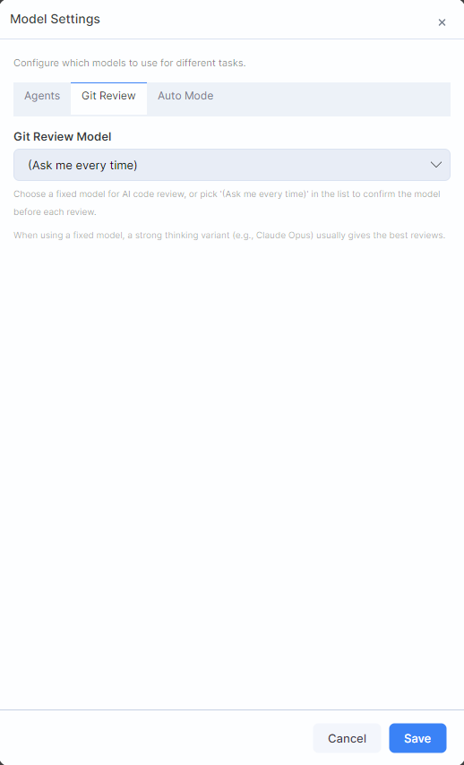

```json
//[doc-seo]
{
    "Description": "Configuration reference for ABP Studio AI Agent models, reasoning, context limits, parallel sessions, permissions, MCP tool connections, AI rules, and learned lessons."
}
```

# ABP Studio: AI Agent Configuration

````json
//[doc-nav]
{
  "Next": {
    "Name": "AI Agent Workflows",
    "Path": "studio/ai-agent-workflows"
  }
}
````

AI Agent configuration controls model selection, execution limits, enabled tools, tool permissions, MCP tool connections, AI rules, and learned lessons.

## Model Provider

ABP Studio maintains a model list with metadata such as provider, context length, maximum completion tokens, image support, reasoning support, and tool support.

The built-in default model set includes:

| Model | Default role | Context length |
| --- | --- | --- |
| Claude Sonnet 5.5 | Main agent | 1,000,000 |
| Claude Haiku 5.5 | Research, browser, and text processing | 1,000,000 |
| Claude Opus 5.5 | Optional high-capability model | 1,000,000 |
| Claude Fable 5.1 | Optional high-capability model | 1,000,000 |
| Gemini 4 Argon | Optional main/review model | 1,048,576 |
| GPT-6 Astra | Optional main/review model | 1,050,000 |
| GPT-6.1 Sol | Optional main/review model | 1,050,000 |
| GPT-6 Luna | Optional main/review model | 1,050,000 |
| GLM-5.3 | Optional text/code model without image support | 1,310,720 |

The available model catalog can be refreshed and is cached locally for a limited period. To add models that are not in the default set, select **Add Models** in the model picker, or open **Settings > Models** and use the **Included models** list.

Open the model picker from the model name in the AI Agent chat composer.



The picker contains these items:

- **Auto** turns Auto mode on or off. See [Auto Mode](#auto-mode).
- **Max** switches the context limit to the model's maximum. See [Context Limit](#context-limit).
- **Reasoning Effort** opens the list of reasoning levels. See [Reasoning Effort](#reasoning-effort).
- The list of included models. Select one to use it as the main model.
- **Add Models** and **Model Settings**.

### Auto Mode

When you use the built-in AI connection, Auto mode picks the model for each message. Studio classifies the task as Easy, Medium, Complex, or Very Complex and uses the model of that tier. Choosing a model manually turns Auto off for the current chat only.

| Tier | Default model |
| --- | --- |
| Easy | Claude Haiku 5.5 |
| Medium | Claude Haiku 5.5 |
| Complex | Claude Sonnet 5.5 |
| Very Complex | Claude Opus 5.5 |

While Auto mode is on, the **Max** and **Reasoning Effort** items are hidden because each tier sets its own limits. To change the model of a tier, open **Model Settings** and use the **Auto Mode** tab. **Reset to defaults** restores the table above.



> The **Auto Mode** tab is shown only when Auto mode is available, which requires the built-in AI connection.

## Model Roles

ABP Studio separates model roles so each AI operation can use a model suited to its cost and capability profile.

| Role | Used by | Default behavior |
| --- | --- | --- |
| Main Model | Normal Agent, Plan, and Ask conversations | Claude Sonnet 5.5. |
| Research Model | Research and ABP documentation subagents | Defaults to Claude Haiku 5.5. Can be set to same as main. |
| Browser Model | The browser subagent that drives the embedded browser (Agent mode only) | Defaults to Claude Haiku 5.5. Only models with image support are listed, because the subagent sends screenshots to the model. |
| Text Processor Model | Lightweight text processing, error summarization, commit message generation, and lesson consolidation | Defaults to Claude Haiku 5.5. Can be set to same as main. |
| Image Model | Image generation and editing | Defaults to Gemini 3 Pro Image. Can be set to "Ask me every time". |
| Video Model | Video generation | Defaults to Veo 3.1 Lite. Can be set to "Ask me every time". |
| Git Review Model | AI Review in the Git panel | Defaults to "Ask me every time". Can be set to same as main or a fixed model. |

To change the roles, select **Model Settings** in the model picker. The window has these tabs:

- **Agents**: Main, Research, Browser, Text Processor, Image, and Video models.
- **Git Review**: the Git Review model.
- **Auto Mode**: the model of each Auto mode tier.



The Git Review model picker does not change the main conversation model. When "Ask me every time" is selected, Studio asks for a model before each AI Review and passes that model only to the review run.



### Image and Video Models

Image and video generation use their own models. Choose the models that are available in two steps:

1. Open **Settings > Models**. In the **Included models** list, switch between the **Chat**, **Image**, and **Video** segments and add the models you want to the **Image** and **Video** segments. By default, the **Image** segment includes Gemini 3 Pro Image, Gemini 3.1 Flash Image, and GPT Image 2, and the **Video** segment includes Veo 3.1 Lite and Veo 3.1.
2. Open **Model Settings** and pick the **Image Model** and **Video Model** on the **Agents** tab. Only the models you included are listed. Select "(Ask me every time)" to choose a model before each generation.

> Image and video generation use your ABP AI Credits.

## Reasoning Effort

Reasoning effort controls the model's reasoning budget where the selected model/provider supports it. Select **Reasoning Effort** in the model picker to change it. Supported values are `none`, `minimal`, `low`, `medium`, `high`, and `xhigh`. The default is `low`.

When the context limit is set to `Max`, Studio uses the maximum context behavior for the model and runs with `xhigh` reasoning effort. The **Reasoning Effort** item is hidden in that case.

## Context Limit

The context limit controls the maximum context size used for agent runs. The default option is `300K`. Select **Max** in the model picker to switch to the `Max` option, which delegates to the model's maximum context behavior. Select it again to return to `300K`.

Large context settings can improve broad solution understanding, but they also increase latency and model cost. Narrow AI scopes and targeted attachments should be preferred when the task is limited to a module or package.

## Parallel Sessions

ABP Studio can run multiple agent sessions in parallel. The default maximum is 3 concurrent sessions, and the configured range is 1 to 5. Prompts beyond the limit are queued. The limit is stored as `maxParallelSessions` in `agent-settings.json` (see [Pull Request Attribution](#pull-request-attribution) for the file location). Values above 5 are treated as 5, and values below 1 use the default of 3.

Each running session locks its own model settings and tool snapshot so global settings changes do not mutate an already-running session.

## Tool Enablement

ABP Studio groups Studio automation tools in settings. Disabled tools are removed from the agent tool list before a run starts.

Core Studio tools are available to Agent mode when enabled:

- Build.
- Monitor exceptions, logs, HTTP requests, and distributed events.
- Start and stop applications.
- Start and stop containers.
- Run tasks.

Extended Studio tools are loaded only when the run context enables them. These include specialized operations such as package/module builds, library installation, and proxy generation.

Tools that exist for internal Studio use can be hidden from the AI agent. Hidden tools are not exposed to the model even when they are implemented in Studio.

## Tool Permissions

Some tools require explicit permission before execution. Open **Settings > Tool Permissions** and choose a **Permission Mode**:

| Mode | Behavior |
| --- | --- |
| Safe mode (default) | Studio prompts before every shell command, URL fetch, and file download, unless the command or domain is on the allowlist. |
| Ask me when important | The AI decides whether an operation is important enough to prompt. Allowlisted commands and domains never prompt, and file downloads always prompt. |
| Allow everything | Studio never prompts for these tools and does not use the allowlist. Use it only in trusted or isolated environments. |

| Tool category | Permission behavior |
| --- | --- |
| Shell commands | Studio prompts before command execution unless the command has been allowed. A command that uses command substitution always prompts, except in Allow everything mode. |
| URL fetches | Studio prompts per domain unless the domain has been allowed. |
| File downloads | Studio always asks before downloading, except in Allow everything mode. |

Permission choices include allow once, allow always, and skip. "Allow always" persists in the AI Agent settings and is reused by future sessions. The allowed commands and domains are listed under **Settings > Tool Permissions**, where you can remove them.

Regardless of the permission mode, Studio asks before the agent reads or writes files outside the active AI scope, opens another solution, or hands the conversation over to the Solution Architect.

## Pull Request Attribution

The **Attribute pull requests to ABP Agent** setting in **Settings > Others** is enabled by default. When it is enabled, pull requests that the agent opens with the GitHub CLI (`gh pr create`, or a `gh api` POST request to `repos/{owner}/{repo}/pulls`) end with a `[Made with ABP Agent](https://abp.io/studio/ai-agent)` link in the description. The agent is also instructed to add this link when it writes a pull request description. If the command needs your approval, the permission prompt shows it with the link added.

When the setting is disabled, the agent does not add the link and shell commands are not modified. Pull request descriptions are published exactly as written.

The setting is stored as `attributeAgentPullRequests` in `agent-settings.json`. The default location is `~/.abp/studio/agent-settings.json` (`%USERPROFILE%\.abp\studio\agent-settings.json` on Windows). If the `ABP_STUDIO_ROOT` environment variable is set, the file is under that folder instead. For headless usage with `abp agent`, for example on CI or on a server where the ABP Studio UI is not available, turn the attribution off by adding the property to the existing JSON object in that file, alongside the other settings:

```json
{
  "attributeAgentPullRequests": false
}
```

A running `abp agent` server or daemon reads the settings at startup, so restart it after changing the file.

## MCP Tool Connections

ABP Studio can connect to user-configured Model Context Protocol (MCP) servers and expose their tools to Agent mode. This section is about that MCP client integration. For the other direction, where external AI clients connect to ABP Studio and use its own tools, see the [Model Context Protocol (MCP)](model-context-protocol.md) documentation.

### Adding an Integration

Open **Settings > MCP Servers** and select **Add integration** to browse the curated integration gallery. Integrations that require settings open a configuration form for values such as an optional Context7 API key, a Microsoft Learn response limit, or a local timezone. You can open the same form later to change or remove those values.

New integrations are added disabled. Review the server and its tools before enabling it.

If the server you need is not in the gallery, select **Add manually** next to the search box. The **Add MCP Server Manually** window asks for:

- **Name**: a name that is not used by another MCP server.
- **Transport**: **HTTP** or **Stdio**.
- **Server URL** (HTTP): remote servers must use HTTPS. Plain HTTP is allowed only for localhost.
- **Command** and **Arguments** (Stdio): separate arguments with spaces and wrap an argument that contains spaces in quotes. Only add commands you trust, because Studio starts them on your machine.
- **Advanced**: for HTTP, the **HTTP transport** (**Auto-detect**, **Streamable HTTP**, or **Server-Sent Events (SSE, legacy)**) and **Headers**. For Stdio, the **Working directory** and **Environment variables**.
- **Enable and connect after adding**: selected by default. Clear it to add the server disabled.

Select **Add server** to save it. Header and environment variable values are stored like [MCP secrets](#mcp-secrets).

MCP server connections use one of these transports:

| Transport | Configuration |
| --- | --- |
| Stdio | Command, arguments, and environment variables. |
| HTTP | URL and headers. |

### Editing the Complete JSON Configuration

Select **Edit JSON** to edit the complete MCP server collection as one document. Studio validates and saves the collection together. Servers omitted from the document are removed, and an empty `mcpServers` object removes all servers.

Studio writes the conventional `mcpServers` document shape:

```json
{
  "mcpServers": {
    "Context7": {
      "command": "npx",
      "args": [
        "-y",
        "@upstash/context7-mcp"
      ]
    },
    "Microsoft Learn": {
      "url": "https://learn.microsoft.com/api/mcp"
    }
  }
}
```

The server name is the key under `mcpServers`. A stdio server requires `command` and can include `args` and `env`. An HTTP server requires `url` and can include `headers`. The JSON document does not contain server IDs or enabled state; enable or disable each server from the MCP Servers page.

The editor accepts strict JSON and rejects unknown server properties or root metadata that Studio cannot preserve. New servers and servers whose command, arguments, or URL changed are saved disabled.

### MCP Secrets

Values entered under `env` or `headers` are stored separately from the AI Agent settings. When you reopen **Edit JSON**, an existing secret is represented by a placeholder such as:

```json
"CONTEXT7_API_KEY": "${secret:CONTEXT7_API_KEY}"
```

- Keep the placeholder unchanged to retain the stored value.
- Replace it with a literal value to update the stored secret.
- Remove the property to delete the stored secret.

Do not create placeholders manually. A placeholder is valid only when it refers to an existing stored value for the same property. Command arguments and URLs are not secret fields and are saved as plain text; use stdio environment variables or HTTP headers for credentials.

MCP secrets use the platform credential storage available to ABP Studio:

| Platform | Storage |
| --- | --- |
| Windows | Windows Data Protection API (DPAPI), scoped to the current user. |
| macOS | A generic password in Keychain under the `AbpStudio` service. |
| Linux and secure-storage fallback | An encrypted file in the user's `.abp/studio` directory with owner-only read/write permissions. |

Connected MCP servers show their connection status, tool count, tools, and resources. Individual MCP tools can be disabled. Disabled MCP tools are omitted from Agent mode. MCP resources can be opened from settings for inspection.

MCP tools are added only for connected and enabled servers. Plan and Ask modes do not receive MCP tools.

## `.abpignore`

The `.abpignore` file is placed in the solution root and uses `.gitignore` syntax. Files matched by `.abpignore` are inaccessible to the agent even when they are under the active AI scope.

The default exclusions protect common secret and credential files, including:

- `appsettings.secrets.json`
- `.env` files except `.env.example`
- certificate and key files such as `.pfx`, `.p12`, `.pem`, `.key`, and `.p8`
- local development Helm values
- tunnel and temporary key files

## AI Rules

AI rules are Markdown files with YAML frontmatter and the `.mdc` extension. Rules can be global or solution-specific.

| Location | Scope |
| --- | --- |
| `%USERPROFILE%/.abp/studio/rules` | Global rules available on the machine. |
| `.abpstudio/ai-rules` | Solution rules shared with the solution when committed. |

Rule frontmatter supports:

```yaml
name: Rule Name
description: Short rule description
alwaysApply: true
```

Always-apply rules are injected into the agent's system prompt. Non-always-apply rules are exposed as available skills and can be loaded by the agent with the `fetch_ai_skills` tool. When a solution skill and a global skill have the same name, the solution skill takes precedence.

## Learned Lessons

The `save_lesson` tool records verified corrections into `.abpstudio/ai-rules/ai-learned-lessons.mdc`. Learned lessons are injected as high-priority context in future sessions.

The agent is instructed to save a lesson only after a user correction is verified against source or tool output. When the learned lessons file becomes large, Studio can consolidate it with the text processor model.
