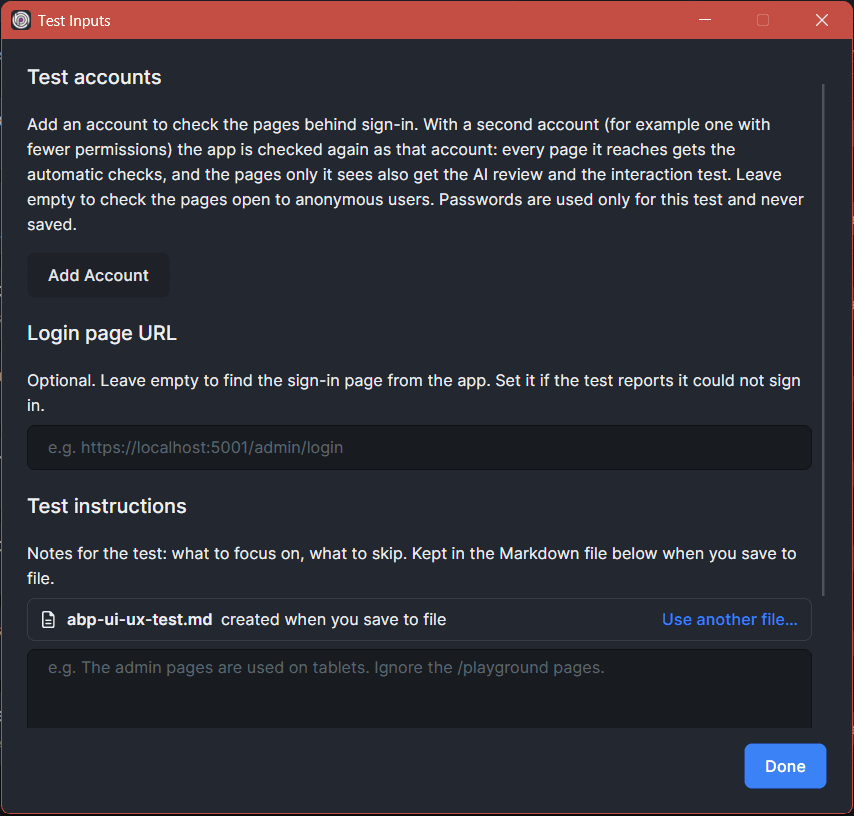

```json
//[doc-seo]
{
    "Description": "Overview of the AI-powered UI/UX Test and Security Test in ABP Studio: what they check, the inputs they use, the results, and fixing and re-verifying findings."
}
```

# ABP Studio: AI Testing

````json
//[doc-nav]
{
  "Next": {
    "Name": "UI/UX Test",
    "Path": "studio/ui-ux-test"
  }
}
````

ABP Studio has two AI-powered tests for the open solution:

- **[UI/UX Test](ui-ux-test.md)** checks the pages of the running applications and the UI code for broken layouts, accessibility problems, missing translations and pages that do not work as they should.
- **[Security Test](security-test.md)** reviews the code for vulnerabilities and attacks the running applications the way a penetration tester would.

Both tests are opened from the menu bar, use the same inputs, show their findings the same way, and can send the findings to the [AI Agent](ai-agent.md) to be fixed. They also run without the UI, from the [ABP CLI and on CI](ai-testing-on-ci.md).

## Codebase and Runtime

Each test has two parts. Choose one of them or both before starting a test:

- **Codebase** reviews the solution's source code. It does not need a running application.
- **Runtime** tests the applications that are running in the [Solution Runner](running-applications.md). Tick them under *Apps to Test*.

If no application is ticked, Studio asks whether to review the code only.

> The runtime part uses the applications for real. The UI/UX Test clicks buttons and submits forms; the Security Test sends real requests, including writes. Both can change or delete data, so run them on a development or test instance whose data you can lose.

## Requirements

- An open solution.
- A working AI connection: an ABP AI plan, or your own model configured in *AI Settings* (see [AI Agent Configuration](ai-agent-configuration.md)). The *Test with* list chooses the model. A test makes many AI calls; with an ABP AI plan, they use its credits.
- For the runtime part, the applications running in the Solution Runner.

Only one of the two tests (or a re-verification) runs at a time.

## Starting and Stopping a Test

1. Click *UI/UX Test* or *Security Test* in the menu bar.
2. Choose the mode: *Codebase + Runtime*, *Codebase* or *Runtime*.
3. Tick the running applications under *Apps to Test*.
4. Optionally pick a model in *Test with*, and click *Configure Inputs* to add test accounts or instructions.
5. Click *Start Test*.

*Stop Test* ends the test after the step it is on and keeps the findings found so far; the status reads *Stopping…* until then. Clicking *Stop Test* again while it waits, and confirming with *Stop Now*, ends the test at once, and nothing from that run is kept. If the AI can no longer be used (no credits left, a rejected key, or the AI access was lost), the test stops the same way as *Stop Test* and says why.

With *Incremental* on, the code review covers only the files changed since the last test, and the findings of the other files are carried over. The running applications are always tested in full.

## Test Inputs

Click *Configure Inputs* to set:



- **Test accounts**: up to two user names and passwords. With an account, the test signs in and also checks the pages behind the sign-in. How each test uses a second account is described on its page ([UI/UX Test](ui-ux-test.md#two-test-accounts), [Security Test](security-test.md#runtime)).
- **Login page URL**: only needed if the test cannot find the sign-in page by itself. Use a path on the application, such as `/Account/Login`, or a full `http://` or `https://` address. A value that is not an address (such as a single word) is not used, and a warning is shown under the field.
- **Test instructions**: free text that tells the test what to focus on or what to skip. They are kept in a Markdown file when the inputs are saved to a file; *Use another file…* picks a Markdown file of your own instead.

### Signing in

The test signs in through the application's own login page, in a browser. When the login page is on a separate authentication server (for example, a tiered solution or an Angular application), the sign-in starts from the application, so that a single-page application completes its own login and receives its token; if that does not work, the given *Login page URL* is tried once.

The password is typed into the login form by Studio; it is never sent to the AI. If the application turns the password down, the test does not try it again, so a wrong password cannot lock the test account, and a warning says why the sign-in failed.

### The inputs file

*Save to File* writes the inputs to the solution folder, so they come back when the solution is opened again and can be committed:

- `abp-ui-ux-test.json` for the UI/UX Test, with the instructions in `abp-ui-ux-test.md`.
- `abp-security.json` for the Security Test, with the instructions in `abp-security.md`.

Passwords are never written to the file. Each account names an environment variable that holds its password; set it where the test runs, or type the password in *Configure Inputs*.

````json
{
  "mode": "both",
  "model": "anthropic/claude-sonnet-5.5",
  "targets": [
    { "name": "Web", "url": "https://localhost:44302" }
  ],
  "loginUrl": "/Account/Login",
  "accounts": [
    { "username": "admin", "passwordEnv": "ABP_TEST_ADMIN_PASSWORD" },
    { "username": "viewer", "passwordEnv": "ABP_TEST_VIEWER_PASSWORD" }
  ],
  "instructionsFile": "abp-ui-ux-test.md"
}
````

| Field | Description |
| --- | --- |
| `mode` | `both`, `codeReview` or `runtime`. `codebase` is accepted too, as the CLI names it. |
| `model` | The model to test with. When it is not available, the default model is used. |
| `targets` | The running applications to test (`name` and `url`). Used by the CLI; in Studio, the applications are ticked under *Apps to Test*. |
| `loginUrl` | The login page, as in *Configure Inputs*. |
| `accounts` | Up to two accounts: `username` and `passwordEnv`, the name of the environment variable that holds the password. |
| `instructions` / `instructionsFile` | The test instructions, as text or as a Markdown file inside the solution folder. |
| `viewports` | UI/UX Test only: the screen widths to test the pages at (`360`, `768`, `1280`, `1920`). |

The Security Test file also holds the test's [policy](security-test.md#policy): `scope`, `suppress` and `severityOverrides`. Saving the inputs from Studio keeps these fields as they are.

So that a cloned repository cannot send the passwords elsewhere, the `targets` and the `loginUrl` in the file must be local addresses (such as `localhost`), and the instructions file must be inside the solution folder. A file that cannot be read is not overwritten.

## Results

The findings are listed with the most severe first. The last results of the open solution are shown again when the test is opened.

- *View Results* opens the results in a tab of their own.
- *Export Results* saves them as Markdown or JSON.
- *Clear Results* deletes them.

Each test also shows what it covered, and checks the findings of the AI a second time before reporting them; see [UI/UX Test](ui-ux-test.md#coverage) and [Security Test](security-test.md#findings). Few findings with a large coverage mean the application looks good; few findings with a small coverage mean the test could not reach much of it.

## Fixing and Re-verifying

1. Tick the findings to fix, or use *Select All*.
2. Optionally pick the model for the fix in *Fix with*.
3. Click *Fix Selected*. A new [AI Agent](ai-agent.md) session opens with the findings, and the agent changes the code there.
4. When the agent finishes, choose *Re-verify now*, or tick the findings later and click *Re-verify Selected*.

If some selected findings are unconfirmed, Studio offers to re-verify them before changing any code.

Re-verification checks the findings again against the code and the running applications. If an application still runs the code from before the fix, Studio offers to restart it first. A finding sent to the agent shows as fixed only after it is re-verified, and a finding seen in a running application can only be re-verified while that application runs: Studio names the application to start, and leaves such findings as they are until then.

| Test | Re-verification results |
| --- | --- |
| UI/UX Test | Fixed, Still failing, Could not re-verify, Incomplete |
| Security Test | Fixed, Still exploitable, Not exploitable, Could not re-verify, Re-verify interrupted |

## Troubleshooting

- **Only the code was reviewed.** No running application was ticked, so the test reviewed the code only. Start the application in the Solution Runner and tick it under *Apps to Test*.
- **Pages behind the sign-in are missing, or the test could not sign in.** Add a test account in *Configure Inputs* and check its password. If the test cannot find the sign-in page, set the *Login page URL* there.

## See Also

- [UI/UX Test](ui-ux-test.md)
- [Security Test](security-test.md)
- [Running the AI Tests from the CLI and on CI](ai-testing-on-ci.md)
- [Solution Runner](running-applications.md)
