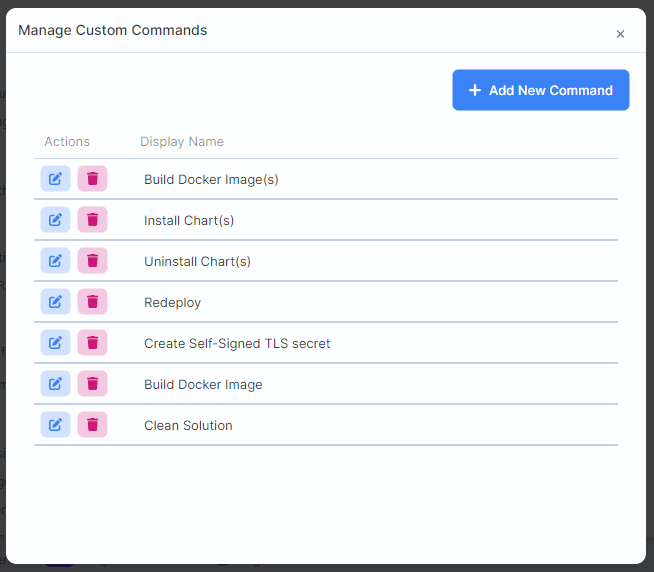
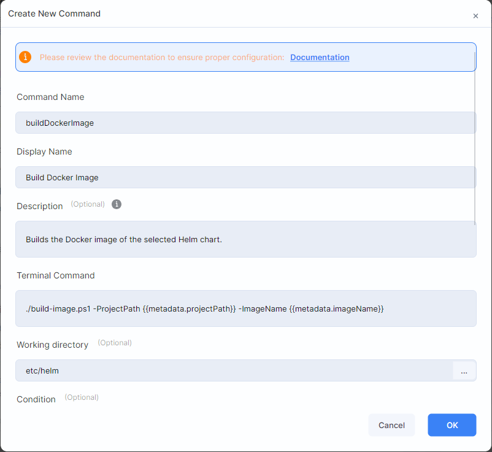

```json
//[doc-seo]
{
    "Description": "Learn how to create and manage custom commands in ABP Studio to automate build, deployment, and other workflows."
}
```

# Custom Commands

````json
//[doc-nav]
{
  "Next": {
    "Name": "Working with ABP Suite",
    "Path": "studio/working-with-suite"
  }
}
````

Custom commands allow you to define reusable terminal commands that appear in context menus throughout ABP Studio. You can use them to automate repetitive tasks such as building Docker images, installing Helm charts, running deployment scripts, or executing any custom workflow.

> **Note:** This is an advanced feature primarily intended for teams working with Kubernetes deployments or complex build/deployment workflows. If you're developing a standard application without custom DevOps requirements, you may not need this feature.

## Opening the Management Window

To manage custom commands, right-click the solution root in the *Solution Explorer* panel and select **Manage Custom Commands**.



The **Manage Custom Commands** window lists the display name of every defined command. Use the pencil icon (**Edit Command**) in the *Actions* column to edit a command, or the trash icon (**Delete**) to delete it after confirmation. Use **Add New Command** at the top right to create a new one.

## Creating a New Command

Click the **Add New Command** button. The **Create New Command** form opens on top of the window. Fill in the fields, select at least one trigger target and click **OK**.



The form has more fields than fit on the screen at once. Scroll down to reach the condition, confirmation and target options.

> Commands are stored in the `.abpsln` file of the solution, so they are shared with your team through source control.

## Command Properties

| Property | Description |
|----------|-------------|
| **Command Name** | A unique identifier for the command (used internally). Use only letters, numbers, underscores, dashes and dots |
| **Display Name** | The text shown in context menus |
| **Description** | Optional. Up to 512 characters. Shown as a tooltip for the command in context menus and read by [ABP Agent](#letting-abp-agent-run-your-commands) to understand what the command does |
| **Terminal Command** | The PowerShell command to execute. Use `&&&` to chain multiple commands |
| **Working directory** | Optional. The directory where the command runs. You can type a path or pick a folder; it is saved relative to the solution folder |
| **Condition** | Optional. A [Scriban](https://github.com/scriban/scriban/blob/master/doc/language.md) expression that determines when the command is visible |
| **Require Confirmation** | When enabled, shows a confirmation dialog before execution |
| **Confirmation Text** | The message shown in the confirmation dialog |

> The **OK** button stays disabled until the command name, display name, terminal command and at least one trigger target are provided.

## Trigger Targets

Trigger targets determine where your command appears in context menus. You can select multiple targets for a single command.

| Target | Location |
|--------|----------|
| **Helm Charts Root** | *Kubernetes* panel > *Helm* tab > root node |
| **Helm Main Chart** | *Kubernetes* panel > *Helm* tab > main chart |
| **Helm Sub Chart** | *Kubernetes* panel > *Helm* tab > sub chart |
| **Kubernetes Service** | *Kubernetes* panel > *Kubernetes* tab > service |
| **Solution Runner Root** | *Solution Runner* panel > profile root |
| **Solution Runner Folder** | *Solution Runner* panel > folder |
| **Solution Runner Application** | *Solution Runner* panel > application |

## Execution Targets

Execution targets define where the command actually runs. This enables cascading execution:

- When you trigger a command from a **root or parent item**, it can recursively execute on all matching children
- For example: trigger from *Helm Charts Root* with execution target *Helm Sub Chart* → the command runs on each sub chart

## Template Variables

Commands support [Scriban](https://github.com/scriban/scriban/blob/master/doc/language.md) template syntax for dynamic values. Use `` to insert context-specific data.

### Available Variables by Context

**Helm Charts:**

| Variable | Description |
|----------|-------------|
| `profile.name` | Kubernetes profile name |
| `profile.namespace` | Kubernetes namespace |
| `chart.name` | Current chart name |
| `chart.path` | Chart directory path |
| `metadata.*` | Hierarchical metadata values (e.g., `metadata.imageName`) |
| `secrets.*` | Secret values (e.g., `secrets.registryPassword`) |

**Kubernetes Service:**

| Variable | Description |
|----------|-------------|
| `name` | Service name |
| `profile.name` | Kubernetes profile name |
| `profile.namespace` | Kubernetes namespace |
| `mainChart.name` | Parent main chart name |
| `chart.name` | Related sub chart name |
| `chart.metadata.*` | Chart-specific metadata |

**Solution Runner (Root, Folder, Application):**

| Variable | Description |
|----------|-------------|
| `profile.name` | Run profile name |
| `profile.path` | Profile file path |
| `application.name` | Application name (Application context only) |
| `application.baseUrl` | Application URL (Application context only) |
| `folder.name` | Folder name (Folder/Application context) |
| `metadata.*` | Profile metadata values |
| `secrets.*` | Profile secret values |

## Example: Build Docker Image

Here's an example command that builds a Docker image for Helm charts:

**Command Properties:**
- **Command Name:** `buildDockerImage`
- **Display Name:** `Build Docker Image`
- **Description:** `Builds the Docker image of the selected Helm chart.`
- **Terminal Command:** `./build-image.ps1 -ProjectPath  -ImageName `
- **Working directory:** `etc/helm`
- **Trigger Targets:** Helm Charts Root, Helm Main Chart, Helm Sub Chart
- **Execution Targets:** Helm Main Chart, Helm Sub Chart
- **Condition:** ``

This command:
1. Appears in the context menu of Helm charts root and all chart nodes
2. Executes on main charts and sub charts (cascading from root if triggered there)
3. Only shows for charts that have `projectPath` metadata defined
4. Runs the `build-image.ps1` script with dynamic parameters from metadata

## Letting ABP Agent Run Your Commands

ABP Agent can list the custom commands of the open solution and run them for you. For example, you can ask the agent to "build the Docker image of the identity service" instead of finding the command in a context menu.

For the agent to use a command correctly:

1. Write a **Description** that explains what the command does and when to use it. The agent reads it together with the command name and display name.
2. Select the correct **Trigger Targets** and **Execution Targets**. When the agent runs a command, it passes one of these target types and, except for *Helm Charts Root* and *Solution Runner Root*, the name of the target item (for example a chart, folder or application name).
3. Mention risky commands in the description. The agent sees whether a command has **Require Confirmation** when it lists the commands, but a command the agent runs does not show the confirmation dialog; the dialog appears only when you run the command from a context menu.

The agent runs the command as a background task, waits for it to finish and shows you the result. If the command fails, the logs are returned to the agent.

> ABP Agent must be enabled and a solution must be open. If the agent says it cannot find a command, ask it to list the custom commands first; the command name must match exactly.
