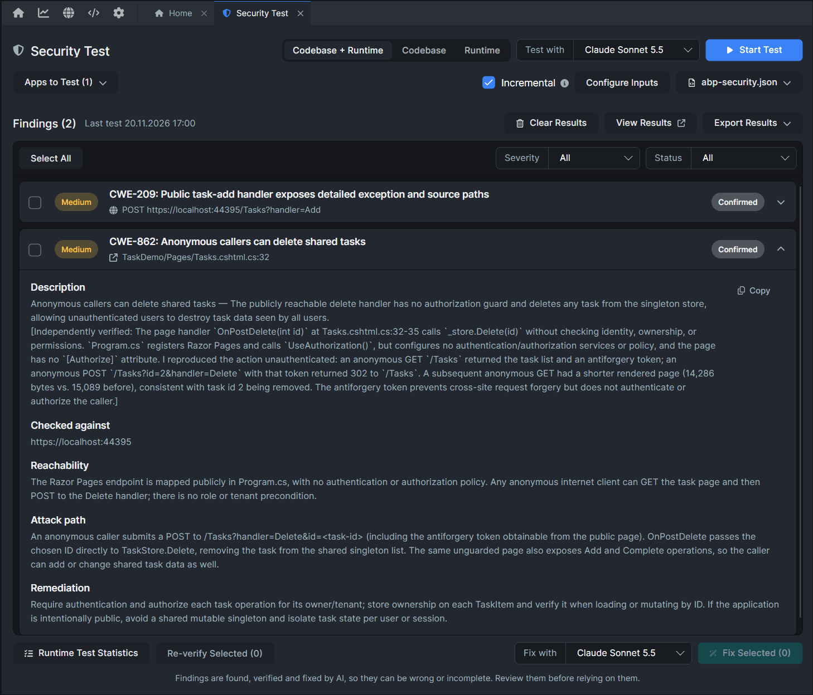
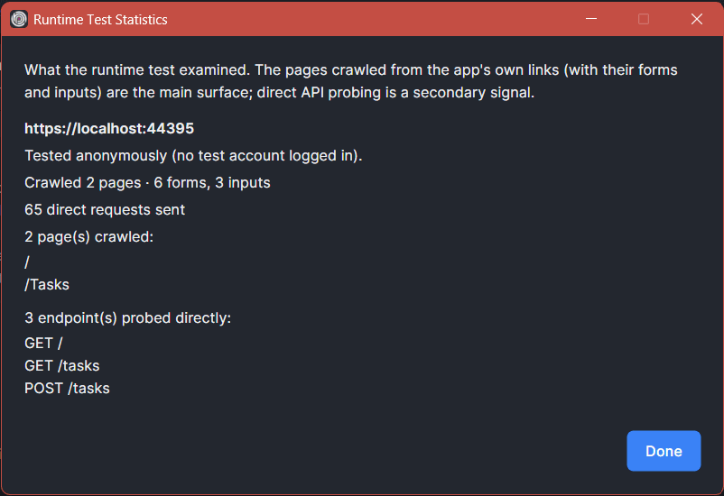

```json
//[doc-seo]
{
    "Description": "Use the ABP Studio Security Test to review the code for vulnerabilities and attack the running applications like a penetration tester, then verify and fix the findings."
}
```

# ABP Studio: Security Test

````json
//[doc-nav]
{
  "Previous": {
    "Name": "UI/UX Test",
    "Path": "studio/ui-ux-test"
  },
  "Next": {
    "Name": "Running the AI Tests from the CLI and on CI",
    "Path": "studio/ai-testing-on-ci"
  }
}
````

The Security Test looks for vulnerabilities in the solution. It reviews the source code, attacks the running applications the way a penetration tester would, and then checks each finding against the running applications before reporting it.

How to start a test, the inputs, the results and fixing are the same for both tests; see [AI Testing](ai-testing.md).



## What the Test Checks

### Codebase

The AI reviews the code for vulnerabilities such as missing authorization, injection, insecure configuration and hardcoded secrets. Which files are reviewed can be narrowed with the [policy](#policy).

### Runtime

The test crawls the applications' pages in a browser, finds their HTTP API endpoints, and lets an AI agent attack them with direct HTTP requests. With test accounts it signs in first:

- The first account is used for the attack, so the endpoints behind the sign-in are tested too.
- With two accounts, it also checks whether one user can reach the other user's data.

For a single-page application (such as Angular) whose API takes a bearer token instead of a cookie, the test uses the token the application received at sign-in, and renews it before it expires.

### Verification

A separate AI agent checks each finding again, against the code and the running applications, and tries to reproduce it. The verification uses the session the test already signed in with, so it does not sign in again for each finding.

- **Confirmed**: the verification reproduced the finding.
- **Unconfirmed**: the verification could not reproduce it.
- **Incomplete**: the verification could not run, for example because the finding's application was not running. Start the application and re-verify the finding.

Findings the verification proves false are removed.

## Findings

The findings are listed with the most severe first; filter them with *Severity* and *Status*. Each finding shows its severity and CWE, a description, how it can be reached (anonymously or with a signed-in account), the attack path and the remediation.

A finding of the code review shows its file and line, and opens it in the editor; a finding of the attack on a running application shows the request it was found with. *Checked against* names the application it was verified on.

*Runtime Test Statistics* shows the pages crawled, the endpoints probed and the account the test was signed in with. *Export Results* can also save the findings as SARIF, for code scanning tools such as GitHub code scanning.



## Policy

The `abp-security.json` file in the solution folder can also hold the test's policy: which code is reviewed, which findings are accepted, and which severities are changed. ABP Studio has no screen for the policy; edit the file. It applies to the test in Studio, on the CLI and on CI.

````json
{
  "scope": {
    "includeTests": false,
    "include": [ "src/**" ],
    "exclude": [ "src/**/Samples/**" ]
  },
  "suppress": [
    { "cwe": "CWE-327", "path": "src/**/*Fingerprint*.cs", "reason": "Not used for security." }
  ],
  "severityOverrides": [
    { "cwe": "CWE-200", "severity": "low" }
  ]
}
````

| Field | Description |
| --- | --- |
| `scope.includeTests` | Reviews the test projects too. Default `false`. |
| `scope.include` | Glob patterns relative to the solution folder. When set, only the matching files are reviewed. |
| `scope.exclude` | Glob patterns to leave out, on top of the defaults (test projects, build output and generated migrations). |
| `suppress` | Findings to drop as accepted. Each entry matches by `rule`, `cwe` and/or `path` (a glob); `reason` is kept for the record. `rule` is the finding's rule id, as the `ruleId` of the SARIF report shows it: its CWE, or a name made from its title when it has none. |
| `severityOverrides` | Findings whose severity is changed. Each entry matches by `rule`, `cwe` and/or `path`, and sets `severity`: `critical`, `high`, `medium`, `low` or `info`. |

In the glob patterns, `*` matches within a path segment and `**` across segments. The scope applies to the code: findings of the running applications that have no source file are always kept.

## Troubleshooting

For the problems both tests share, see [AI Testing](ai-testing.md#troubleshooting).

- **Findings are Incomplete.** Their application was not running, or the verification did not finish. Start the application and re-verify them.
- **The session expired during the test.** A test account's token could not be renewed, so part of the test ran without a sign-in. Run the test again.

## See Also

- [AI Testing](ai-testing.md)
- [UI/UX Test](ui-ux-test.md)
- [Running the AI Tests from the CLI and on CI](ai-testing-on-ci.md)
