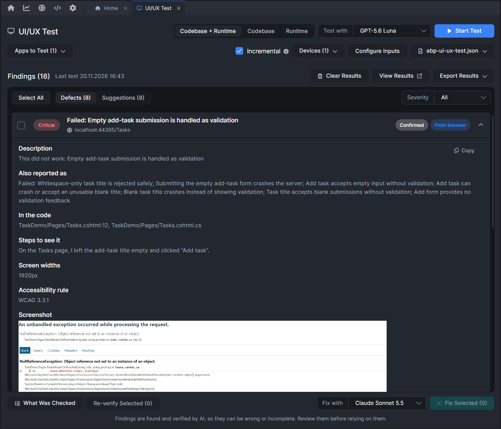
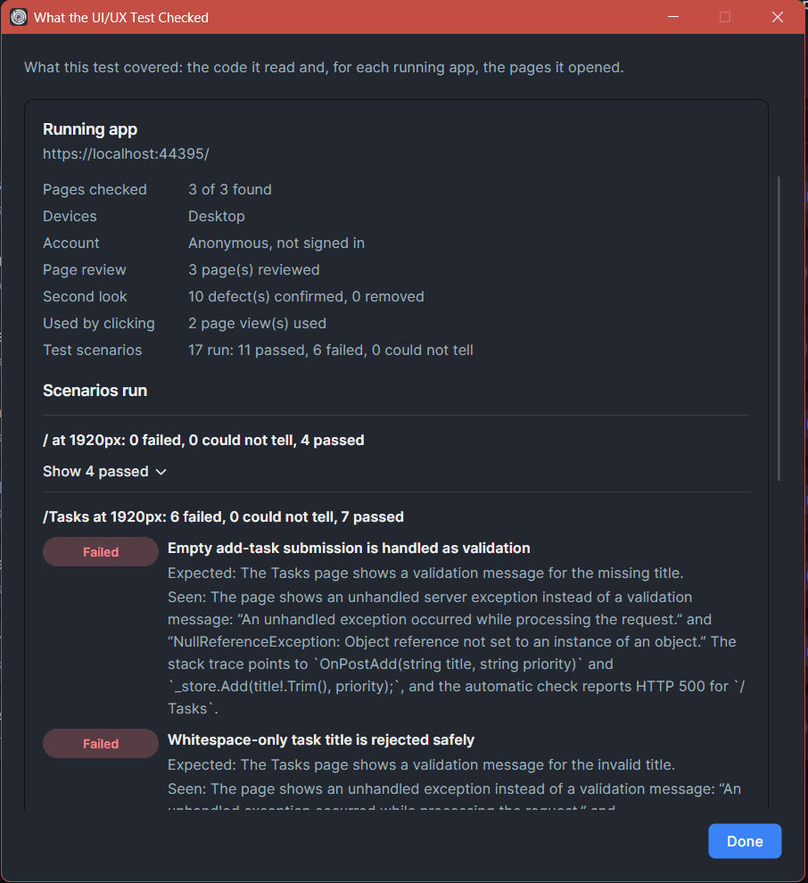

```json
//[doc-seo]
{
    "Description": "Use the ABP Studio UI/UX Test to check the pages of running applications and the UI code for broken layouts, accessibility issues, missing translations and pages that do not work."
}
```

# ABP Studio: UI/UX Test

````json
//[doc-nav]
{
  "Previous": {
    "Name": "AI Testing",
    "Path": "studio/ai-testing"
  },
  "Next": {
    "Name": "Security Test",
    "Path": "studio/security-test"
  }
}
````

The UI/UX Test checks the solution's user interface the way a test team would. It opens every page of the running applications in a browser at the screen widths you choose, has the AI review and use each page, and reviews the UI code and the localization files. It reports what is broken (defects) and what could be better (improvements).

How to start a test, the inputs, the results and fixing are the same for both tests; see [AI Testing](ai-testing.md). Before starting this test, open the *Devices* list and pick the screen widths to test the pages at: *Phone* (360 px), *Tablet* (768 px), *Laptop* (1280 px) and *Desktop* (1920 px).



## What the Test Checks

### Runtime

The test finds the pages of each application by following its links from the start page, in a headless browser. With a test account, it signs in first. Each page is then checked at every chosen width:

- **Checks without AI**:
  - Layout: content that overflows the screen, clipped text, controls covered by other elements, and touch targets that are too small.
  - Text: untranslated localization keys, unrendered templates and raw values shown to the user.
  - Errors the page writes to the browser console, and requests that fail.
  - Links that are broken, and links shown to the signed-in account that it cannot open (an access-denied page, or a redirect to the home page).
- **AI review**: the AI looks at the whole page, from screenshots and an outline of the page (its controls, form fields, images and text), together with the results of the checks above. It reports usability and accessibility problems, and names the [WCAG](https://www.w3.org/WAI/standards-guidelines/wcag/) criterion or the usability heuristic a finding breaks. A second pass compares the pages of each application for consistency.
- **AI interaction**: the AI uses each page like a tester. It works out the scenarios the page needs and runs them: it opens menus, tabs and dialogs, submits each form empty, with invalid values and with valid values, adds, edits and deletes a record, and searches, filters, sorts and pages through lists. Each scenario ends with a statement of what should be true on the screen, which an independent check decides. A failed scenario becomes a defect with the steps to reproduce it; passed scenarios are listed in the coverage as proof.

The parts every page shares, such as the main menu, the header and the footer, are tested on the first page at each screen width only. Sign-in pages are never shown to the AI.

### Codebase

- **Code review**: the AI reviews the UI source code (pages, components, views and their code-behind files) and verifies what it finds.
- **Localization**: the language files (JSON and `.resx`) are compared with each other, without AI, for keys that are missing in a language.

With *Incremental* on, only the code review is limited to the changed files; the localization comparison always covers every language file.

## Two Test Accounts

With a second test account, the applications are checked again as that account. Every page it reaches gets the checks without AI; only the pages the first account did not see get the AI review and interaction. A finding shows *Seen as* with the accounts that saw it, and re-verification signs in with that account.

Use a second account with fewer permissions to find pages and links that only such a user sees, for example a menu item that leads to an access-denied page.

The test does not sign out, and it tells the AI the user name of the account it uses (never the password), so that the AI does not edit, lock or delete that account. If the session ends anyway (for example, after a step changed the account), the test signs in again once per application; if that fails, the remaining pages of that application are listed as not tested.

## Findings

Each finding is a **defect** (something does not work, or breaks an accessibility rule) or an **improvement** (a suggestion), with a severity; the list shows them under *Defects* and *Suggestions*. A badge says where the finding was found: *From browser* (on a page of a running application), *From browser console* (an error the page wrote to the browser console) or *From code* (in the code review). A finding shows:

- The page, the element and the screen widths it was seen at, with a screenshot.
- The steps that led to it, for findings found while using the page.
- What should be true once it is fixed. Every AI defect states this, and a second look checks it: confirmed defects are marked *Confirmed*, defects the second look cannot reproduce become unconfirmed suggestions, and the ones it refutes are dropped.
- **Also in**: the same problem is folded into one finding when it appears on several pages or in one shared component, and the other places are listed.
- **Also reported as**: the other titles the same problem was reported under, folded into this finding.
- The code location, when the code review found the same problem.

After a fix, re-verification checks the page again at a width where the element is visible, and shows the screenshots before and after. A finding is *Incomplete* when it could not be checked again: its application stopped running during the re-verification, the account that saw it is no longer in the inputs or cannot sign in, the page could not be reached, or the AI stopped.

## Coverage

*What Was Checked* shows the code the test read and, for each application:

- the pages checked out of the pages found, and the screen widths;
- whether the test was signed in, and as which account;
- how many pages the AI reviewed and used, and the scenarios it ran with their outcome;
- the pages and links that were skipped or could not be tested, with the reason.



## Troubleshooting

For the problems both tests share, see [AI Testing](ai-testing.md#troubleshooting).

- **The session ended during the test.** A step of the test may have changed the account (its user name, password, roles or lock state). Check the account in the application before the next test.

## See Also

- [AI Testing](ai-testing.md)
- [Security Test](security-test.md)
- [Running the AI Tests from the CLI and on CI](ai-testing-on-ci.md)
