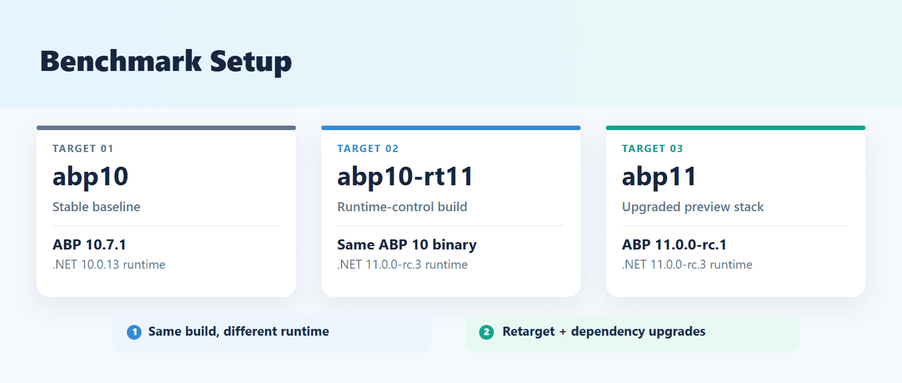
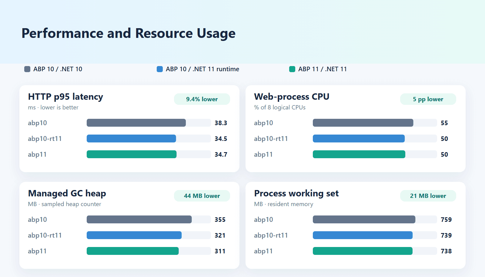

# ABP .NET 10 vs .NET 11 Performance Benchmark

End-to-end load test comparing a template-based ABP MVC application on stable ABP 10.7.1 + .NET 10 (`abp10`) against preview ABP 11.0.0-rc.1 + .NET 11 (`abp11`) under identical hardware, database, data set, and workload conditions:

| Target | Application Build | Runtime | Role |
|---|---|---|---|
| `abp10` | ABP `10.7.1` (`net10.0`) | .NET `10.0.13` | Primary — Stable baseline |
| `abp11` | ABP `11.0.0-rc.1` (`net11.0`) | .NET `11.0.0-rc.3` | Primary — Preview stack |
| `abp10-rt11` | ABP `10.7.1` (`net10.0`) | .NET `11.0.0-rc.3` (`DOTNET_ROLL_FORWARD=LatestMajor`) | Supplementary — Isolates the .NET runtime difference from ABP package changes |



### Key Findings Summary

| Metric / Test | `abp10` (ABP 10 + .NET 10) | `abp10-rt11` (ABP 10 on .NET 11) | `abp11` (ABP 11 + .NET 11) | .NET 11 Advantage |
|---|---|---|---|---|
| **6 it/s p95 Latency (27-run main-validation batch)** | 38.3 ms | 34.5 ms | **34.7 ms** | **9.4% faster** |
| **6 it/s Web CPU Usage** | 55% | 50% | **50%** | **5 pp lower** |
| **6 it/s GC Heap Size** | 355 MB | 321 MB | **311 MB** | **~44 MB less heap** |
| **7 it/s Saturation Knee (p95)** | 39.5 ms | 40.3 ms | **40.2 ms** | Stable at capacity edge (0 errors) |
| **ABP 11 Package Overhead** | — | Baseline | **+0.2 ms** (0.5%) | **No measurable regression** |



Full benchmark methodology, tool evaluation, scenario correlation analysis, and findings are documented in [`report/README.md`](report/README.md). Exact package, runtime, and hardware versions are recorded in [`report/versions.md`](report/versions.md).

---
## Repository Structure

```text
.
├── docker-compose.yml               # PostgreSQL 18.6 (digest-pinned) on port 5433
├── abp10/                           # ABP 10.7.1 + .NET 10 MVC project (EF Core, PostgreSQL, LeptonX Lite)
├── abp11/                           # ABP 11.0.0-rc.1 + .NET 11 MVC project (upgraded copy of abp10)
├── k6/
│   ├── tools/
│   │   └── summarize.mjs            # Aggregates k6, dotnet-counters, and docker stats into Markdown tables
│   └── scenario.js                  # Parameterized multi-VU load-test scenario (smoke, probe, fixed modes)
├── scripts/
│   ├── env.ps1                      # Shared Production measurement environment variables
│   ├── publish.ps1                  # Release-publishes Web and DbMigrator for abp10 and abp11
│   ├── db.ps1                       # Seeds or resets the database from Bench_seed_<target> template DBs
│   ├── seed-bench-data.sql          # Seeds 1,000 test accounts (bench_vu_1..1000) and global email settings
│   ├── start-app.ps1                # Starts a target with optional CPU affinity mask and background logging
│   ├── run-bench.ps1                # Automated benchmark runner (DB reset, affinity, counters, docker stats, k6)
│   └── versions.ps1                 # Generates report/versions.md from published artifacts and system info
└── report/
    ├── README.md                    # Benchmark report (methodology, tool evaluation, results, limitations)
    ├── versions.md                  # Generated environment, SDK, runtime, and package version table
    ├── probe.md                     # Capacity probe results (2 to 32 it/s)
    ├── results-main-validation.md   # Full 27-run marathon re-validation (abp10 vs abp10-rt11 vs abp11)
    ├── results-runtime.md           # Runtime isolation at 4 it/s
    ├── results-runtime6.md          # Runtime isolation at 6 it/s
    ├── results-verify-knee.md       # Saturation knee validation at 7 it/s (9 runs)
    └── results-verify-marathon6.md  # Targeted 6 it/s marathon validation (9 runs)
```

---

## Prerequisites

* **OS:** Windows 11 (CPU affinity and power mode inspection in scripts use Windows commands)
* **.NET SDKs & Runtimes:**
  * .NET 10 SDK (`10.0.402`) and ASP.NET Core Runtime (`10.0.13`)
  * .NET 11 Preview/RC SDK and ASP.NET Core Runtime (`11.0.100-rc.3` / `11.0.0-rc.3`)
* **Diagnostics:** `dotnet-counters` (`dotnet tool install --global dotnet-counters`)
* **Database:** Docker Desktop (runs `postgres:18.6` via `docker compose`)
* **Load Generator:** [Grafana k6](https://grafana.com/docs/k6/latest/set-up/install-k6/) (`v2.3.0+`)
* **Node.js:** `v20+` (for `k6/tools/summarize.mjs`)

---

## Setup & Preparation

Run all commands from the repository root in PowerShell.

### 1. Start PostgreSQL

```powershell
docker compose up -d
```

### 2. Publish Both Projects (Release)

Publishes `Bench.Web` and `Bench.DbMigrator` for both `abp10` and `abp11` into `publish/<target>/`:

```powershell
./scripts/publish.ps1
```

### 3. Seed Template Databases

Runs `Bench.DbMigrator`, applies `scripts/seed-bench-data.sql` (`bench_vu_1..1000` + global email setting rows), and snapshots the result into `Bench_seed_abp10` and `Bench_seed_abp11`. Subsequent runs use `-Action reset` to recreate `Bench` from the template in seconds:

```powershell
./scripts/db.ps1 -Target abp10 -Action seed
./scripts/db.ps1 -Target abp11 -Action seed
```

### 4. Generate the Versions Report

```powershell
./scripts/versions.ps1
```

---

## Running the Scenario Manually (Smoke / Validation)

Set the seeded admin/test user password in the environment:

```powershell
$env:BENCH_PASSWORD = '<seeded_admin_password>'
```

Reset the database and start the desired target (`abp10`, `abp11`, or `abp10-rt11`):

```powershell
./scripts/db.ps1 -Target abp10 -Action reset
./scripts/start-app.ps1 -Target abp10
```

In a second terminal, run the load-test scenario with 1 VU (1 iteration) or 20 concurrent VUs:

```powershell
# Single-user verification (1 iteration = 92 HTTP requests, 107 checks)
k6 run -e BENCH_PASSWORD=$env:BENCH_PASSWORD --vus 1 --iterations 1 k6/scenario.js

# Multi-user concurrency verification (20 VUs, 60 iterations, no think time)
k6 run -e BENCH_PASSWORD=$env:BENCH_PASSWORD -e THINK_TIME=0 -e SESSION_ITERATIONS=2 --vus 20 --iterations 60 k6/scenario.js
```

---

## Running the Full Benchmark Suite

Before running measurements:
* Plug the machine into AC power and set Windows Power Mode to **Best performance**.
* Close browsers, IDEs, k6 Studio, and background apps; leave only Docker Desktop and the PowerShell terminal open.
* Ensure `$env:BENCH_PASSWORD` is set.

### Step 1: Capacity Probe (~32 minutes)

Steps through arrival rates (`2,4,6,8,10,12,14,16,20,24,28,32` iterations/s, 60 s per step) on `abp10` and `abp11` to find the saturation point:

```powershell
./scripts/run-bench.ps1 -Mode probe -Repeats 1 -Batch probe
node k6/tools/summarize.mjs results/probe report/probe.md
```

Inspect `report/probe.md` and pick three load levels (`a, b, c` iterations/s) corresponding to ~25%, ~50%, and ~75% of the lower saturation threshold before dropped iterations or error spikes occur.

### Step 2: Runtime Isolation — `abp10` vs `abp10-rt11` vs `abp11` (~1 hour 15 minutes)

Runs an arrival rate across all three targets × 3 repetitions to separate runtime gains/regressions from ABP package changes:

```powershell
# Medium load (4 it/s):
./scripts/run-bench.ps1 -Mode fixed -Rates 4 -Targets abp10,abp10-rt11,abp11 -Repeats 3 -Batch runtime
node k6/tools/summarize.mjs results/runtime report/results-runtime.md

# High load (6 it/s):
./scripts/run-bench.ps1 -Mode fixed -Rates 6 -Targets abp10,abp10-rt11,abp11 -Repeats 3 -Batch runtime6
node k6/tools/summarize.mjs results/runtime6 report/results-runtime6.md
```

### Step 3: Verification Batches — Knee & Marathon (~1 hour 15 minutes each)

Targeted validation runs addressing saturation threshold and sustained-load endurance:

```powershell
# Saturation Knee (7 it/s):
./scripts/run-bench.ps1 -Mode fixed -Rates 7 -Targets abp10,abp10-rt11,abp11 -Repeats 3 -Batch verify-knee
node k6/tools/summarize.mjs results/verify-knee report/results-verify-knee.md

# Sustained Marathon (6 it/s):
./scripts/run-bench.ps1 -Mode fixed -Rates 6 -Targets abp10,abp10-rt11,abp11 -Repeats 3 -Batch verify-marathon6
node k6/tools/summarize.mjs results/verify-marathon6 report/results-verify-marathon6.md

# Full 3-Target Re-Validation Marathon (Rates 2, 4, 6 it/s, 27 runs, ~3.5 hours):
./scripts/run-bench.ps1 -Mode fixed -Rates 2,4,6 -Targets abp10,abp10-rt11,abp11 -Repeats 3 -Batch main-validation
node k6/tools/summarize.mjs results/main-validation report/results-main-validation.md
```
