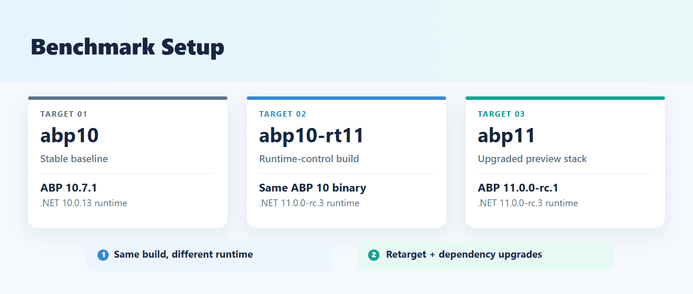
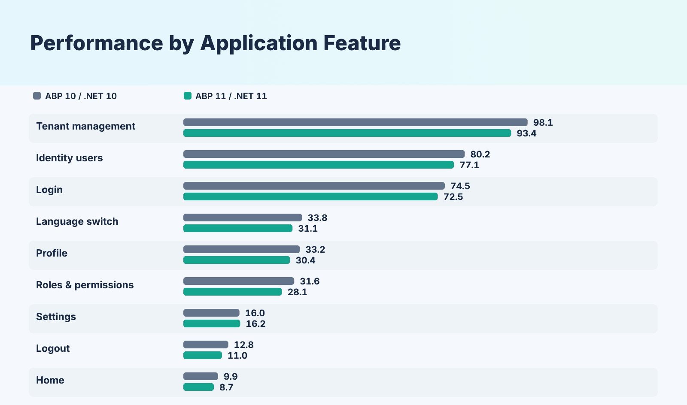
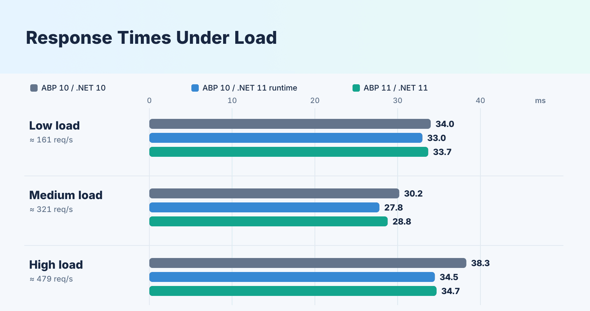
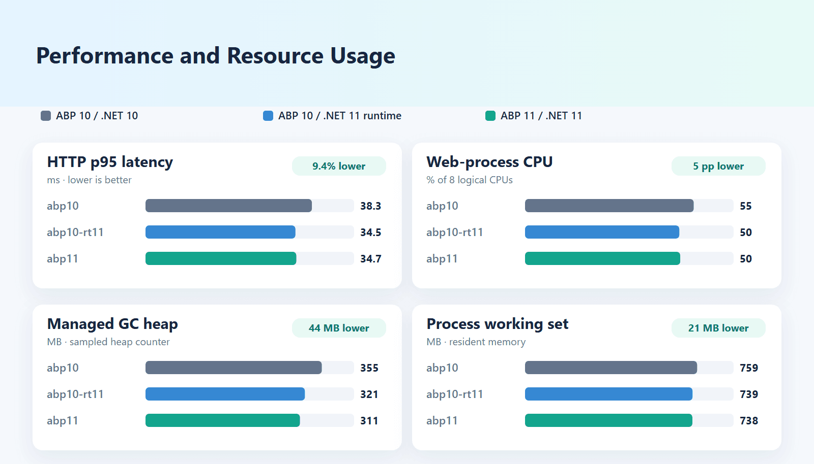

# ABP .NET 10 vs .NET 11 Load-Test Benchmark Report

## 1. Objective & Scope

The goal of this benchmark is to compare the end-to-end performance of a template-based ABP Framework MVC application running on:
1. **`abp10` (Baseline):** Latest stable ABP (`10.7.1`) on .NET 10 (`10.0.13`).
2. **`abp11` (Preview):** Latest preview ABP (`11.0.0-rc.1`) updated for .NET 11 on .NET 11 (`11.0.0-rc.3`).

As a supplementary check for the interpretation note (because comparing `abp10` and `abp11` changes both the ABP version and the .NET runtime simultaneously), an additional **`abp10-rt11`** target runs the exact `abp10` published build rolled forward onto the .NET 11 runtime (`DOTNET_ROLL_FORWARD=LatestMajor`, `DOTNET_ROLL_FORWARD_TO_PRERELEASE=1`) at the medium load level to isolate pure runtime effects from ABP/EF Core package changes.

Both projects were created from the same open-source ABP MVC template (`app`, MVC / Razor Pages, Entity Framework Core, PostgreSQL, LeptonX Lite theme), use identical database schemas and seeded data, and execute the same recorded multi-page user scenario under controlled load.



---

## 2. Versions & Environment

Full generated details are available in [`report/versions.md`](versions.md).

### 2.1 Application & Package Matrix

| Component | `abp10` | `abp11` |
|---|---|---|
| **SDK (`global.json`)** | `10.0.402` | `11.0.100-rc.3.26522.148` |
| **Target Framework** | `net10.0` | `net11.0` |
| **Server GC** | `True` | `True` |
| **Runtime: `Microsoft.NETCore.App`** | `10.0.13` | `11.0.0-rc.3.26522.148` |
| **Runtime: `Microsoft.AspNetCore.App`** | `10.0.13` | `11.0.0-rc.3.26522.148` |
| **NuGet: `Volo.Abp.Core`** | `10.7.1` | `11.0.0-rc.1` |
| **NuGet: `Volo.Abp.AspNetCore.Mvc.UI.Theme.LeptonXLite`** | `5.7.1` | `6.0.0-rc.1` |
| **NuGet: `Volo.Abp.Studio.Client.AspNetCore`** | `3.1.6` | `3.1.6` |
| **NuGet: `Microsoft.EntityFrameworkCore`** | `10.0.11` | `11.0.0-rc.3.26522.148` |
| **NuGet: `Npgsql.EntityFrameworkCore.PostgreSQL`** | `10.0.3` | `11.0.0-rc.1.1` |
| **NuGet: `Npgsql`** | `10.0.3` | `10.0.3` |
| **NuGet: `OpenIddict.Core`** | `7.7.0` | `7.7.0` |
| **npm: `@abp/aspnetcore.mvc.ui.theme.leptonxlite`** | `5.7.1` | `6.0.0-rc.1` |
| **npm: `@abp/aspnetcore.mvc.ui.theme.shared`** | `10.7.1` | `11.0.0-rc.1` |

### 2.2 Project Construction & Parity Verification

* **`abp10`:** Generated via `abp new Bench -t app -u mvc -d ef -dbms PostgreSQL -th leptonx-lite -uost --no-tests`, upgraded to ABP `10.7.1` (`abp update --version 10.7.1`) and LeptonX Lite `5.7.1`.
* **`abp11`:** Created as a direct copy of `abp10` (avoiding template generator drift), upgraded to ABP `11.0.0-rc.1`, target framework `net11.0`, `Microsoft.*` `11.0.0-rc.3.26522.148`, and LeptonX Lite `6.0.0-rc.1`.
* **Schema & Seed Parity:** Both databases contain exactly **41 tables** and identical initial seed rows (21 permission grants, 1 admin role, 1 admin user, plus 1,000 seeded load-test accounts and 2 global email setting rows).

### 2.3 Hardware & Software Environment

| Property | Value |
|---|---|
| **CPU** | Intel Core i7-14650HX — 16 physical cores (8 Performance cores / 16 threads `0..15` + 8 Efficiency cores `16..23`, 24 logical processors) |
| **RAM** | 31.7 GB |
| **OS** | Microsoft Windows 11 Pro (`10.0.26300`) |
| **Power Configuration** | Windows Power Plan: `Balanced`; AC Power Mode overlay: `Best performance` |
| **Database** | PostgreSQL `18.6` (`Debian 18.6-1.pgdg13+2`) in Docker `29.8.1` (`postgres@sha256:3a4264520e121176619f54ff867d12774bc81e95e7b84db58d63bccdb6144b81`) |
| **Load Generator** | Grafana k6 `v2.3.0` + Grafana k6 Studio `2.1.2` |
| **Server Telemetry** | `dotnet-counters` `10.0.750501` + `docker stats` |

---

## 3. Tool Evaluation & Selection

Five candidate tools specified in the task requirements were evaluated against the benchmark criteria: browser scenario recording, stateful replay (cookies, anti-forgery tokens, dynamic IDs, optimistic concurrency stamps), open-workload modeling, resource overhead on a single host, and licensing.

| Tool | License | Browser Recording & Correlation | Multi-Page Stateful Replay | Load Generator Overhead | Suitability for This Task |
|---|---|---|---|---|---|
| **Grafana k6 + k6 Studio** | Free / OSS (AGPLv3 CLI, free Studio) | **Yes** — k6 Studio proxy records HAR and extracts correlation rules into JS | **High** — full JS control over cookies, dual CSRF tokens, multipart forms, and dynamic IDs | **Very Low** — single native Go binary, event-loop VUs, no JVM GC pauses | **Selected** |
| **Apache JMeter** | Free / OSS (Apache 2.0) | **Yes** — HTTP(S) Test Script Recorder captures `.jmx` tree | **Medium** — requires dozens of GUI Regex/JSON extractors and controllers across 92 requests; `.jmx` XML is hard to diff/maintain | **High** — JVM thread-per-VU model; JVM GC pauses and CPU/RAM usage contend with the SUT on a single host | Viable alternative, but inferior isolation and maintainability |
| **Microsoft Crank** | Free / OSS (MIT) | **No** — no browser recorder or HAR correlation pipeline | **Low** — orchestrates single-endpoint drivers (`bombardier`, `wrk`) rather than stateful 92-request user flows unless paired with an external script | Low | Not suitable as a standalone scenario recorder/player |
| **BenchmarkDotNet** | Free / OSS (MIT) | **No** — in-process C# microbenchmark runner | **No** — measures isolated methods, not full HTTP/MVC/EF Core/PostgreSQL page flows | N/A | Supplementary micro-benchmarking only |
| **NBomber** | Commercial license required for organization use | No built-in proxy recorder | High (C# scripting) | Low | **Excluded** due to licensing restriction |

### Why Grafana k6 (+ k6 Studio) Was Chosen Over Apache JMeter

1. **Single-Machine Resource Isolation:** Both the .NET web application, PostgreSQL, and the load generator run on the same laptop. JMeter runs on the JVM with one OS thread per virtual user; under high concurrency its memory footprint and JVM garbage collection pauses introduce measurement noise. k6 is a compiled Go binary with a tiny footprint that runs cleanly inside the pinned Efficiency cores (`0xFF0000`) without starving the .NET process.
2. **True Open Workload Model (`constant-arrival-rate`):** Fairly comparing `.NET 10` and `.NET 11` requires starting the exact same number of user scenario iterations per second against each target regardless of response time. k6 provides `constant-arrival-rate` natively. JMeter's default Thread Group is a closed model (where a slower server throttles the request rate unless extra plugins/timers are configured).
3. **Browser-Like Parallel Requests (`http.batch`):** Every ABP MVC page load fetches three dynamic script endpoints (`/Abp/ApplicationConfigurationScript`, `/Abp/ApplicationLocalizationScript`, `/Abp/ServiceProxyScript`) in parallel. k6 supports parallel batching natively via `http.batch()`, whereas standard JMeter samplers execute sequentially without third-party plugins.
4. **Maintainable Correlation Logic:** Maintaining dual anti-forgery tokens, `ConcurrencyStamp` extraction, multipart form boundaries, and per-VU parameterization across 92 requests takes ~360 lines of clean JavaScript (`k6/scenario.js`) versus thousands of lines of GUI-configured `.jmx` XML in JMeter.
5. **Clean Warm-up Separation:** k6 scenarios (`warmup` followed by `measure`) combined with threshold-filtered `--summary-export` automatically exclude warm-up requests from overall and per-page-group percentiles (`p95`, `p99`) without post-processing raw CSV logs.

---

## 4. Scenario Recording, Correlation & Replay Evaluation

### 4.1 User Journey Covered

One complete scenario iteration visits all pages of the template-based ABP MVC application and exercises every available function (9 groups; about 92 HTTP requests per iteration as counted during scenario validation, per-group counts were not measured):

| Group | Pages & Operations Exercised |
|---|---|
| `01_login` | `GET /Account/Login` (+3 `/Abp/*Script`), switch language to `en`, reload login page, `POST /Account/Login`, redirect to `GET /` (+3 `/Abp/*Script`). Executed on each VU's first iteration and every `SESSION_ITERATIONS` (10) thereafter. |
| `02_home` | Visit home page `GET /` (+3 `/Abp/*Script`). |
| `03_users` | `GET /Identity/Users` (+3 `/Abp/*Script`), list users, filter by `bench`, `GET`/`POST /Identity/Users/CreateModal`, filter by created user name, `GET`/`POST /Identity/Users/EditModal` (with `ConcurrencyStamp`), `GET`/`POST /AbpPermissionManagement/PermissionManagementModal` (`providerName=U`), `DELETE /api/identity/users/{id}`, verify deletion (`totalCount === 0`). |
| `04_roles` | `GET /Identity/Roles` (+3 `/Abp/*Script`), list roles, `GET`/`POST /Identity/Roles/CreateModal`, lookup created role ID, `GET`/`POST /Identity/Roles/EditModal` (with `ConcurrencyStamp`), `GET`/`POST /AbpPermissionManagement/PermissionManagementModal` (`providerName=R`), `DELETE /api/identity/roles/{id}`, verify deletion. |
| `05_tenants` | `GET /TenantManagement/Tenants` (+3 `/Abp/*Script`), list tenants, `GET`/`POST /TenantManagement/Tenants/CreateModal`, lookup tenant ID, `GET`/`POST /TenantManagement/Tenants/EditModal`, `GET`/`POST /FeatureManagement/FeatureManagementModal` (`providerName=T`), `DELETE /api/multi-tenancy/tenants/{id}`, verify deletion. |
| `06_settings` | `GET /SettingManagement` (+3 `/Abp/*Script`), render Emailing tab (`handler=RenderView&id=Volo.Abp.EmailSetting`), `POST /api/setting-management/emailing`, `POST /SettingManagement?handler=RefreshConfiguration`, render Feature Management tab, open Host Feature modal (`GET /FeatureManagement/FeatureManagementModal?providerName=T`). |
| `07_profile` | `GET /Account/Manage` (+3 `/Abp/*Script`), extract `ConcurrencyStamp`, `PUT /api/account/my-profile`, `GET /api/account/my-profile`. |
| `08_language` | Switch UI language to Turkish (`GET /Abp/Languages/Switch?culture=tr`), load `/Account/Manage` (+3 `/Abp/*Script`), switch back to English (`culture=en`), load `/Account/Manage` (+3 `/Abp/*Script`). |
| `09_logout` | `GET /Account/Logout` (`302`), load `GET /Account/Login` (+3 `/Abp/*Script`). Executed every `SESSION_ITERATIONS` (10) iterations. |

### 4.2 Recording with k6 Studio

* Chrome bypasses local proxies for `localhost`, so the recording was performed via `https://bench.localtest.me:44377` (public DNS resolving to `127.0.0.1`) with proxy SSL verification disabled for the ASP.NET Core developer certificate.
* The raw recording contained passwords and session cookies and was not committed; the final scenario is [`k6/scenario.js`](../k6/scenario.js).

### 4.3 Replay Evaluation: Round 1 (Default Export, No Rules)

Exporting the recording from k6 Studio with default settings failed immediately:
1. **Stale Anti-Forgery Token on Login (`400 Bad Request`):** `POST /Account/Login` sent the recorded `__RequestVerificationToken` without matching the fresh `.AspNetCore.Antiforgery.*` cookie from `GET /Account/Login`.
2. **Unauthenticated Cascade:** Because login failed, no `.AspNetCore.Identity.Application` cookie was issued; every subsequent page returned `302 Found` to `/Account/Login` (which k6 followed, returning `200 OK` on the login HTML and masking failures unless URL/content checks are present), while AJAX endpoints returned `401`/`400`.
3. **Static Filter Trap:** k6 Studio's static-asset filter excludes responses with `content-type: application/javascript`. That stripped `/Abp/ApplicationConfigurationScript`, which is the endpoint that sets the `XSRF-TOKEN` cookie required by all ABP AJAX requests.

### 4.4 Replay Evaluation: Round 2 (Correlated k6 Studio Generator)

Seven rules were configured in a k6 Studio generator (not committed), producing a correlated script:

| # | Rule Type | Source / Filter | Selector | Target | Purpose |
|---|---|---|---|---|---|
| 1 | Verification | All requests | `status == recordedValue` | Response status | Fail on unexpected status codes (`200`, `204`, `302`) |
| 2 | Correlation | HTML responses | `name="__RequestVerificationToken" type="hidden" value="..."` | Form/body fields | Replace form anti-forgery tokens with most recent token |
| 3 | Correlation | HTML responses | `name="__RequestVerificationToken" type="hidden" value="..."` | Header `RequestVerificationToken` | Supply valid anti-forgery token header on AJAX requests |
| 4 | Correlation | `/api/identity/users?filter=rec_user` | JSON `items[0].id` | Subsequent URLs & forms | Correlate dynamically generated User GUID |
| 5 | Correlation | `/api/identity/roles` | Regex `"name":"rec_role"[^}]*?"id":"([^"]+)"` | Subsequent URLs & forms | Correlate dynamically generated Role GUID |
| 6 | Correlation | `/api/multi-tenancy/tenants` | JSON `items[0].id` | Subsequent URLs & forms | Correlate dynamically generated Tenant GUID |
| 7 | Correlation | Modal / page HTML | Regex `name="(?:\w+\.)?ConcurrencyStamp" value="([^"]+)"` | Subsequent POST/PUT | Prevent `409 Conflict` on User/Role/Tenant/Profile updates |

**Round 2 Results:**
* **1 VU × 1 iteration:** `59 / 59` checks passed (`0%` failed).
* **1 VU × 3 sequential iterations:** `177 / 177` checks passed (`0%` failed) because each iteration deletes the `rec_user`, `rec_role`, and `rec_tenant` it creates.
* **5 concurrent VUs:** **8.8% request failure rate.** Concurrent VUs collided on hardcoded entity names (`rec_user`, `rec_role`, `rec_tenant` → `Volo.Abp.BusinessException` returned as **HTTP 403**) and on the shared `admin` user's `ConcurrencyStamp` (`AbpDbConcurrencyException` → **HTTP 409**).

### 4.5 Production Load-Test Scenario (`k6/scenario.js`)

To support high-concurrency load testing without artificial data collisions, [`k6/scenario.js`](../k6/scenario.js) refines the correlated Studio script with:
1. **Per-VU Isolated Accounts:** 1,000 admin-equivalent users (`bench_vu_1` .. `bench_vu_1000`) are seeded in `scripts/seed-bench-data.sql`. VU `n` logs in exclusively as `bench_vu_n`, eliminating `ConcurrencyStamp` contention on `/api/account/my-profile`.
2. **Unique Entity Names:** Created entities are named `u_<run>_<vu>_<iter>`, `r_<run>_<vu>_<iter>`, and `t_<run>_<vu>_<iter>` (`run = Date.now().toString(36)`), guaranteeing zero name collisions across VUs and iterations.
3. **Session Reuse Across Iterations:** `noCookiesReset: true` preserves the VU cookie jar across iterations. Each VU logs in on its first iteration and logs out/in every `SESSION_ITERATIONS = 10` iterations so ASP.NET Core Identity's PBKDF2 password hashing does not dominate CPU usage.
4. **Full ABP Dynamic Script Load:** Every `page()` call fetches the HTML and executes `http.batch()` for `/Abp/ApplicationConfigurationScript`, `/Abp/ApplicationLocalizationScript`, and `/Abp/ServiceProxyScript`.
5. **Authentic ABP Token Mechanics:** `ajax()` reads the `XSRF-TOKEN` cookie from the VU's cookie jar for the `RequestVerificationToken` header, while multipart modal posts (`CreateModal`, `EditModal`, `PermissionManagementModal`, `FeatureManagementModal`) embed the latest hidden `__RequestVerificationToken` extracted from HTML.
6. **Validation:** Verified at **1 VU (1 iteration = 107/107 checks)** and **20 concurrent VUs × 60 iterations (6,220/6,220 checks, 0 HTTP errors, 0 application warnings)** on `abp10`, `abp10-rt11`, and `abp11`.

---

## 5. Measurement Methodology

1. **Identical Production Configuration (`scripts/env.ps1`):**
   * `ASPNETCORE_ENVIRONMENT=Production` and `DOTNET_ENVIRONMENT=Production`.
   * `Serilog__MinimumLevel__Default=Warning` and `Serilog__MinimumLevel__Override__Microsoft=Warning` so synchronous file/console logging at `Information` level does not bottleneck throughput.
2. **CPU Core Pinning (`scripts/run-bench.ps1`, `scripts/start-app.ps1`):**
   * On the Intel i7-14650HX (logical CPUs `0..15` = 8 P-cores with HT; `16..23` = 8 E-cores):
     * **Web Application (`Bench.Web.dll`):** Pinned at process creation (`start /affinity FF`) to logical CPUs `0..7` (4 physical P-cores / 8 threads). Setting affinity at process startup ensures .NET Server GC sizes its heaps to `dotnet.process.cpu.count = 8`.
     * **Load Generator (`k6`):** Pinned (`start /affinity FF0000`) to logical CPUs `16..23` (8 E-cores).
     * **OS & Docker/WSL2 (`bench-postgres`):** Logical CPUs `8..15` (remaining 4 P-cores / 8 threads) remain uncontested by the web app and k6.
3. **Clean Database State Per Run (`scripts/db.ps1`):**
   * Before every single run, the running web app is stopped, and `Bench` is dropped and recreated from `Bench_seed_<target>` (`CREATE DATABASE "Bench" TEMPLATE "Bench_seed_<target>"`).
4. **Alternating Target Order:**
   * Odd repetitions run in order `abp10 → abp11` (or `abp10 → abp10-rt11 → abp11`); even repetitions reverse the order (`abp11 → abp10`) to cancel thermal or background drift.
5. **Warm-up & Measurement Window:**
   * Every fixed-rate run executes a **120 s warm-up** (`warmup` scenario), a **10 s grace gap** (`GRACE_S = 10`, allowing in-flight requests to finish while keeping VUs logged in), and a **300 s measured window** (`measure` scenario), repeated **3 times** per target and rate.
   * Server metrics (`dotnet-counters` at 1 s intervals and `docker stats` at ~2 s intervals) are sliced strictly to `[measureStartUtc, measureEndUtc)` by `k6/tools/summarize.mjs`.

---

## 6. Results & Bottleneck Analysis


### 6.1 Capacity Probe (`abp10` vs `abp11`)

Command:
```powershell
./scripts/run-bench.ps1 -Mode probe -Repeats 1 -Batch probe
node k6/tools/summarize.mjs results/probe report/probe.md
```

The capacity probe stepped through 12 arrival rates (`2, 4, 6, 8, 10, 12, 14, 16, 20, 24, 28, 32` iterations/s, 60 s per step after a 60 s warm-up). Full output in [`report/probe.md`](probe.md):

| target | rate it/s | req/s | p95 ms | p99 ms | failed | dropped it | app CPU % (avg/max) | working set MB | GC pause ms/s | TP queue max | DB CPU % |
|---|---:|---:|---:|---:|---:|---:|---|---:|---:|---:|---:|
| abp10 | 2 | 161.6 | 25.2 | 79.5 | 0.00% | 0 | 14.2 / 18.2 | 574 | 18.2 | 2 | 14.9 |
| abp10 | 4 | 324.5 | 30.2 | 86.4 | 0.00% | 0 | 32.7 / 40.8 | 630 | 26.4 | 93 | 34.2 |
| abp10 | 6 | 484.8 | 44.7 | 129.6 | 0.00% | 0 | 65.0 / 90.8 | 703 | 37.8 | 2 | 61.1 |
| abp10 | 8 | 625.3 | 195.8 | 364.8 | 0.00% | 21 | 97.4 / 102.3 | 866 | 48.4 | 37 | 88.7 |
| abp10 | 10 | 582.8 | 641.3 | 1075.5 | 0.00% | 128 | 97.7 / 104.3 | 988 | 72.8 | 340 | 85.6 |
| abp10 | 12 | 519.3 | 1298.4 | 2174.9 | 0.00% | 201 | 97.3 / 108.8 | 1208 | 103.3 | 597 | 84.7 |
| abp10 | 14 | 460.5 | 1843.4 | 2565.4 | 0.00% | 274 | 97.4 / 122.9 | 1433 | 112.1 | 941 | 78.8 |
| abp10 | 16 | 384.9 | 3657.1 | 5967.5 | 0.00% | 368 | 97.4 / 116.2 | 1634 | 89.1 | 967 | 74.4 |
| abp10 | 20 | 316.2 | 5745.5 | 7931.9 | 0.00% | 480 | 97.1 / 107.2 | 1953 | 92.5 | 1105 | 60.9 |
| abp10 | 24 | 248.8 | 8682.5 | 12970.0 | 0.00% | 577 | 97.9 / 134.2 | 2162 | 93.8 | 1040 | 49.1 |
| abp10 | 28 | 216.8 | 15130.9 | 17844.5 | 0.00% | 681 | 97.6 / 126.4 | 2560 | 83.2 | 1075 | 40.4 |
| abp10 | 32 | 195.9 | 17141.5 | 23436.1 | 0.00% | 921 | 97.8 / 121.1 | 2735 | 75.4 | 1077 | 37.6 |
| abp11 | 2 | 161.6 | 31.2 | 96.1 | 0.00% | 0 | 16.7 / 24.4 | 581 | 22.3 | 1 | 16.3 |
| abp11 | 4 | 324.5 | 34.5 | 98.9 | 0.00% | 0 | 36.2 / 48.2 | 674 | 22.0 | 1 | 36.6 |
| abp11 | 6 | 486.1 | 53.7 | 149.7 | 0.00% | 0 | 72.0 / 95.1 | 705 | 40.7 | 4 | 66.8 |
| abp11 | 8 | 588.9 | 392.9 | 1056.8 | 0.00% | 53 | 97.5 / 102.5 | 906 | 65.4 | 62 | 91.4 |
| abp11 | 10 | 575.5 | 581.4 | 7347.7 | 0.00% | 150 | 97.3 / 109.4 | 1056 | 141.9 | 74 | 87.2 |
| abp11 | 12 | 511.6 | 1516.9 | 9978.2 | 0.00% | 205 | 95.1 / 118.2 | 1225 | 134.2 | 714 | 93.0 |
| abp11 | 14 | 475.9 | 2936.0 | 4962.4 | 0.00% | 269 | 95.5 / 109.6 | 1615 | 108.4 | 488 | 96.0 |
| abp11 | 16 | 413.1 | 4390.1 | 8079.5 | 0.00% | 353 | 90.7 / 99.8 | 1866 | 99.2 | 50 | 87.5 |
| abp11 | 20 | 176.6 | 9764.5 | 17464.3 | 1.10% | 482 | 54.1 / 99.0 | 2042 | 62.5 | 1303 | 37.0 |
| abp11 | 24 | 311.9 | 8049.4 | 12906.0 | 0.00% | 583 | 95.4 / 125.0 | 2309 | 121.3 | 482 | 76.8 |
| abp11 | 28 | 296.4 | 11598.2 | 14170.4 | 0.00% | 681 | 95.0 / 102.5 | 2664 | 99.0 | 1036 | 76.1 |
| abp11 | 32 | 255.8 | 15488.4 | 19624.8 | 0.00% | 921 | 96.5 / 103.7 | 3031 | 85.2 | 1126 | 67.2 |

**Probe Findings & Selected Load Levels:**
* Both targets sustain **`2`, `4`, and `6` it/s** (`162`, `325`, and `485 req/s`) with **0 dropped iterations** and **0.00% HTTP errors**.
* Both targets reach full CPU saturation (`97.4%`–`97.5%` average CPU across the 8 pinned P-core threads) at **`8 it/s`**, where `abp10` peaks at **`625.3 req/s`** (`p95 = 195.8 ms`, `21` dropped iterations) and `abp11` peaks at **`588.9 req/s`** (`p95 = 392.9 ms`, `53` dropped iterations).
* Using `8 it/s` as the saturation ceiling, the three measured load levels (~25%, ~50%, ~75% of capacity) are **`2`, `4`, and `6` iterations/s** (`~162`, `~323`, and `~485 req/s`).

### 6.2 Excluded Initial Batch

The first fixed-rate batch (`abp10` vs `abp11` at 2, 4, 6 it/s) was measured while the machine was still in use for other work. Its absolute numbers were inflated (the `abp10` web process needed ~79% CPU at 6 it/s, versus ~50–55% in every later batch for the same request rate) and `abp11` showed an unexplained 2x p95 at 6 it/s. Because the measurement conditions were not controlled, the batch was discarded and is not reported. All results below were measured on a dedicated, otherwise idle machine; the 27-run `main-validation` batch (6.3.5) repeats the full 2, 4, 6 it/s matrix under those conditions.

### 6.3 Runtime Isolation (`abp10` vs `abp10-rt11` vs `abp11`)

To isolate how much of the performance difference comes from the .NET 11 runtime versus the ABP 11.0.0-rc.1 / EF Core 11 RC packages, two runtime isolation batches were executed (3 repetitions each):

#### 6.3.1 Rate 4 it/s (Medium Load, ~321 req/s)

Command:
```powershell
./scripts/run-bench.ps1 -Mode fixed -Rates 4 -Targets abp10,abp10-rt11,abp11 -Repeats 3 -Batch runtime
node k6/tools/summarize.mjs results/runtime report/results-runtime.md
```

| target | req/s | avg ms | p95 ms | p99 ms | app CPU % | DB CPU % | working set MB | GC pause ms/s |
|---|---:|---:|---:|---:|---:|---:|---:|---:|
| abp10 | 321.3 | 9.1 | 26.6 | 74.5 | 28.3 | 33.0 | 650 | 24.3 |
| abp10-rt11 | 321.4 | 9.2 | 26.8 | 75.2 | 29.3 | 32.3 | 674 | 20.1 |
| abp11 | 321.4 | 9.3 | 27.3 | 76.1 | 30.5 | 32.9 | 655 | 24.3 |

#### 6.3.2 Rate 6 it/s (High Load, ~480 req/s)

Command:
```powershell
./scripts/run-bench.ps1 -Mode fixed -Rates 6 -Targets abp10,abp10-rt11,abp11 -Repeats 3 -Batch runtime6
node k6/tools/summarize.mjs results/runtime6 report/results-runtime6.md
```

| target | req/s | avg ms | p95 ms | p99 ms | app CPU % | DB CPU % | working set MB | GC pause ms/s |
|---|---:|---:|---:|---:|---:|---:|---:|---:|
| abp10 | 481.5 | 11.5 | 34.9 | 93.7 | 49.7 | 56.6 | 731 | 33.0 |
| abp10-rt11 | 479.2 | 11.3 | 34.1 | 94.3 | 49.2 | 54.2 | 736 | 32.8 |
| abp11 | 478.4 | 11.4 | 34.1 | 95.8 | 49.8 | 54.9 | 746 | 32.9 |

p95 per page group at 6 it/s (ms):

| target | 01_login | 02_home | 03_users | 04_roles | 05_tenants | 06_settings | 07_profile | 08_language | 09_logout |
|---|---:|---:|---:|---:|---:|---:|---:|---:|---:|
| abp10 | 68.9 | 8.3 | 73.7 | 29.0 | 89.1 | 14.4 | 30.3 | 30.6 | 10.0 |
| abp10-rt11 | 71.7 | 8.6 | 74.8 | 28.1 | 90.4 | 14.7 | 30.2 | 30.2 | 11.0 |
| abp11 | 71.5 | 8.7 | 75.6 | 27.3 | 91.7 | 16.3 | 30.1 | 30.7 | 11.5 |

#### 6.3.3 Rate 7 it/s Saturation Knee Validation (`verify-knee`, ~557 req/s)

To test behavior right at the tipping point between comfortable load (6 it/s) and full saturation (8 it/s), a 9-run batch was executed across all three targets at 7 it/s:

| target | req/s | avg ms | p95 ms | p99 ms | app CPU % | DB CPU % | working set MB | GC pause ms/s |
|---|---:|---:|---:|---:|---:|---:|---:|---:|
| abp10 | 557.5 | 13.1 | 39.5 | 108.9 | 62.6 | 69.1 | 790 | 34.9 |
| abp10-rt11 | 557.7 | 13.4 | 40.3 | 113.0 | 63.0 | 70.4 | 793 | 35.2 |
| abp11 | 557.2 | 13.3 | 40.2 | 112.9 | 63.1 | 69.5 | 798 | 35.3 |

p95 per page group at 7 it/s (ms):

| target | 01_login | 02_home | 03_users | 04_roles | 05_tenants | 06_settings | 07_profile | 08_language | 09_logout |
|---|---:|---:|---:|---:|---:|---:|---:|---:|---:|
| abp10 | 83.2 | 10.0 | 86.5 | 33.1 | 101.7 | 16.3 | 33.7 | 34.4 | 12.9 |
| abp10-rt11 | 86.2 | 9.8 | 89.8 | 32.7 | 107.0 | 16.9 | 35.1 | 35.0 | 13.1 |
| abp11 | 85.8 | 9.7 | 89.0 | 32.3 | 106.8 | 17.9 | 35.2 | 35.1 | 12.9 |

#### 6.3.4 Rate 6 it/s Targeted Marathon Validation (`verify-marathon6`, ~478 req/s)

To verify sustained load endurance without repeating lower rates, a 9-run marathon was executed across all three targets specifically at 6 it/s (70 minutes total duration):

| target | req/s | avg ms | p95 ms | p99 ms | app CPU % | DB CPU % | working set MB | GC heap MB |
|---|---:|---:|---:|---:|---:|---:|---:|---:|
| abp10 | 478.0 | 12.7 | 37.9 | 102.2 | 54.7 | 56.5 | 756 | 345 |
| abp10-rt11 | 478.5 | 11.5 | 34.5 | 95.6 | 49.7 | 56.2 | 737 | 321 |
| abp11 | 478.7 | 11.6 | 34.6 | 96.9 | 50.3 | 55.8 | 737 | 317 |

p95 per page group at 6 it/s marathon (ms):

| target | 01_login | 02_home | 03_users | 04_roles | 05_tenants | 06_settings | 07_profile | 08_language | 09_logout |
|---|---:|---:|---:|---:|---:|---:|---:|---:|---:|
| abp10 | 75.1 | 9.9 | 79.6 | 31.0 | 97.7 | 16.2 | 33.3 | 34.1 | 12.8 |
| abp10-rt11 | 73.0 | 9.1 | 76.3 | 27.8 | 91.7 | 15.4 | 30.5 | 30.9 | 11.2 |
| abp11 | 73.0 | 9.0 | 76.7 | 28.0 | 92.9 | 16.6 | 30.5 | 31.2 | 11.9 |

#### 6.3.5 Full 3-Target Re-Validation Marathon (`main-validation`, ~3.5 hours, 27 runs)

As a complete, uncompromised end-to-end verification, the entire main matrix across all three targets (`abp10`, `abp10-rt11`, `abp11`) was executed at rates 2, 4, and 6 it/s (3 repeats × 3 rates × 3 targets = 27 runs, 12,538 seconds / 3.5 hours total duration) without overwriting any earlier data:

| rate | target | req/s | avg ms | p95 ms | p99 ms | app CPU % | DB CPU % | working set MB | GC heap MB |
|---|---|---:|---:|---:|---:|---:|---:|---:|---:|
| 2 it/s | abp10 | 160.8 | 10.8 | 34.0 | 78.7 | 16.4 | 17.3 | 613 | 222 |
| 2 it/s | abp10-rt11 | 160.5 | 10.6 | 33.0 | 77.1 | 16.2 | 17.4 | 616 | 219 |
| 2 it/s | abp11 | 160.5 | 10.7 | 33.7 | 80.0 | 15.9 | 17.0 | 611 | 212 |
| 4 it/s | abp10 | 321.1 | 10.0 | 30.2 | 77.8 | 30.9 | 34.1 | 687 | 266 |
| 4 it/s | abp10-rt11 | 321.4 | 9.4 | 27.8 | 77.0 | 31.1 | 34.0 | 661 | 261 |
| 4 it/s | abp11 | 321.1 | 9.6 | 28.8 | 77.2 | 30.7 | 33.8 | 663 | 249 |
| 6 it/s | abp10 | 478.1 | 12.8 | 38.3 | 102.1 | 55.0 | 57.0 | 759 | 355 |
| 6 it/s | abp10-rt11 | 479.1 | 11.7 | 34.5 | 97.0 | 50.3 | 55.6 | 739 | 321 |
| 6 it/s | abp11 | 478.8 | 11.6 | 34.7 | 96.7 | 50.6 | 55.6 | 738 | 311 |

**Key Insights from Validation & Runtime Isolation:**
* In the 27-run `main-validation` batch (2, 4 and 6 it/s), **.NET 11 showed lower latency and lower resource use than .NET 10 at the same throughput**:
  * At 6 it/s, .NET 11 shows **5 pp lower CPU** (50% vs 55%), a **9.4% lower p95** (34.7 ms vs 38.3 ms), **44 MB less GC heap** (311 MB vs 355 MB) and **21 MB less working set** (738 MB vs 759 MB).
  * At 4 it/s, .NET 11 and .NET 10-rt11 are faster (p95 27.8–28.8 ms vs 30.2 ms) and leaner on memory.
  * At 7 it/s near the saturation knee (separate 9-run `verify-knee` batch), all three setups stay stable at ~40 ms p95 with 0 dropped iterations and 0 errors.
* **ABP 11 vs .NET 11 Separation:** These are medians of three runs. `abp10-rt11` and `abp11` are close at both load levels (34.5 ms vs 34.7 ms at 6 it/s, 27.8 ms vs 28.8 ms at 4 it/s), so **ABP 11.0.0-rc.1 and EF Core 11 RC packages showed no measurable overhead** in this workload.
### 6.4 Structural Bottlenecks & Diagnostic Findings

1. **Heaviest scenario groups (`05_tenants`, `03_users`, `01_login`):**
   * Consistently across all batches, `05_tenants` (p95 ~73–91 ms), `03_users` (p95 ~62–75 ms), and `01_login` (p95 ~54–71 ms) have the highest latencies versus 8–30 ms for `02_home`, `04_roles`, `06_settings`, `07_profile`, and `08_language`.
   * Likely cause **(inference, not profiled)**: user and tenant creation triggers password hashing (PBKDF2) and multiple database writes.


2. **Thermal & Saturation Knee Sensitivity:**
   * At ~50% CPU load (isolated 6 it/s), latency is flat at ~34 ms p95.
   * Near the saturation knee (8 it/s = ~97% CPU) minor queuing differences are amplified into large latency differences (see 6.1).
3. **`RuntimeBinderException` in `dotnet-counters`:**
   * All three setups showed 10 `RuntimeBinderException` in the first second after startup and 0 for the remainder of the run. Confined strictly to the first second of warm-up; zero impact on the measured window.
   * Likely cause **(inference)**: first-time binding of C# `dynamic` call sites populating DLR cache.

### 6.5 Consolidated Master Matrix & Unified Conclusions

Combining all validated data across the full load spectrum (2, 4, 6, 7, and 8 it/s) yields a single progression model:

| Arrival Rate | Target | Throughput (req/s) | Avg (ms) | p95 (ms) | p99 (ms) | Web CPU % | DB CPU % | Working Set (MB) | GC Heap (MB) | Unified Assessment |
|---|---|---:|---:|---:|---:|---:|---:|---:|---:|---|
| **2 it/s** (~25% load) | `abp10`<br>`abp10-rt11`<br>`abp11` | 160.8<br>160.5<br>160.5 | 10.8<br>10.6<br>10.7 | 34.0<br>33.0<br>33.7 | 78.7<br>77.1<br>80.0 | 16.4%<br>16.2%<br>15.9% | 17.3%<br>17.4%<br>17.0% | 613<br>616<br>611 | 222<br>219<br>212 | **Identical baseline** (within 0.7 ms noise) |
| **4 it/s** (~50% load) | `abp10`<br>`abp10-rt11`<br>`abp11` | 321.1<br>321.4<br>321.1 | 10.0<br>9.4<br>9.6 | 30.2<br>**27.8**<br>**28.8** | 77.8<br>77.0<br>77.2 | 30.9%<br>31.1%<br>30.7% | 34.1%<br>34.0%<br>33.8% | 687<br>661<br>663 | 266<br>261<br>249 | **.NET 11 advantage begins:** -7% p95, -17 MB heap |
| **6 it/s** (~75% load) | `abp10`<br>`abp10-rt11`<br>`abp11` | 478.1<br>479.1<br>478.8 | 12.8<br>11.7<br>11.6 | 38.3<br>**34.5**<br>**34.7** | 102.1<br>97.0<br>96.7 | 55.0%<br>**50.3%**<br>**50.6%** | 57.0%<br>55.6%<br>55.6% | 759<br>739<br>738 | 355<br>321<br>311 | **.NET 11 wins clearly:** -9.4% p95, -5 pp CPU, -44 MB heap |
| **7 it/s** (~90% knee) | `abp10`<br>`abp10-rt11`<br>`abp11` | 557.5<br>557.7<br>557.2 | 13.1<br>13.4<br>13.3 | 39.5<br>40.3<br>40.2 | 108.9<br>113.0<br>112.9 | 62.6%<br>63.0%<br>63.1% | 69.1%<br>70.4%<br>69.5% | 790<br>793<br>798 | 375<br>348<br>353 | **Pre-saturation parity:** stable at ~40 ms, 0 errors |
| **8 it/s** (Saturation cliff) | `abp10`<br>`abp11` | 625.3<br>588.9 | 16.5<br>19.7 | 195.8<br>392.9 | 364.8<br>1056.8 | 97.4%<br>97.5% | 88.7%<br>91.4% | 866<br>906 | — | **Hardware saturation:** CPU maxed out (97%), dropped iterations begin |





**The 3 Unified Architectural Takeaways:**
1. **.NET 11 Showed Lower Latency and Resource Use at the Same Throughput:** At 6 it/s throughput was the same (478.1 / 479.1 / 478.8 req/s), while p95 latency was 9.4% lower, CPU was 5 pp lower and the GC heap was 44 MB smaller.
2. **ABP 11 Packages Showed No Measurable Overhead:** Comparing `abp10-rt11` directly against `abp11` shows that upgrading to ABP 11.0.0-rc.1 and EF Core 11 RC added +0.2 ms p95 at 6 it/s and +1.0 ms at 4 it/s (medians of three runs). The runtime gains carried over to the ABP 11 application.
3. **Consistent Saturation Threshold:** Both stacks maintain flat latencies (~30–40 ms) from 160 req/s up to 557 req/s, and both encounter CPU exhaustion at ~8 it/s (~600 req/s) on the pinned 4 P-core hardware envelope.
---

## 7. Comparability Limitations & Interpretation Notes

1. **Coupled Framework and Runtime Changes (`abp10` vs `abp11`):**
   * Moving from `abp10` to `abp11` changes both the .NET runtime (`10.0.13` → `11.0.0-rc.3`), Entity Framework Core (`10.0.11` → `11.0.0-rc.3`), and ABP Framework (`10.7.1` → `11.0.0-rc.1`, LeptonX Lite `5.7.1` → `6.0.0-rc.1`).
   * Differences between `abp10` and `abp11` **must not** be attributed solely to .NET 11. Compare `abp10` against `abp10-rt11` for the pure runtime effect, and `abp10-rt11` against `abp11` for the ABP 11 / EF Core 11 package effect.
2. **Pre-Release Software Status:**
   * Both .NET 11 (`11.0.0-rc.3.26522.148`) and ABP 11 (`11.0.0-rc.1`) are pre-release builds, whereas .NET 10 (`10.0.13`) and ABP 10 (`10.7.1`) are mature stable patch releases.
3. **Npgsql Package Asymmetry:**
   * `abp11` uses `Npgsql.EntityFrameworkCore.PostgreSQL` `11.0.0-rc.1.1` (compiled against EF Core `11.0.0-rc.1`, emitting `NU1608` against EF Core `11.0.0-rc.3`), while both `abp10` and `abp11` resolve the underlying `Npgsql` ADO.NET driver to `10.0.3`.
4. **Single-Host Execution & WSL2 Database Affinity:**
   * All components run on one physical machine. While the .NET web app (`0xFF`, P-cores `0..7`) and k6 (`0xFF0000`, E-cores `16..23`) are strictly pinned, PostgreSQL runs inside Docker Desktop's WSL2 VM, which is scheduled by the Windows hypervisor across the remaining cores rather than hard-pinned via process affinity.
5. **Controlled Deviations from Raw Browser Recording:**
   * **Role ID Lookup:** The Roles page fetches the first 10 roles (`maxResultCount=10`). Under multi-VU concurrency, more than 10 roles can exist simultaneously, so `scenario.js` queries `/api/identity/roles?filter=<name>` to locate the VU's role deterministically.
   * **Password Change Omitted:** Changing a user's password (`POST /api/account/my-profile/change-password`) is excluded so VUs can re-authenticate cleanly across iterations without invalidating `BENCH_PASSWORD`.
   * **Host Features Modal:** The open-source ABP template defines no host-scoped features (`Manage Host Features` modal renders "No feature available" with no Save button), so `06_settings` opens the modal (`GET /FeatureManagement/FeatureManagementModal?providerName=T`) without a `POST`.
   * **Pre-Seeded Global Email Settings:** `AbpSettings` stores global settings with `ProviderKey = NULL`. Because PostgreSQL unique indexes treat `NULL` values as distinct unless `NULLS NOT DISTINCT` is specified, concurrent first-time saves of `Abp.Mailing.Smtp.UserName` and `Abp.Mailing.Smtp.Domain` can insert duplicate rows. Seeding those two rows once in `scripts/seed-bench-data.sql` ensures `POST /api/setting-management/emailing` performs deterministic updates under concurrency.
   * **Soft-Deleted Entities & Database Growth:** Deleting users and tenants in ABP performs a soft delete (`IsDeleted = true`), and tenant creation leaves behind the tenant's seeded admin user/role/permission rows. Within a 5-minute run the database grows slightly; resetting `Bench` from `Bench_seed_<target>` before every run prevents cross-run accumulation.
   * **Template Database Statistics:** The first probe run exposed that `Bench_seed_abp11` had no planner statistics while `Bench_seed_abp10` did (autovacuum timing), which changed query plans and inflated `abp11` latency and DB CPU. `VACUUM ANALYZE` was added to `scripts/seed-bench-data.sql` and run on both templates; all results in this report were measured after that fix.
6. **Run-to-Run Drift Between Batches:** Absolute latencies differ between batches taken at different times (`abp10` p95 at `4` it/s: 30.2 ms in `main-validation`, 26.6 ms in `runtime`). Only compare targets within the same batch.
